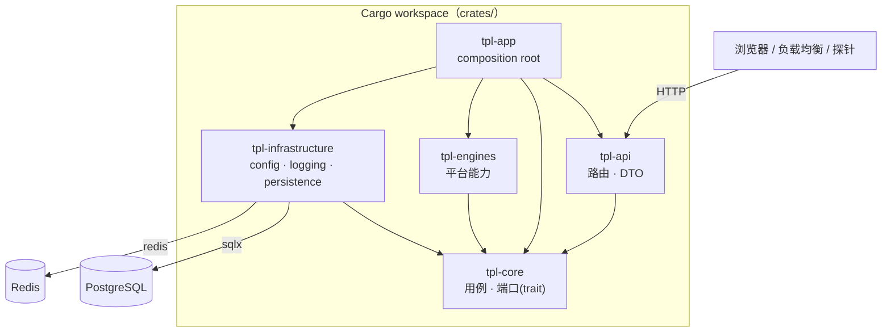

# 系统架构

本仓库遵循 **Clean Architecture 依赖方向 + 模块化单体** 的设计：一个仓库、一个部署单元（一个二进制），内部按层拆成多个 Cargo crate，层间边界有 Cargo 和守卫测试两道防线。模板刻意不内置业务域，业务模块由派生项目自行添加。

## 架构原则

- **依赖向内**：外层可以依赖内层，内层不能反向依赖外层。最内层是 `tpl-core`。
- **边界有两道防线**：依赖关系写在各 crate 的 `Cargo.toml`，没声明就无法 `use`（Cargo）；已声明的依赖由 `crates/app/tests/architecture.rs` 对照允许名单检查。只靠前者不够，因为违规依赖一旦写进 `Cargo.toml` 照样能编译。
- **端口与适配器**：core 只定义端口（trait）；基础设施与平台能力提供适配器（实现）；装配层把适配器接到用例上。
- **按职责分层**：按变化率和业务边界分层，而不是按技术栈堆目录。
- **可替换实现**：数据库、HTTP 客户端、日志、配置都在外层，core 只依赖接口。

## 分层

### `tpl-api`（`crates/api`）请求接入层

- 接收 HTTP（将来可有 WebSocket、CLI）请求
- 只做参数校验、DTO 转换、调用用例；不写业务规则
- 只依赖 `tpl-core`，因此碰不到数据库等具体实现
- 响应里不暴露内部错误细节，原因写日志

### `tpl-core`（`crates/core`）核心编排层

- 放置用例、领域规则和端口（trait）：`health`（健康检查）、`auth`（注册、登录、会话、退出，及其端口 `UserRepository` / `SessionStore` / `PasswordHasher`）
- 不依赖任何其他内部 crate，不依赖具体 SDK
- `auth::testing` 提供端口的内存替身（`testing` feature），让 core 与 api 的测试不连外部服务
- 公共签名里不出现 `sqlx::PgPool` 这类具体类型

### `tpl-engines`（`crates/engines`）平台能力层

- 放置可插拔的平台能力（检索、爬虫、OCR 等），实现 core 定义的端口
- 模板里是空的，由派生项目添加

### `tpl-infrastructure`（`crates/infrastructure`）基础设施层

- 配置（`config.rs`）、日志（`logging.rs`）、PostgreSQL（`persistence.rs`：连接池、迁移、用户仓储、管理员仓储）、Redis（`redis_session.rs`：按命名空间隔离的会话存储）、密码哈希（`password.rs`：argon2id）
- 实现 core 的端口，例如 `PostgresReadinessProbe` 实现 `ReadinessProbe`，`RedisSessionStore` 实现 `SessionStore`
- 不依赖 `tpl-api`、`tpl-engines`

### `tpl-app`（`crates/app`）装配层（composition root）

- `main.rs`：读配置 → 初始化日志 → 装配 → 启动 → 响应退出信号（薄薄一层）
- `lib.rs` + `composition.rs`：根据配置构建 `AppState`，把具体实现接到用例上。做成库是为了让集成测试复用**真实的装配代码**
- `shutdown.rs`：Ctrl+C / SIGTERM 优雅退出
- 唯一允许依赖全部各层的地方；不承载业务规则

## 模块关系图



## 一个请求怎么走：`GET /ready`

1. `tpl-api` 的 `ready` 处理器收到请求，调用 `HealthService::check_readiness()`（core 的用例）
2. 用例遍历注册的 `ReadinessProbe`（core 定义的端口）
3. 真正执行的是 `PostgresReadinessProbe`（infrastructure 的适配器）：对连接池执行 `SELECT 1`，带超时
4. 用例汇总成 `ReadinessReport`（core 的领域对象）返回
5. 处理器把报告转成 DTO：全部通过返回 200，否则 503；失败原因只写日志，响应里只有 `ok` / `fail`

处理器全程不知道 PostgreSQL 的存在；换成别的探针实现，api 与 core 一行不用改。这个探针是在 `tpl-app/composition.rs` 里接上的。

## 认证

端点：`POST /auth/register`、`POST /auth/login`、`POST /auth/logout`、`GET /auth/me`。需要 `DATABASE_URL` 和 `REDIS_URL` 同时配置；缺任何一个，`/auth/*` 返回 503（`auth_unavailable`），其余功能不受影响。

错误响应统一为 `{"error": {"code": "...", "message": "..."}}`：`invalid_email` / `password_too_short` / `password_too_long`（400）、`email_taken`（409）、`invalid_credentials` / `unauthenticated`（401）、`internal_error`（500，不含任何内部细节）。

安全上的取舍与理由：

| 关注点 | 做法 |
|---|---|
| 密码存储 | argon2id（PHC 字符串，带随机盐与参数），在 `spawn_blocking` 里计算，不卡异步运行时 |
| 密码长度 | 至少 8 个字符；最多 128 字节（哈希很耗 CPU，不设上限就是拒绝服务入口），超长密码登录时不进入哈希 |
| 用户枚举 | 「邮箱不存在」和「密码错误」返回同一个 401；用户不存在时也对一个**诱饵哈希**做一次校验，让耗时相近 |
| 会话令牌 | 256 位系统随机数；Redis 里的键是令牌的 **SHA-256**，Redis 数据泄露也拿不到可用的 Cookie |
| 会话撤销 | 退出会在服务端删除会话（不只是让浏览器删 Cookie）；再次登录会作废请求里带着的旧令牌（防会话固定） |
| Cookie | `HttpOnly`（JS 读不到）、`SameSite=Lax`、`Path=/`、`Max-Age` 与服务端有效期一致；`Secure` 由配置控制，**生产必须开启**，监听非本机地址却没开时启动会告警 |
| CSRF | `SameSite=Lax` + 写接口只接受 `application/json`（跨站表单发不出这种请求，跨站发 JSON 需要 CORS 预检，本服务不开放 CORS）。**将来开放 CORS 或增加表单接口时必须重新评估** |
| 登录限流 | 按 **IP**（默认 20 次失败/15 分钟，挡撞库）和按**账号**（默认 10 次/15 分钟，挡分布式猜密码）各计数；超限返回 `429 too_many_attempts` 并带 `Retry-After`，**此时即使密码正确也拒绝，且不进入哈希** |
| 限流不泄露账号是否存在 | 不存在的邮箱同样计数，所以存在与不存在的账号被限流的节奏和响应完全一致 |
| 登录成功不清零 IP 计数 | 只清零账号计数；否则攻击者拿自己的账号登录一次就能重置 IP 计数 |
| 注册限流 | 按 IP（默认 10 次/小时，成败都算——哈希本身就是开销），也限制了批量注册和靠 409 探测已注册邮箱 |
| 客户端 IP 的来源 | 默认只用 **TCP 对端地址**（客户端无法伪造）。`trust_forwarded_for=true` 时取 `X-Forwarded-For` **最右**的地址（你自己的代理追加的；左边的都是客户端写的，可伪造）；最右的值不是 IP 就退回对端地址。IPv6 按 /64 归并 |
| 计数存储 | Redis 固定窗口：`SET NX EX` + `INCR` 放在一个 MULTI/EXEC 事务里（拆开的话进程崩在中间会留下永不过期的键，等于永久封号）；键是逻辑键的 SHA-256，Redis 里看不到邮箱或 IP 明文；Redis 不可用时认证直接失败（fail-closed），不会悄悄放开限流 |
| 输入上限 | 请求体 16 KiB；Cookie 里的令牌超过 256 个字符直接视为无效 |
| 邮箱 | 去空白、转小写后保存；数据库有唯一约束（并发注册只有一个成功）和 `CHECK (email = lower(email))` 兜底 |
| 日志 | 请求体类型不派生 `Debug`；令牌、哈希、连接串的 `Debug` 输出都被隐藏；成功的注册/登录只记用户 ID |

**已知取舍**：按账号限流意味着别人可以故意连续输错来**暂时**锁住你的账号（窗口过后自动恢复）。这比无限次猜密码的风险小，是行业里常见的折中；如果不可接受，需要验证码或 IP 信誉等更重的手段。

**还没有做的**（见 `docs/migration-status.md`）：邮箱验证、找回密码、「登出所有设备」、会话列表。

**部署时必须注意**：

- 服务必须通过 `server::serve` 启动（`main` 已是如此）：处理器靠它拿到 TCP 对端地址，漏掉不会报错，只会让按 IP 的限流悄悄失效；`tests/http_end_to_end.rs` 里有走真实 socket 的测试守着，并已用「去掉对端地址则测试失败」验证过它守得住。
- 服务前面有反向代理时，对端地址永远是代理的地址：**不开 `trust_forwarded_for` 就会让所有用户共用同一个 IP 额度**；开了则必须保证外部无法绕过代理直连服务，且这层代理**必须覆盖写** `X-Forwarded-For`（只是透传的代理，比如 Next.js 的 rewrites，不满足）。

## 管理员与管理后台接口

管理员域在 `tpl-core::admin`，与普通用户域（`tpl-core::auth`）**完全隔离**，只共用端口与登录辅助（限流器、诱饵哈希、密码规则），安全逻辑不复制两份。

| 关注点 | 做法 |
|---|---|
| 账号来源 | 独立的 `admin_users` 表，登录标识是**用户名**；**没有注册入口**，唯一的创建途径是启动时的引导账号（`ADMIN_BOOTSTRAP_USERNAME` / `ADMIN_BOOTSTRAP_PASSWORD`）：已存在则不改动（不覆盖密码），多实例并发启动靠唯一约束只成功一个；凭据不合规则启动失败 |
| 不用「用户表加管理员标志」 | 普通账号或会话被攻破，拿不到任何管理权限 |
| 会话 | 独立 Cookie（`admin_session`，与 `session` 必须不同，可在同一浏览器并存）；Redis 键用独立命名空间（`admin_session:` / `session:`），两个域的令牌互相查不到，即使主体 ID 相同。默认有效期 12 小时（普通用户 7 天） |
| 限流 | 键前缀独立（`admin-login`），两个域的失败计数互不影响；默认上限更严（每 IP 10 次、每账号 5 次 / 15 分钟）；其余防护（诱饵哈希、不泄露账号存在、成功只清账号计数）与普通登录一致 |
| 停用立即生效 | 普通域每次校验会话都读取用户当前状态，所以**不需要撤销会话**：停用后已有登录态下一次请求即 401，登录得到专门的 `403 account_disabled`（只在密码正确之后才说「已停用」，不变成探测邮箱的手段）；启用后全部恢复，数据不删除 |
| CSRF | 同普通域：`SameSite=Lax` + 写接口只接受 `application/json`；没有请求体的写接口（`logout`/`enable`/`disable`）用 `RequireJson` 单独检查 `Content-Type`，否则 415 |
| 列表 | 页码与每页条数在服务里规整（每页默认 20、上限 100，页码最小 1）；邮箱关键字按字面子串、不区分大小写匹配（`%`、`_` 不当作通配符）；`status` 取值非法返回 400 |

端点：`POST /admin/auth/login`（`{identifier, password}`）、`POST /admin/auth/logout`、`GET /admin/auth/me`、`GET /admin/users`（`page`、`page_size`、`status`、`keyword`）、`GET /admin/users/{id}`、`POST /admin/users/{id}/enable`、`POST /admin/users/{id}/disable`。ID 一律是字符串。

数据库或 Redis 未配置时 `/admin/*` 返回 `503 admin_unavailable`；两者就绪但没有配置引导账号时，服务照常启动，只是没有任何管理员能登录（401）。

**已知取舍**：管理员只能靠环境变量创建，增删管理员或改密码需要运维操作；密码没有轮换机制，上生产前应结合部署平台的密钥管理。

## 前端如何接入

浏览器只和前台站点（`frontend-public`，Next.js）通信，`/api/*` 由 Next.js 的 rewrites 转发给后端：

```mermaid
sequenceDiagram
    participant B as 浏览器
    participant N as Next.js（前台站点）
    participant R as Rust 后端
    B->>N: POST /api/auth/login（同源，带 Cookie）
    N->>R: POST /auth/login（TCP 对端 = Next.js；X-Forwarded-For 原样透传，Next 不会追加）
    R-->>N: 200 + Set-Cookie: session=…; HttpOnly; SameSite=Lax
    N-->>B: 原样透传响应与 Set-Cookie
```

要点：

- **同源**：浏览器看到的始终是前台站点的域名，所以 Cookie 是第一方的，`SameSite=Lax` 与「写接口只收 JSON」这套 CSRF 防护成立；不需要开放 CORS。
- **后端地址在前端构建时固化**（`BACKEND_URL`，写进 `.next/routes-manifest.json`），运行时改环境变量无效。
- **Next.js 的 rewrite 代理不会追加 `X-Forwarded-For`**（已读 Next 源码并用真实部署验证：客户端发来的头原样透传）。所以后端看到的 TCP 对端是 Next.js，不是用户；不开 `trust_forwarded_for` 时所有用户共用一个 IP 额度，而**直接暴露 Next.js 再开 `trust_forwarded_for`，攻击者每次换一个伪造 IP 就能绕过按 IP 的限流**。正确做法是在前面放一层自己的 nginx 来**覆盖写**这个头并把 `/api/` 直接转给后端（`docker-compose.yml` 里的 `edge`、`deploy/edge.nginx.conf`），详见 `docs/guides/deployment.md`。`just web-dev` 的开发模式不开 `trust_forwarded_for`，不受影响。
- 前端按后端返回的**错误码**（不是文案）取翻译，所以提示语言跟随界面语言；契约细节见 `frontend-public/README.md`。

## 配置

- 优先级：代码默认值 < `config.toml` < 环境变量（`APP_<分区>__<字段>`，以及约定俗成的 `DATABASE_URL`、`REDIS_URL`）
- 本地开发的环境变量与密钥放 `.env.local`（启动时自动加载，不提交）
- 所有字段都有默认值：env 没填时配置加载也必须成功；未配置 `DATABASE_URL` / `REDIS_URL` 时不启用对应功能
- 含密码的类型手写 `Debug`，避免泄漏到日志

## 启动与运行

- **启动时**：配置了 `DATABASE_URL` 就会执行数据库迁移（见 `docs/ai-standards/migrations.md`），所以要求数据库启动时可达，否则以非 0 退出（快速失败，交给编排平台重启）
- **运行中**：PostgreSQL 连接池和 Redis 连接都是**惰性重连**的：依赖短暂不可用时进程不会退出，`/ready` 如实报告 503，依赖恢复后自动变回 200，不需要重启进程
- 探针：`/live`（进程存活，不查依赖）、`/health`（基本信息与版本）、`/ready`（依赖是否就绪）
- 收到 SIGTERM / Ctrl+C 后先停止接收新连接，等在途请求处理完再退出

## 部署

- 产物是一个二进制 `server`（`cargo build --release`）
- `Dockerfile` 多阶段构建：构建阶段编译，运行阶段只放二进制与 `config.toml`，非 root 用户运行
- 容器里通过 `APP_SERVER__HOST=0.0.0.0` 监听所有网卡；其余配置用环境变量注入

## 如何新增一项业务能力

1. 在 `tpl-core` 定义端口（trait）和用例，写单元测试（用替身实现端口）
2. 在 `tpl-infrastructure` 或 `tpl-engines` 实现端口
3. 在 `tpl-api` 加路由与 DTO，在 `crates/api/tests/` 加走完整路由的集成测试
4. 在 `tpl-app/composition.rs` 接线
5. 运行 `just ci`，再用真实进程做一次 `curl` 冒烟

## 与 Python 版模板的差异

- 层间边界由 Cargo 依赖图加一个 `cargo metadata` 守卫测试保证，不再需要 `check_architecture.py` 这类逐文件扫描 import 的脚本
- 依赖方向采用标准 Clean Architecture：所有外层依赖 core。Python 版规则写着「infrastructure 不得导入 core」，靠鸭子类型实现；Rust 的 trait 必须显式 `impl`，实现方必须依赖定义 trait 的 crate
- 数据库访问用 `sqlx`（SQL 直写、参数绑定），不用 ORM；用运行期检查的查询，不开编译期 `query!` 宏（理由见 `docs/ai-standards/migrations.md`）
- 管理后台与用户端是两套独立账号和会话（与 Python 版一致），但实现不同：管理员只能由启动时的环境变量创建，会话靠 Redis 键命名空间隔离，用户停用靠每次校验会话时读取状态而不是撤销会话
- 密码哈希用 argon2id（Python 版用 bcrypt）；会话存 Redis，键为令牌的 SHA-256
- 尚未迁移的部分见 [`docs/migration-status.md`](../migration-status.md)
