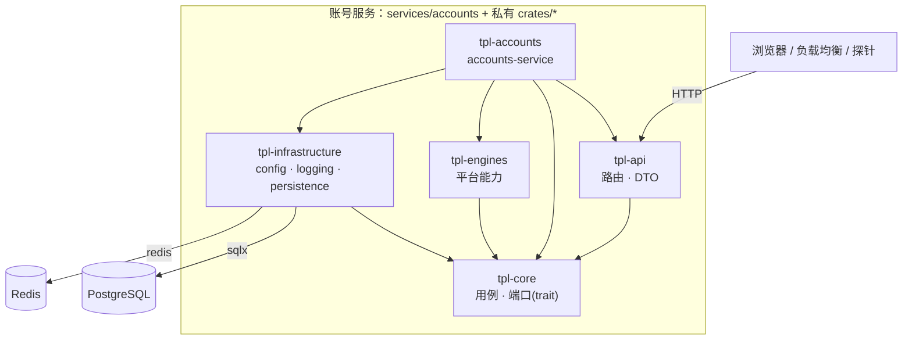

# 系统架构

本仓库提供一个可独立部署的 **账号业务服务**。当前发布的是一个业务服务，不代表已经拆出多个业务微服务。账号服务内部仍按 Clean Architecture 分层；下一项有独立数据归属和部署理由的业务模块应建立自己的服务入口和存储，不能依赖账号私有领域实现。

Cargo workspace 是单仓管理多个独立产物的方式：`services/accounts` 是账号服务 composition root；当前 `crates/*` 都是账号服务私有实现。前后端可经同源 nginx 路由接入账号服务。跨应用复用有两种部署选择：每个应用独立部署账号服务并配置自己的数据库/Redis；或明确选择共享同一账号域。当前没有 `tenant_id` / `app_id` 隔离，不能把共享实例视为彼此隔离的多租户账号系统。

## 架构原则

- **依赖向内**：外层可以依赖内层，内层不能反向依赖外层。最内层是 `tpl-core`。
- **账号服务内部边界有两道防线**：依赖写在 Cargo.toml 里，没声明就无法 `use`（Cargo）；已声明的依赖由 `services/accounts/tests/architecture.rs` 对照允许名单检查。后续业务服务不得依赖这些账号私有 crate。
- **端口与适配器**：core 只定义端口（trait）；基础设施与平台能力提供适配器（实现）；装配层把适配器接到用例上。
- **按职责分层**：按变化率和业务边界分层，而不是按技术栈堆目录。
- **可替换实现**：数据库、HTTP 客户端、日志、配置都在外层，core 只依赖接口。

## 分层

### 账号服务内部层

这些 crate 属于账号服务内部实现，不是跨业务模块的共享 SDK。

#### `tpl-api`（`crates/api`）请求接入层

- 接收 HTTP（将来可有 WebSocket、CLI）请求
- 只做参数校验、DTO 转换、调用用例；不写业务规则
- 只依赖 `tpl-core`，因此碰不到数据库等具体实现
- 响应里不暴露内部错误细节，原因写日志

#### `tpl-core`（`crates/core`）核心编排层

- 放置用例、领域规则和端口（trait）：`health`（健康检查）、`auth`（注册、登录、会话、退出，及其端口 `UserRepository` / `SessionStore` / `PasswordHasher`）
- 不依赖任何其他内部 crate，不依赖具体 SDK
- `auth::testing` 提供端口的内存替身（`testing` feature），让 core 与 api 的测试不连外部服务
- 公共签名里不出现 `sqlx::PgPool` 这类具体类型

#### `tpl-engines`（`crates/engines`）平台能力层

- 放置可插拔的平台能力（检索、爬虫、OCR 等），实现 core 定义的端口
- 模板里是空的，由派生项目添加

#### `tpl-infrastructure`（`crates/infrastructure`）基础设施层

- 配置（`config.rs`）、日志（`logging.rs`）、PostgreSQL（`persistence.rs`：连接池、迁移、用户仓储、管理员仓储）、Redis（`redis_session.rs`：按命名空间隔离的会话存储）、密码哈希（`password.rs`：argon2id）
- 实现 core 的端口，例如 `PostgresReadinessProbe` 实现 `ReadinessProbe`，`RedisSessionStore` 实现 `SessionStore`
- 不依赖 `tpl-api`、`tpl-engines`

### `tpl-accounts`（`services/accounts`）账号服务装配层（composition root）

- `main.rs`：读配置 → 初始化日志 → 装配 → 启动 → 响应退出信号（薄薄一层）
- `lib.rs` + `composition.rs`：根据配置构建 `AppState`，把具体实现接到用例上。做成库是为了让集成测试复用**真实的装配代码**
- `shutdown.rs`：Ctrl+C / SIGTERM 优雅退出
- 账号服务唯一允许依赖全部内部层的地方；不承载业务规则

## 模块关系图



## 一个请求怎么走：`GET /ready`

1. `tpl-api` 的 `ready` 处理器收到请求，调用 `HealthService::check_readiness()`（core 的用例）
2. 用例遍历注册的 `ReadinessProbe`（core 定义的端口）
3. 真正执行的是 `PostgresReadinessProbe`（infrastructure 的适配器）：对连接池执行 `SELECT 1`，带超时
4. 用例汇总成 `ReadinessReport`（core 的领域对象）返回
5. 处理器把报告转成 DTO：全部通过返回 200，否则 503；失败原因只写日志，响应里只有 `ok` / `fail`

处理器全程不知道 PostgreSQL 的存在；换成别的探针实现，api 与 core 一行不用改。这个探针是在 `services/accounts/src/composition.rs` 里接上的。

## 认证

端点：`POST /auth/register`、`POST /auth/login`、`POST /auth/logout`、`GET /auth/me`。需要 `DATABASE_URL` 和 `REDIS_URL` 同时配置；缺任何一个，`/auth/*` 返回 503（`auth_unavailable`），其余功能不受影响。

错误响应统一为 `{"error": {"code": "...", "message": "..."}}`：`invalid_email` / `password_too_short` / `password_too_long`（400）、`email_taken`（409）、`invalid_credentials` / `unauthenticated`（401）、`internal_error`（500，不含任何内部细节）。

安全上的取舍与理由：

| 关注点 | 做法 |
|---|---|
| 密码存储 | argon2id（PHC 字符串，带随机盐与参数），在 `spawn_blocking` 里计算，不卡异步运行时 |
| 密码长度 | 至少 8 个字符；最多 128 字节（哈希很耗 CPU，不设上限就是拒绝服务入口），超长密码登录时不进入哈希 |
| 用户枚举 | 「邮箱不存在」和「密码错误」返回同一个 401；用户不存在时也对一个**诱饵哈希**做一次校验，让耗时相近 |
| 会话令牌 | 256 位系统随机数；Redis 里的键是令牌的 **SHA-256**，Redis 数据泄露也拿不到可用的 Cookie |
| 会话撤销 | 退出会在服务端删除会话（不只是让浏览器删 Cookie）；再次登录会作废请求里带着的旧令牌（防会话固定） |
| Cookie | `HttpOnly`（JS 读不到）、`SameSite=Lax`、`Path=/`、`Max-Age` 与服务端有效期一致；`Secure` 由配置控制，**生产必须开启**，监听非本机地址却没开时启动会告警 |
| CSRF | `SameSite=Lax` + 写接口只接受 `application/json`（跨站表单发不出这种请求，跨站发 JSON 需要 CORS 预检，本服务不开放 CORS）。**将来开放 CORS 或增加表单接口时必须重新评估** |
| 登录限流 | 按 **IP**（默认 20 次失败/15 分钟，挡撞库）和按**账号**（默认 10 次/15 分钟，挡分布式猜密码）各计数；超限返回 `429 too_many_attempts` 并带 `Retry-After`，**此时即使密码正确也拒绝，且不进入哈希** |
| 限流不泄露账号是否存在 | 不存在的邮箱同样计数，所以存在与不存在的账号被限流的节奏和响应完全一致 |
| 登录成功不清零 IP 计数 | 只清零账号计数；否则攻击者拿自己的账号登录一次就能重置 IP 计数 |
| 注册限流 | 按 IP（默认 10 次/小时，成败都算——哈希本身就是开销），也限制了批量注册和靠 409 探测已注册邮箱 |
| 客户端 IP 的来源 | 默认只用 **TCP 对端地址**（客户端无法伪造）。`trust_forwarded_for=true` 时取 `X-Forwarded-For` **最右**的地址（你自己的代理追加的；左边的都是客户端写的，可伪造）；最右的值不是 IP 就退回对端地址。IPv6 按 /64 归并 |
| 计数存储 | Redis 固定窗口：`SET NX EX` + `INCR` 放在一个 MULTI/EXEC 事务里（拆开的话进程崩在中间会留下永不过期的键，等于永久封号）；键是逻辑键的 SHA-256，Redis 里看不到邮箱或 IP 明文；Redis 不可用时认证直接失败（fail-closed），不会悄悄放开限流 |
| 输入上限 | 请求体 16 KiB；Cookie 里的令牌超过 256 个字符直接视为无效 |
| 邮箱 | 去空白、转小写后保存；数据库有唯一约束（并发注册只有一个成功）和 `CHECK (email = lower(email))` 兜底 |
| 日志 | 请求体类型不派生 `Debug`；令牌、哈希、连接串的 `Debug` 输出都被隐藏；成功的注册/登录只记用户 ID |

**已知取舍**：按账号限流意味着别人可以故意连续输错来**暂时**锁住你的账号（窗口过后自动恢复）。这比无限次猜密码的风险小，是行业里常见的折中；如果不可接受，需要验证码或 IP 信誉等更重的手段。

**还没有做的**（见 `docs/migration-status.md`）：邮箱验证、找回密码、「登出所有设备」、会话列表。

**部署时必须注意**：

- 服务必须通过 `tpl_accounts::server::serve` 启动（`services/accounts/src/main.rs` 已是如此）：处理器靠它拿到 TCP 对端地址，漏掉不会报错，只会让按 IP 的限流悄悄失效；`services/accounts/tests/http_end_to_end.rs` 里有走真实 socket 的测试守着，并已用「去掉对端地址则测试失败」验证过它守得住。
- 服务前面有反向代理时，对端地址永远是代理的地址：**不开 `trust_forwarded_for` 就会让所有用户共用同一个 IP 额度**；开了则必须保证外部无法绕过代理直连服务，且这层代理**必须覆盖写** `X-Forwarded-For`（只是透传的代理，比如 Next.js 的 rewrites，不满足）。

## 管理员与管理后台接口

管理员域在 `tpl-core::admin`，与普通用户域（`tpl-core::auth`）**完全隔离**，只共用端口与登录辅助（限流器、诱饵哈希、密码规则），安全逻辑不复制两份。

| 关注点 | 做法 |
|---|---|
| 账号来源 | 独立的 `admin_users` 表，登录标识是**用户名**；**没有注册入口**，唯一的创建途径是启动时的引导账号（`ADMIN_BOOTSTRAP_USERNAME` / `ADMIN_BOOTSTRAP_PASSWORD`）：已存在则不改动（不覆盖密码），多实例并发启动靠唯一约束只成功一个；凭据不合规则启动失败 |
| 不用「用户表加管理员标志」 | 普通账号或会话被攻破，拿不到任何管理权限 |
| 会话 | 独立 Cookie（`admin_session`，与 `session` 必须不同，可在同一浏览器并存）；Redis 键用独立命名空间（`admin_session:` / `session:`），两个域的令牌互相查不到，即使主体 ID 相同。默认有效期 12 小时（普通用户 7 天） |
| 限流 | 键前缀独立（`admin-login`），两个域的失败计数互不影响；默认上限更严（每 IP 10 次、每账号 5 次 / 15 分钟）；其余防护（诱饵哈希、不泄露账号存在、成功只清账号计数）与普通登录一致 |
| 停用立即生效 | 普通域每次校验会话都读取用户当前状态，所以**不需要撤销会话**：停用后已有登录态下一次请求即 401，登录得到专门的 `403 account_disabled`（只在密码正确之后才说「已停用」，不变成探测邮箱的手段）；启用后全部恢复，数据不删除 |
| CSRF | 同普通域：`SameSite=Lax` + 写接口只接受 `application/json`；没有请求体的写接口（`logout`/`enable`/`disable`）用 `RequireJson` 单独检查 `Content-Type`，否则 415 |
| 列表 | 页码与每页条数在服务里规整（每页默认 20、上限 100，页码最小 1）；邮箱关键字按字面子串、不区分大小写匹配（`%`、`_` 不当作通配符）；`status` 取值非法返回 400 |

端点：`POST /admin/auth/login`（`{identifier, password}`）、`POST /admin/auth/logout`、`GET /admin/auth/me`、`GET /admin/users`（`page`、`page_size`、`status`、`keyword`）、`GET /admin/users/{id}`、`POST /admin/users/{id}/enable`、`POST /admin/users/{id}/disable`。ID 一律是字符串。

数据库或 Redis 未配置时 `/admin/*` 返回 `503 admin_unavailable`；两者就绪但没有配置引导账号时，服务照常启动，只是没有任何管理员能登录（401）。

**已知取舍**：管理员只能靠环境变量创建，增删管理员或改密码需要运维操作；密码没有轮换机制，上生产前应结合部署平台的密钥管理。

## 前端如何接入

完整部署中，浏览器与前台站点同源访问，nginx 网关把 `/api/*` 转给独立账号服务。Next.js dev rewrites 仅用于本地开发：

```mermaid
sequenceDiagram
    participant B as 浏览器
    participant N as nginx 网关
    participant W as Next.js（公开站点）
    participant A as accounts-service
    B->>N: POST /api/auth/login（同源，带 Cookie）
    N->>A: POST /auth/login（nginx 覆盖写 X-Forwarded-For）
    A-->>N: 200 + Set-Cookie: session=…; HttpOnly; SameSite=Lax
    N-->>B: 原样转发响应与 Set-Cookie
    N->>W: GET /login 等页面请求
    W-->>N: 页面响应
```

要点：

- **同源**：浏览器看到的始终是前台站点的域名，所以 Cookie 是第一方的，`SameSite=Lax` 与「写接口只收 JSON」这套 CSRF 防护成立；不需要开放 CORS。
- **公开站点后端地址在构建时固化**（保留的 `BACKEND_URL` 构建参数指向 accounts-service），运行时改环境变量无效。完整部署中由 `edge` 把 `/api/*` 直接转给账号服务；Next.js rewrite 仅供本地开发。
- **Next.js rewrite 不会追加 `X-Forwarded-For`**，所以独立开发模式必须关闭 `trust_forwarded_for`。完整部署中 nginx 网关覆盖写该头并把 `/api/` 转给账号服务；账号服务不对外发布端口，外部无法绕过网关，详见 `docs/guides/deployment.md`。
- 前端按后端返回的**错误码**（不是文案）取翻译，所以提示语言跟随界面语言；契约细节见 `frontend-public/README.md`。

身份边界与其他应用的接入方式见 [`docs/guides/accounts-integration.md`](../guides/accounts-integration.md)：其他业务后端可将原始会话 Cookie 转发给账号服务的 `/auth/me` 验证后使用返回的用户 ID；不得信任浏览器自报的用户 ID，也不得直接访问账号 Redis 或数据库。当前不提供 JWT/OIDC。

## 配置

- 优先级：代码默认值 < `config.toml` < 可选 Nacos TOML < 环境变量（`APP_<分区>__<字段>`，以及约定俗成的 `DATABASE_URL`、`REDIS_URL`）
- 本地开发可在 `.env.local` 配置 Nacos 连接参数；服务启动时读取 Nacos 配置，`.env.local` 本身不提交
- Nacos 用户名/密码或访问令牌只作为本地引导凭据留在 `.env.local` 或部署密钥管理，不放进被读取的 Nacos 配置
- 所有业务字段都有默认值：未启用 Nacos 且 env 没填时配置加载仍须成功；未配置 `DATABASE_URL` / `REDIS_URL` 时不启用对应功能
- 含密码的类型手写 `Debug`，避免泄漏到日志

## 启动与运行

- **启动时**：配置了 `DATABASE_URL` 就会执行账号服务自己的迁移（见 `docs/ai-standards/migrations.md`），所以要求数据库启动时可达，否则以非 0 退出（快速失败，交给编排平台重启）
- **运行中**：PostgreSQL 连接池和 Redis 连接都是**惰性重连**的：依赖短暂不可用时进程不会退出，`/ready` 如实报告 503，依赖恢复后自动变回 200，不需要重启进程
- 探针：`/live`（进程存活，不查依赖）、`/health`（基本信息与版本）、`/ready`（依赖是否就绪）
- 收到 SIGTERM / Ctrl+C 后先停止接收新连接，等在途请求处理完再退出

## 部署

- 产物是一个二进制 `accounts-service`（`cargo build --release -p tpl-accounts --bin accounts-service`）
- `Dockerfile` 多阶段构建：构建阶段编译，运行阶段只放二进制与 `config.toml`，非 root 用户运行
- 容器里通过 `APP_SERVER__HOST=0.0.0.0` 监听所有网卡；其余配置用环境变量注入

## 如何新增一项账号服务内能力

1. 在 `tpl-core` 定义端口（trait）和用例，写单元测试（用替身实现端口）
2. 在 `tpl-infrastructure` 或 `tpl-engines` 实现端口
3. 在 `tpl-api` 加路由与 DTO，在 `crates/api/tests/` 加走完整路由的集成测试
4. 在 `services/accounts/src/composition.rs` 接线
5. 运行 `just ci`，再用真实进程做一次 `curl` 冒烟

新的业务模块不属于账号域时，建立独立服务目录、二进制、迁移和部署配置。不要依赖本节列出的账号私有 crate。共用身份时通过同源网关调用账号公开 API，并确认应用确实需要共享同一个账号集合；这不提供 tenant/app 隔离。

## 与 Python 版模板的差异

- 层间边界由 Cargo 依赖图加一个 `cargo metadata` 守卫测试保证，不再需要 `check_architecture.py` 这类逐文件扫描 import 的脚本
- 依赖方向采用标准 Clean Architecture：所有外层依赖 core。Python 版规则写着「infrastructure 不得导入 core」，靠鸭子类型实现；Rust 的 trait 必须显式 `impl`，实现方必须依赖定义 trait 的 crate
- 数据库访问用 `sqlx`（SQL 直写、参数绑定），不用 ORM；用运行期检查的查询，不开编译期 `query!` 宏（理由见 `docs/ai-standards/migrations.md`）
- 管理后台与用户端是两套独立账号和会话（与 Python 版一致），但实现不同：管理员只能由启动时的环境变量创建，会话靠 Redis 键命名空间隔离，用户停用靠每次校验会话时读取状态而不是撤销会话
- 密码哈希用 argon2id（Python 版用 bcrypt）；会话存 Redis，键为令牌的 SHA-256
- 尚未迁移的部分见 [`docs/migration-status.md`](../migration-status.md)
