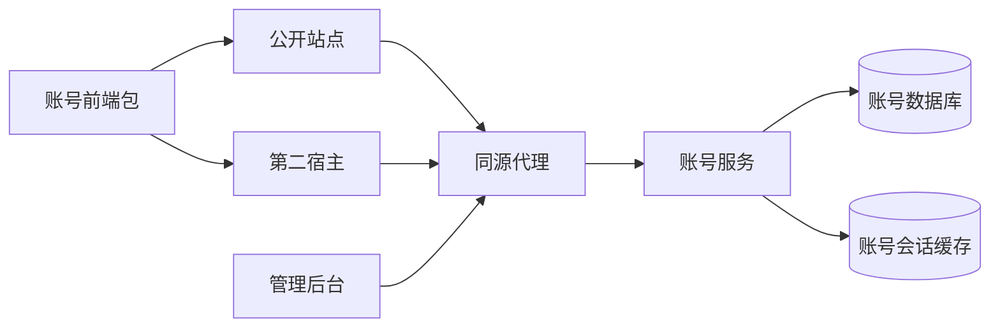

# PRD: 可独立部署与跨应用复用的账号模块

> ✅ **交付前置**：无，可立即开工。投影自 §8。
> 🧍 **验收状态**：待人工验收。投影自 §9。

## Feature Overview (功能一览)

- FR-1：账号能力独立启动、部署并拥有数据。
- FR-2：公开认证页面与客户端打包供不同应用接入。
- FR-3：现有用户与管理员行为、安全隔离保持兼容。
- FR-4：第二宿主通过实际包产物接入，提供真实验证与使用指南。

# Part A · 人审层 (Review Layer)

## 1. Introduction & Goals

### Problem Statement

目前公开站点的登录表单依赖本应用的路由、翻译和组件，其他应用无法直接安装使用；后端只有一个启动入口，账号能力没有明确的独立部署身份。用户已明确选择先抽现有账号与认证，并授权执行。

### Interpretation (解读回显)

| 验证方式 | 输入 / 操作 | 期望观察到的结果 |
|---|---|---|
| 👀 人审 + 自动验证 | 在公开站点及第二个应用注册并登录 | 两个应用使用同一份账号页面包，均能登录并读取自己的当前用户 |
| 🤖 自动验证 | 单独启动账号服务及它的数据依赖 | 无需启动公开站点或后台即可完成认证请求 |
| 🤖 自动验证 | 普通用户会话访问管理员能力 | 被拒绝，普通用户与管理员身份仍隔离 |
| 🤖 自动验证 | 账号服务依赖不可用或登录凭据错误 | 返回原有不可用或认证失败语义，不绕过验证 |

**我默默定了这些**

- 账号服务拥有普通账号、管理员账号及用户管理，避免让管理员跨服务直连用户表。
- 前端复用先覆盖普通用户注册与登录，管理员界面继续独立。
- 第二个应用是最小集成示例，通过实际打包产物安装。

**我理解为不做**

- 本轮不创建训练或运行追踪业务；尚无对应需求与实现。
- 不新增单点登录协议、多租户、跨域共享 Cookie 或多租户数据模型。

本次交付一个真实可独立部署的账号业务服务及可跨应用安装的认证页面包。不同应用默认拥有各自的浏览器会话，其他业务模块通过公开接口使用账号能力，不直接访问其数据库或会话缓存。

### What The User Gets

接入新应用时，可以安装账号页面包并配置服务地址、语言和导航行为，继续使用现有认证能力，无需复制登录业务。

### Measurable Objectives

- 两个独立前端宿主均能通过真实账号服务完成注册、登录、当前用户查询和退出。
- 管理员与普通用户的会话隔离、用户停用和错误契约保持原有行为。
- 无前端进程时账号服务可独立启动并提供就绪探针。

## 2. Human Review Map (介入与风险地图)

### 决策：先整体抽出账号能力

推荐账号服务统一拥有账号、认证和管理员用户管理，保持既有安全边界。当前只有一个业务服务，作为后续业务模块的独立接入基础，不宣称已经具备多个业务微服务。

**请确认：** 两个应用安装同一份认证页面包、接入独立账号服务，是否满足这次模块复用目标？用户已批准实施，最终效果待交付后审阅。

**验收：** 在公开站点与第二个应用都能看到真实认证页面并完成登录。

### 自动门禁，不需要逐项人工审阅

独立服务启动、数据迁移、管理员隔离、限流、错误语义、构建和旧入口引用由真实测试及审查核对。

### 本次明确不涉及

不改数据库实体与字段，不合并用户与管理员身份，不引入跨服务事务、消息队列或新业务模块。

## 3. Usage And Impact After Implementation

普通用户继续从现有站点注册登录，页面入口与认证结果保持兼容。管理员继续从管理后台登录并管理用户，停用立即生效。运维可以独立启动账号服务及依赖，也可启动完整站点。接入开发者安装认证页面包，传入接口入口和导航、文案等适配；其余业务服务通过账号公开 API 获取当前用户，不共享账号数据库。

## 4. Requirement Shape

- Actor: 普通用户、管理员、运维、应用接入开发者。
- Trigger: 新应用接入账号能力，或运行现有应用。
- Expected behavior: 账号服务独立运行；认证前端通过版本化包复用；现有行为兼容。
- Scope boundary: 单一账号业务服务、普通认证前端包、第二宿主和必要部署工具。

# Part B · 执行器层 (Build Layer)

## 5. Repository Context And Architecture Fit

- Existing path: `crates/app/src/composition.rs` 装配 auth/admin；`frontend-public` 内部表单及 API 客户端。
- Reuse candidates: 现有 api/core/infrastructure/engines、认证表单、HTTP 客户端和 e2e。
- Architecture: 账户服务内保留依赖向内；新业务服务不得依赖账号领域及存储实现。
- Frontend impact: 公开站点注册/登录页面采用共享包；管理后台仅适配服务部署地址；新增独立 React 示例宿主。
- Existing PRD relationship: pending 无待执行 PRD；archive 管理后台 PRD 为既有行为参考，无排期依赖。
- Redundancy risks: 禁止复制登录逻辑到第二宿主，禁止为拆分复制数据库访问或密码校验。

## 6. Recommendation

### Recommended Approach

把 composition root 迁移到 `services/accounts`，命名 `tpl-accounts` / `accounts-service`，保留现有分层 crate 为账号内部库；迁移归属账号服务。已有 nginx 负责入口路由。前端包独立构建、npm pack，两个宿主通过配置适配。

### Proposed Solution Summary (实现机制)

后端服务独占 PostgreSQL 的账号表与 Redis 会话；公开及后台代理保持既有外部 API。公开前端从 `packages/accounts-ui` 消费组件/客户端，注入 API base、文案及事件回调，组件不依赖 Next.js。`examples/accounts-host` 安装真实 tarball，运行时同源代理到账号服务。同步 Docker、just、CI、备份恢复、模板复制和文档。现有数据库迁移内容/校验和保持不变。

ROI：复用现有业务和 nginx，不新增网关程序、消息基础设施或服务发现；首次投入通过两个宿主验证复用边界。

## 7. Implementation Guide

This section is a living implementation guide based on current repository analysis. If implementation discovers additional affected files, hidden dependencies, edge cases, or a better path, update this PRD before proceeding.

### 7.1 Core Logic

后端移入口不重写业务规则；身份解析和错误码保持单点。前端以配置和回调代替宿主 import。构建发现 Google 字体下载不稳定后，公开站点改为同款真实 Geist 本地字体并保留来源与许可证；Docker 安装使用缓存和有限重试，避免联网字体与重复依赖下载阻塞可复现构建。独立服务必须可单独运行，普通账号与管理员分表、Cookie、namespace、限流前缀保持隔离。

### 7.2 Change Impact Tree

```text
.
├── services/accounts/ [新增/移动] 【总结】独立账号服务入口、集成测试与迁移所有权
├── crates/ [修改] 【总结】账号内部层文档与迁移路径，维持依赖方向
├── Cargo.toml [修改] 【总结】登记独立服务 workspace 成员
├── Dockerfile [修改] 【总结】构建 accounts-service，提供服务独立镜像
├── docker-compose.yml [修改] 【总结】accounts 部署与现有网关、数据依赖接线
├── justfile [修改] 【总结】独立启动与验证入口
├── scripts/ [修改] 【总结】备份恢复、端到端及部署探针适配新服务
├── .github/workflows/ [修改] 【总结】构建发布与校验新路径
├── packages/accounts-ui/ [新增] 【总结】可配置公开账号页面与 API 客户端
├── frontend-public/ [修改] 【总结】现有登录注册路由消费共享包，保留导航翻译；Geist 字体本地化并保留许可证，使用专属 Docker ignore
├── frontend-admin/ [修改] 【总结】必要的服务地址接入，保留管理员 UI
├── examples/accounts-host/ [新增] 【总结】第二宿主安装真实包产物并接入账号服务
└── docs/ [修改] 【总结】架构规范、部署、配置与模块接入指南
```

### 7.3 Executor Drift Guard

- `rg -n 'tpl-app|crates/app|target/.*/server' crates services scripts .github justfile Dockerfile README.md docs`：活动引用应消除；历史 PRD 不改。
- `rg -n 'accounts-service|tpl-accounts' services scripts .github justfile Dockerfile`：目标启动、构建与测试入口齐全。
- `rg -n 'migrate!|migrations/' crates services scripts .github Dockerfile justfile`：归属一致，迁移不丢失。

### Risk Classification Register

| 变更 | 等级及理由 | 干预与判别门禁 |
|---|---|---|
| 服务入口、迁移、代理 | R3：部署和身份安全边界 | 保持数据模型；rv-1、rv-2 |
| 可复用 UI 与包消费 | R2：跨宿主认证流程 | npm pack 真安装；rv-1 |
| 文档、名称、同款字体本地化与构建接线 | R1：可逆且不改变业务规则 | rv-3 |

### 7.4 Flow Or Architecture Diagram



### 7.5 ER Diagram

No data model changes in this PRD.

### 7.6 Realistic Validation Plan

```yaml
- id: rv-1
  behavior: 在公开站点及第二个应用注册并登录
  reviewer: human
  real_entry: "just web-e2e；第二宿主通过 npm pack 安装后运行真实浏览器认证流程"
  expected: "两个应用使用同一份账号页面包，均能登录并读取自己的当前用户"
  mock_boundary: "不模拟包安装、浏览器、代理、认证API、PostgreSQL或Redis"
  tier: R3
  test_layer: e2e
  required_for_acceptance: true
  presentation: "tasks/evidence/P1-ARCH-20261029-120000-reusable-accounts-service/human-review-checklist.md 与真实截图"
  critical_value_source: "在浏览器表单输入唯一邮箱，由真实注册及登录响应产生用户ID/Cookie"
  must_cross: "tarball安装 -> 宿主表单 -> 同源代理 -> accounts-service -> PostgreSQL提交与Redis会话 -> 新HTTP请求"
  forbidden_bypasses: "禁止复制模块源码到第二宿主、模拟认证成功或直调Rust用例"
  fresh_state_probe: "注册后由新的当前用户请求读取邮箱与ID，退出后重新查询返回401"
  final_tree_evidence: "记录最终代码清单哈希与验证日志；认证包/代理/API改动后重新采集"
  negative_control: "错误密码应失败；在测试宿主代理边界停止账号服务时登录应失败，不修改生产代码"
  expected_fail: "无法登录、无当前用户；绝不产生成功会话"
- id: rv-2
  behavior: 单独启动账号服务及它的数据依赖，并保持身份隔离与失败语义
  reviewer: verifier
  real_entry: "just accounts-up；just test real；just stack-smoke"
  expected: "无公开站点或后台也能完成认证；普通会话不能访问管理员；依赖不可用返回原有失败语义"
  mock_boundary: "真实进程、HTTP、PostgreSQL和Redis；不使用内存身份替身"
  tier: R3
  test_layer: smoke
  required_for_acceptance: true
  critical_value_source: "真实注册/登录返回的ID与Cookie，以及实际容器状态"
  must_cross: "独立服务启动 -> 迁移 -> HTTP API -> 数据提交 -> 新请求查询"
  forbidden_bypasses: "不运行旧server入口、不直连数据库作为API认证结果、不合并admin/user会话"
  fresh_state_probe: "新客户端携带普通Cookie请求admin API被拒绝；新请求读取用户停用状态"
  final_tree_evidence: "最终服务与部署文件哈希、真实测试日志；路径/配置更改后重跑"
  negative_control: "对admin API仅发送普通用户Cookie应返回401；停止数据库后ready应503"
  expected_fail: "拒绝普通身份访问admin，依赖失败时不就绪"
- id: rv-3
  behavior: 构建与活动文档使用新服务入口
  reviewer: verifier
  real_entry: "just ci；just web-check；just web-admin-check；Docker构建；第二宿主构建"
  expected: "相关构建与测试通过，旧启动入口引用被移除，包可从tarball安装"
  mock_boundary: "不模拟编译与依赖解析"
  tier: R1
  test_layer: integration
  required_for_acceptance: true
```

失败先检查 package artifact、同源代理、服务配置和迁移路径；缺服务不能用替身宣称通过。

### 7.7 Prototype Waiver

公开站点为模块提取，保留现有页面布局与交互，以现有页面作为视觉基准；同款字体改本地加载并同步架构说明文案，不新增产品布局设计，因此豁免新增原型图。第二宿主为开发者集成示例，仅展示包的真实页面。

### 7.8 Interactive Prototype Change Log

No interactive prototype file changes in this PRD.

### 7.9 External Validation

No external validation required; repository evidence was sufficient.

## 8. Delivery Dependencies

- Depends on tasks/issues:
  - none
- Gate type: none
- Sequence: via-main
- Notes: 用户已选择账号认证模块并授权 Luna 执行；实现和本地审阅，不自动提交或发布。

## 9. Acceptance Checklist

### 9.1 人读呈递区（Human Review Surface）

| # | 你要看什么 | 呈递物 | 想自己复核？ |
|---|---|---|---|
| 1 | 两个应用安装同一账号包且完成认证 | `just prd review P1-ARCH-20261029-120000-reusable-accounts-service.md`，打开本地审阅页 | 查看公开站点 Workspace 和第二宿主 Signed in 下的邮箱；退出及错误密码会话由自动断言证明 |


两图均为 real user flow。本地图片，GitHub 上不显示。仓库根目录执行：

```bash
open tasks/evidence/P1-ARCH-20261029-120000-reusable-accounts-service/human-review-checklist.html
```

以下项不需要你看：rv-2 独立服务/身份安全、rv-3 构建与文档，由执行器及独立审查验证。

### 9.2 Acceptance Evidence Package

- rv-1：统一浏览器日志 `web-e2e.log`（20/20 公开、33/33 后台、7 项第二宿主）；后续导航修订的 `accounts-host-popstate-e2e.log` 9 项通过；两张最终截图见 §9.1。
- rv-2：`just-test-real.log` 15 个真实测试、`accounts-container-http.log`、`stack-smoke.log` 全通过；`readiness-failure-control.log` 200→503 无内部原因→200。
- rv-3：`just-ci.log`、`frontend-validation.md`、Docker 镜像输入清单与页面 smoke 全通过；静态检查和活动旧路径搜索通过。
- 独立审查：`tasks/evidence/P1-ARCH-20261029-120000-reusable-accounts-service/verifier-report.md`，approved、findings=[]。
- 最终源码清单 SHA256：`2278f2bab59fea60454a550fb4852ca055a031d79581ca7a5f362d5c9aecf040`（351 文件，排除 tasks）；详细导航与限制见 `tasks/evidence/P1-ARCH-20261029-120000-reusable-accounts-service/evidence-report.md`。
- 预测风险与最终风险一致；发现并修复宿主退出/历史导航、Corepack 目录、Docker ignore 与 Google 字体构建依赖，均已回填本 PRD。数据模型和 HTTP 契约未变，无新增故障注入。

### Human-Confirmed

- [ ] 两个应用安装同一份认证页面包、接入独立账号服务，满足本轮复用目标（§2，rv-1）。

### Architecture Acceptance

- [x] 账号服务可独立启动且拥有迁移，普通账号/admin仍隔离（rv-2）。
- [x] 账号内部库依赖向内，前端包不依赖Next宿主（rv-3）。

### Behavior Acceptance

- [x] 注册、登录、退出、停用、限流、错误及管理员行为兼容（rv-1/rv-2）。

### Frontend Acceptance

- [x] 公开站点消费共享包，第二宿主从tarball安装并完成真实认证（rv-1）。

### Documentation Acceptance

- [x] 架构、配置、部署、迁移和模块接入指南一致；活动旧入口引用清除（rv-3）。

### Validation Acceptance

- [x] just ci、前端检查、Docker构建通过（rv-3）。
- [x] 真实PostgreSQL/Redis和浏览器流程通过，记录ID/Cookie来源、代理链、新请求后置状态（rv-1/rv-2）。
- [x] 最终树标识及独立审查结论记录到证据包。

### Delivery Readiness

- [x] 实施完整且无未披露回归阻塞；审阅入口可打开、截图和报告已呈递。

## 10. Functional Requirements

- FR-1: 账号服务独立启动部署并拥有全部账号数据和迁移。
- FR-2: 公开认证UI与客户端独立打包，API地址、文案和导航行为由宿主提供。
- FR-3: 现有API契约及普通用户/admin身份隔离、限流、停用行为保持兼容。
- FR-4: 第二宿主安装真实包产物并通过真实服务验证；提供独立部署、包接入和升级文档。

## 11. Non-Goals

训练/追踪业务、多个业务服务、SSO/OIDC、多租户模型、跨域共享Cookie、消息队列、独立admin数据服务与自动发布不在本轮。

## 12. Risks And Follow-Ups

npm包的样式与SSR兼容、Docker构建上下文和历史路径引用可能遗漏；以公开站点生产构建、tarball第二宿主及完整部署验证发现问题。当前一个业务服务不等于多业务微服务全套平台。跨域集成需自行评估Cookie/CORS/CSRF，本轮推荐同源反代。

## 13. Decision Log

| # | 决策问题 | 选择 | 放弃的方案 | 理由 |
|---|---|---|---|---|
| D-01 | 首个业务域 | 用户已选择账号认证 | 未定义的training/tracing模块 | 使用仓库真实业务 |
| D-02 | 管理员数据访问 | 与账号同一服务 | admin独立服务直连账号库 | 保持数据所有权和身份隔离 |
| D-03 | 前端复用 | 版本化npm包及真实tarball宿主 | 复制表单或远程微前端运行时 | 简单且可验证复用 |

### Final Reconciliation

- Interpretation: confirmed — 已交付首个可独立部署的账号服务、公开认证包与真实第二宿主，未虚构多个业务服务。
- Public behavior and contracts: confirmed — HTTP 契约及用户/admin隔离保持；部署入口改为 accounts-service，旧部署升级方式已写指南。
- Related PRD status: confirmed — 无 pending 依赖，既有管理员归档PRD仅作兼容参考。
- Requirements and risks: confirmed — FR-1 至 FR-4 有真实入口证据，独立审查通过；共享实例无租户隔离、包未发布等限制已明示。
- Reconciled differences: 字体本地化、Corepack 调用目录、截图输出路径和宿主历史导航修订已纳入实现指南；数据库迁移逐字节不变。

### Change Log

- 2026-10-29：根据用户明确选项创建计划，Luna分别负责后端及前端实现。
- 2026-10-29：实际构建发现 Google 字体、Corepack 项目目录和 Docker context 依赖，已纳入实现指南；第二宿主退出模式与后退导航按真实浏览器反馈修正。

- 2026-10-29：全部实现与本地真实验证完成，独立审查 approved；归档为待人工验收，未替用户勾选。
