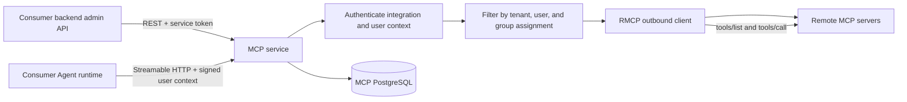
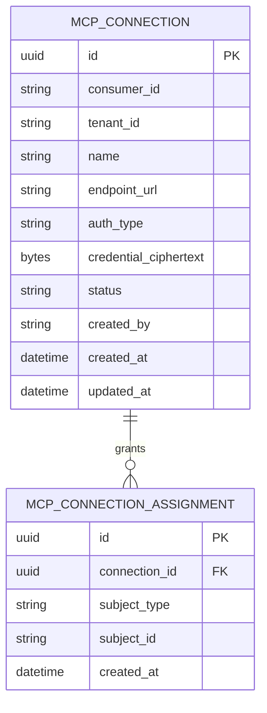

# PRD: MCP Gateway 微服务

- GitHub Issue: https://github.com/ZataZhang/zata-code-template-rust/issues/4
- lifecycle_agents:
  - review: codex

> ✅ **交付前置**：无，可立即开工。  
> 结构化声明见 §8 Delivery Dependencies，那里是唯一事实源。

> 🧍 **验收状态**：待人工验收。  
> 本行是 §9 Acceptance Checklist 的投影，归档前按实际证据更新。

> 本 PRD 分为两层：Part A 供需求方确认行为和产品范围；Part B 为实现者提供架构、接口和验证细节。

## Feature Overview (功能一览)

- **独立的 MCP 连接管理**（FR-1、FR-6）：不同消费服务与租户的连接彼此隔离。
- **凭据写入但不可读**（FR-2）：远端密钥加密保存，管理响应不返回明文。
- **通过 MCP 接口调用获准工具**（FR-3、FR-4）：工具发现和调用都按当前租户、用户及分组授权过滤。
- **安全连接远端服务器**（FR-5）：拒绝内部网络目标、云元数据地址和不安全重定向。
- **可独立运行与接入**（FR-6）：服务拥有自己的数据库、迁移、镜像、健康探针和公开接口。

# Part A · 人审层 (Review Layer)

## 1. Introduction & Goals

### Problem Statement

ai-assistant 已有远程 MCP 连接管理、凭据加密、工具发现和授权过滤；这些能力与该应用自己的组织、用户和权限模型绑定。rust-study 目前没有 MCP 服务，其他项目不能通过稳定的独立服务契约复用这套管理和调用能力。用户希望把它沉淀为可单独部署、供多个项目调用的 Rust 微服务。

### Interpretation (解读回显)

我把需求理解为：只在 rust-study 新增一个独立 Rust MCP 服务，保存和管理远端 MCP 连接，在标准 MCP HTTP 接口上向受信任的消费服务提供获准工具。这个首期服务不修改 FreshAI 或 ai-assistant，也不假设它们共享 rust-study 的账号数据库。

| 验证方式    | 输入 / 操作                            | 期望观察到的结果                                  |
| ------- | ---------------------------------- | ----------------------------------------- |
| 🤖 自动验证 | 消费服务的管理员创建一个远端 MCP 连接并提交 Bearer 凭据 | 连接创建成功；响应只报告凭据已配置，不返回凭据值                  |
| 🤖 自动验证 | 已获授权的用户请求工具列表并调用其中一个工具             | 只显示该用户或其所属分组获准使用的工具；调用结果来自对应远端 MCP server |
| 🤖 自动验证 | 同一租户中未获授权的用户尝试列举或调用该工具             | 工具不会进入列表；直接调用也被拒绝                         |
| 🤖 自动验证 | 管理员登记指向云元数据或本机内部网络的远端地址            | 请求被拒绝，服务不向该地址发出连接                         |
| 🤖 自动验证 | 一台远端 server 不可用，但同一租户还有其他可用连接      | 不可用连接不提供工具，其他连接仍可发现和调用                    |

表中有效行为会成为验收 oracle；如果某个输入或结果不符合你的预期，修改该单元格就会同时修改验收标准。

**我默默定了这些**

- 复用面是远端 Streamable HTTP MCP server；不让网页配置本地进程命令。
- 消费项目继续负责登录和前端；MCP 服务校验受信任消费服务及其签发的短时用户上下文。
- 第一期提供管理与网关 API，不迁移现有应用数据，也不建设目录市场或用户界面。

**我理解为不做**

- 不把 MCP server 的脚本、凭据或历史连接从 ai-assistant 自动搬进新服务。
- 不在 FreshAI、ai-assistant 或 rust-study 前端中接入这项服务。
- 不提供任意本机命令、旧式 HTTP+SSE 传输、MCP prompts/resources 代理或公开的 MCP 市场。

我理解为：交付对象是可独立部署的共享后端能力，由消费项目服务端在完成自己的用户认证后调用；连接、密钥和用户/分组授权由 MCP 服务集中保存与执行。它支持标准远端 MCP 工具的发现和调用，并在列表与调用两个入口都执行授权。它不是现成的 FreshAI 用户功能，不会替消费项目实现登录界面，也不会在本期提供可浏览和安装的公开市场。

**实现前确认：** 请直接在本 PRD 中确认；如需调整，先改行为样例和范围文字再勾选。

- [x] 我确认这段解读与行为样例准确表达了我的需求。

### What The User Gets

消费项目能通过单独的 Rust 服务登记远端 MCP server、查看工具、授予用户或分组访问权限，并在 Agent 运行时以标准 MCP 接口调用这些工具。凭据留在服务端，不需要复制到每个 Agent Runtime 或浏览器。

### Measurable Objectives

- 可分别登记至少两个消费服务、两个租户的连接；跨消费服务或租户的读取和调用无法越界。
- 管理响应不包含凭据明文；数据库中保存的是认证加密后的密文。
- MCP tools/list 只列出当前授权主体可使用的工具；tools/call 会再次验证授权。
- 对不安全目标的检查和连接均 fail-closed。
- MCP 服务可用独立进程、数据库和镜像启动，消费项目无需依赖其私有 Rust crate。

## 2. Human Review Map (介入与风险地图)

### 决策一：消费项目怎样把已验证的用户身份交给 MCP 服务

建议由消费项目的后端使用专属服务凭据，并为每个请求签发短时、带租户和用户标识的签名上下文。MCP 服务不读取 rust-study 或消费项目的用户数据库，也不接受浏览器自报的用户 ID。这样一个已完成用户认证的项目才能调用服务，同时服务仍可按用户和分组授权。代价是每个消费服务都要安全保管一把签名密钥；如果消费服务本身失陷，它可以替自己的用户签发上下文。

另一种做法是让 MCP 服务直接调用 rust-study accounts 验证 Cookie。它可以复用本仓库 Agent 的身份模式，但会让 ai-assistant 等消费项目依赖 rust-study 的账号契约，削弱服务复用性。

**请确认：** 是否按建议让消费服务签发短时用户上下文，并由 MCP 服务验证消费服务身份与签名？

**实现前选择：**

- [x] 推荐：消费服务 Bearer 凭据 + 短时签名用户上下文；不耦合具体账号服务
- [ ] 替代：MCP 服务直接通过 rust-study accounts 验证用户 Cookie

**验收：** 已登录且获准的用户可以使用被授权工具；未授权用户、伪造用户上下文或其他租户不能列出或调用工具。数据表仅保存消费服务和租户的外部 ID，不建立跨服务外键。数据模型见 Part B §7 的 ER 图。

### 决策二：首期服务是否包含 MCP 市场目录与管理界面

建议本期交付连接管理 API、工具发现和 MCP 网关，不建设市场目录、精选服务器列表或管理 UI。当前代码没有一个可复用的 MCP 市场数据源或跨项目统一的上架/审核规则；先把连接、授权和调用做成独立服务，可由多个消费项目各自集成。若这期一并加入市场和 UI，会增加目录内容治理及用户界面，但并不会由服务边界自动解决。

**请确认：** 首期是否按建议聚焦后端连接管理与 MCP 网关，市场目录和 UI 留待明确市场数据源与使用方后另行规划？

**实现前选择：**

- [x] 推荐：本期仅提供连接管理、工具发现、授权和 MCP 网关 API；不改任何前端
- [ ] 替代：本期同时增加可供管理员浏览和维护的 MCP 市场目录与管理 UI

**验收：** API 文档与实现清楚说明首期管理的是消费服务自行提供的远端 endpoint；不声称存在公开目录、精选列表或前端安装流程。

### 自动门禁，不需要逐项人工审阅

- 运行时代码只依赖新 MCP 服务自己的 crate；租户隔离、连接授权、凭据保护和地址校验由真实 HTTP / MCP 流程测试守护。
- 迁移、Docker 镜像和健康探针通过真实 PostgreSQL、独立服务启动及镜像构建检查。
- 工具冲突以稳定连接前缀区分；单个远端故障不阻塞其他连接。

### 本次明确不涉及

不在消费者应用实现登录、用户管理、市场 UI 或迁移；本服务仍会新增自己的 MCP 连接数据库并建立服务鉴权、出站网络和凭据存储边界。

## 3. Usage And Impact After Implementation

### 消费项目的后端开发者

在服务端为该项目配置专属凭据和用户上下文签名密钥。用户完成消费项目自己的认证后，后端以受信任身份连接 MCP 服务，并附带短时签名上下文。该集成只需要访问公开 HTTP/MCP 契约，不依赖 MCP 服务内部 Rust crate。FreshAI 与 ai-assistant 的接入不在本 PRD 内。

### 消费项目的管理员

通过消费项目后端调用管理 API，按租户创建远端 MCP 连接、设置或轮换凭据、检查可发现工具，并把连接授权给用户或分组。本 PRD 不增加管理页面；调用方需要在现有可信后端中提供代理入口或运维接口。

### rust-study 服务运营者

独立部署 MCP 服务和其 PostgreSQL 数据库，提供消费服务凭据、用户上下文签名密钥及凭据加密主密钥。通过 /live、/ready 和结构化日志查看服务状态；日志不包含密钥、用户工具参数或工具结果。

### Impact On Existing Behavior

- 现有 FreshAI、ai-assistant、Agent、accounts 和 Agent tracing 的接口与数据不变；只有显式配置并接入新服务的消费项目会使用它。
- 新服务使用独立数据库和独立凭据，不读取其他服务数据库，也不迁移既有 MCP 记录。
- 本地开发新增独立 PostgreSQL 服务；生产部署可选择启用 MCP 服务，无需同时启用前端。

## 4. Requirement Shape

- Actor: 消费项目后端、消费项目管理员、MCP 服务运营者和集成开发者。
- Trigger: 管理员登记或更新远端 MCP server，或已认证用户请求工具列表/调用工具。
- Expected behavior: MCP 服务验证消费身份与用户上下文，按租户和主体授权访问远端连接，并以 Streamable HTTP MCP 提供获准工具。
- Scope boundary: 仅覆盖服务端连接管理、授权、工具发现和工具调用，不覆盖消费项目前端、公共市场目录、登录身份源、stdio 进程或 prompts/resources。

# Part B · 执行器层 (Build Layer)

> 以下供实现者使用；如果实现发现遗漏的受影响文件、隐藏依赖或更好的路径，先更新本 PRD 再继续。

## 5. Repository Context And Architecture Fit

- Existing path: rust-study 尚无 MCP crate 或 MCP 服务；最近的独立服务实现是 services/agent，包括独立配置、私有 crate、PostgreSQL 迁移、Dockerfile、OpenAPI 和 /live、/ready 探针。
- Reuse candidates: 沿用 services/agent 的独立服务装配、Cargo workspace 注册、PostgreSQL 与健康探针模式；不依赖 tpl-agent-* 等服务私有 crate。ai-assistant 的 src/backend/core/mcp_connection、src/backend/engines/mcp 和 docs/guides/mcp-connection-management.md 是现状与行为参考，不是 Rust 运行时依赖。
- Architecture pattern to preserve: 新服务私有 crate 放在 services/mcp/crates/；api 依赖 core，infrastructure 依赖 core；core 不依赖外层实现；装配根只负责配置和接线。服务通过 HTTP / MCP 契约被消费，其他服务不能跨库读取。
- Frontend impact: No frontend impact. rust-study 当前有 frontends/public（Next.js，pnpm dev；无仓库内 E2E 命令）、frontends/admin（Vite，pnpm dev；pnpm test:browser）、frontends/tracing（Vite，pnpm dev；无测试脚本）。这项交付只增加可由后端调用的管理与 MCP API，没有用户可见前端改动。
- Existing PRD relationship: tasks/pending/ 目前为空；tasks/archive/P1-FEAT-20261030-092543-agent-service-runtime.md 说明 Agent 微服务的部署与身份边界，但不是前置依赖。此任务独立执行。
- Redundancy risks: 不要复制 ai-assistant 的 Python endpoint 或组织/账号数据模型；不要让各消费项目重复保存同一份 MCP 凭据；不要把 MCP 服务放进 Agent 私有 crate；不要在本服务另造静态模板市场。

## 6. Recommendation

### Recommended Approach

- Approach: 在 rust-study 新增 services/mcp 独立微服务，专门拥有远端 MCP 连接、加密凭据和授权记录，并提供 REST 管理接口及一个聚合 Streamable HTTP MCP endpoint。
- Why this is the best fit: 连接和秘密需要跨项目共享并独立运行；现有账号与 Agent crate 是私有实现，复用它们会引入反向依赖。现有 Agent 服务证明本仓库已经采用独立目录、迁移、配置、容器和 Compose 的发布方式。
- Rejected redundancy: 不抽成 zata_code_template 通用库或 skill；这些形式无法集中保护运行期凭据，也不能提供独立 MCP endpoint。消费者只依赖 HTTP 契约，无共享 DTO crate。
- Scope cohesion: 服务身份、连接数据、授权过滤和工具转发共同构成单一安全闭环；拆开会留下能管理却不能安全调用，或能调用却不能按用户授权的中间态。市场目录与用户界面可独立规划，因此按本期范围单独排除。

### Proposed Solution Summary (实现机制)

实现 services/mcp/ 的组合根和 tpl-mcp-api/core/infrastructure crates；新增独立 PostgreSQL 迁移、服务配置、Dockerfile 和 Compose 服务。管理员使用版本化 REST API 创建、更新、停用、删除、检查连接并管理用户/分组授权。MCP 服务只消费显式传入且验签通过的调用上下文，不根据用户 ID 猜组织或权限，也不访问消费项目数据库。

远端只支持 Streamable HTTP；使用官方 Rust MCP SDK rmcp 的客户端与服务端实现，MCP endpoint 暴露已授权工具并将工具调用转发到对应连接。稳定连接 ID 前缀用于避免多个上游工具重名。工具列表不持久化，远端发现结果在使用时读取；某条连接失败只跳过该连接。用户/分组标识以消费服务命名空间下的不透明字符串保存，不建外部账号、组织或部门镜像。

凭据字段采用写入即加密、响应只返回 configured 状态的契约。出站 endpoint 默认要求 HTTPS，并在保存与连接时校验，拒绝 loopback、私网、link-local、组播、保留地址和云元数据目标；禁用重定向，设置每连接超时及请求/响应大小上限。只允许通过明确的开发配置访问 loopback 测试 server。服务不运行用户提供的命令。

## 7. Implementation Guide

This section is a living implementation guide based on current repository analysis. If implementation discovers additional affected files, hidden dependencies, edge cases, or a better path, update this PRD before proceeding.

### 7.1 Core Logic

- 启动时读取 services/mcp/config.toml 和环境变量，校验服务凭据及用户上下文签名配置，连接独立 PostgreSQL 并执行服务迁移。
- 管理 REST 请求必须通过消费服务 Bearer token；需要管理员操作的接口还要求短时签名上下文中含管理权限。token 映射出的 consumer_id 作为权限域，不接受路径或请求体覆盖该值。
- 消费服务在每次 MCP HTTP 请求上同时提供服务身份和短时签名用户上下文。验证签名、issuer、audience、过期时间、租户与主体字段后构造 core IdentityContext；任何缺失或无效上下文均拒绝。
- 创建或更新连接时校验 endpoint，认证方式与凭据字段严格对应；密文由 infrastructure 使用独立主密钥保护并持久化，日志、响应和 Debug 输出不包含秘密。
- tools/list 读取当前租户连接并发现远端 tools/list；对不可用连接做单条隔离；工具被包装为稳定的连接前缀名称，再按显式 user/group assignment 过滤。
- tools/call 在解析稳定连接前缀后重新校验该连接对当前用户是否授权，再解密连接凭据并转发调用；发现阶段授权不能代替调用阶段授权。
- 数据库只保存本服务所有的数据，不创建 accounts、Agent 或消费项目数据的跨库外键；工具参数和结果只在本次请求内转发，不写入数据库或日志。

### 7.2 Change Impact Tree

```text
.
├── Cargo.toml
│   [修改]
│   【总结】登记 MCP 服务私有 crate 和 SDK 依赖。
├── Cargo.lock
│   [修改]
│   【总结】锁定经过验证的 MCP 协议依赖。
├── services/mcp/Cargo.toml
│   [新增]
│   【总结】定义独立 MCP 服务组合根和二进制。
├── services/mcp/crates/api/
│   [新增]
│   【总结】提供 REST 管理路由、MCP Streamable HTTP endpoint、DTO 与 OpenAPI 接入。
├── services/mcp/crates/core/
│   [新增]
│   【总结】定义连接管理、访问控制、工具发现/调用用例及基础设施端口。
├── services/mcp/crates/infrastructure/
│   [新增]
│   【总结】实现 PostgreSQL、凭据加密、服务认证和远端 MCP transport。
├── services/mcp/src/
│   [新增]
│   【总结】装配各层、加载配置并启动独立服务。
├── services/mcp/migrations/
│   [新增]
│   【总结】建立连接、密文凭据和用户/分组授权表。
├── services/mcp/tests/
│   [新增]
│   【总结】验证 crate 边界、真实 HTTP/MCP 流程和 PostgreSQL 迁移。
├── services/accounts/src/bin/compose_config.rs
│   [修改]
│   【总结】让 compose-config 接受并透传 MCP Compose 键，mcp 模式启用 mcp profile。
├── services/accounts/crates/infrastructure/src/config/compose.rs
│   [修改]
│   【总结】允许 MCP 秘密与端口键通过受限 Properties 校验。
├── scripts/mcp-e2e.sh
│   [新增]
│   【总结】提供真实 MCP 服务进程与本地假上游的端到端场景。
├── services/mcp/Dockerfile
│   [新增]
│   【总结】生成不依赖其他业务服务私有 crate 的独立镜像。
├── services/mcp/config.toml
│   [新增]
│   【总结】声明 MCP 服务非敏感运行参数。
├── services/mcp/.env.example
│   [新增]
│   【总结】列出留空的服务 token、签名密钥、数据库和凭据加密密钥变量。
├── services/mcp/openapi.yaml
│   [新增]
│   【总结】描述 REST 管理接口、字段、错误码和鉴权。
├── docker-compose.yml
│   [修改]
│   【总结】增加可选 MCP 服务与其专属 PostgreSQL。
├── docker-compose.testing.yml
│   [修改]
│   【总结】为本机真实数据库验证增加独立 MCP PostgreSQL。
├── justfile
│   [修改]
│   【总结】提供 MCP 镜像构建、独立启动/停止和端到端场景入口。
├── config.toml
│   [修改]
│   【总结】只在仓库组合部署需要时加入 MCP 服务配置说明，不共享其他服务的密钥。
├── .env.example
│   [修改]
│   【总结】列出部署入口所需的空 MCP 密钥变量。
├── docs/architecture/system-design.md
│   [修改]
│   【总结】记录 MCP 服务的数据所有权和独立发布边界。
├── docs/ai-standards/architecture.md
│   [修改]
│   【总结】登记 MCP 服务 crate 依赖方向与架构检查。
├── docs/guides/mcp-service.md
│   [新增]
│   【总结】说明服务 API、身份信任、配置、启动、探针和接入方式。
├── docs/guides/configuration.md
│   [修改]
│   【总结】记录 MCP 服务配置来源与受限 Compose 环境变量。
├── docs/guides/deployment.md
│   [修改]
│   【总结】记录可选 mcp profile、秘密注入、备份与故障排查。
└── No frontend impact
    【总结】本期不改 frontends/public、frontends/admin 或 frontends/tracing。
```

### 7.3 Risk Classification Register


| Change point                                                             | Tier | Decisive dimension / override | Intervention                                     | Oracle / gate                                                                  |
| ------------------------------------------------------------------------ | ---- | ----------------------------- | ------------------------------------------------ | ------------------------------------------------------------------------------ |
| consumer identity, tenant scope, assignment at tools/list and tools/call | R3   | 授权与信任边界；跨租户工具泄露               | Human confirmation + executable negative control | rv-1; exact 401/403 plus authorized success                                    |
| credential encryption, endpoint validation and outbound calls            | R3   | 凭据泄露与服务端请求伪造                  | Human confirmation + executable negative control | rv-2; encrypted storage, write-only API, unsafe target rejected, real MCP call |
| connection and assignment schema                                         | R2   | 新持久化模型及部署迁移                   | Human confirmation + real PostgreSQL validation  | §7.5 ER diagram; rv-2; migration from empty database                           |
| MCP protocol and isolated upstream failure                               | R2   | 外部协议互通及多连接行为                  | Executor + real MCP endpoint test                | rv-2; rmcp Streamable HTTP flow                                                |
| independent service deployment and probes                                | R1   | 新服务部署路径，独立回滚                  | Executor + build and real readiness checks       | Docker build; /live and /ready                                                 |

### 7.4 Executor Drift Guard

- Implementation start: rerun searches for MCP libraries and MCP API paths in the Rust workspace; confirm no new MCP crate or service landed since PRD analysis.
- Before touching consumers, verify current ai-assistant files still match the context in §5. Consumer integration remains excluded unless this PRD is explicitly reopened.
- Never depend on source files from ai-assistant at build or runtime; its code is reference-only.
- Before archiving, confirm every entry in the change tree exists in git diff or explain generated/unused entries; revise this tree if the implementation changes the service boundary.

### 7.5 Flow, Architecture, And ER Diagrams



#### ER Diagram



The consumer and tenant identifiers are opaque, namespaced external IDs. Add database uniqueness constraints for each connection’s assignment subject and prevent a consumer from reading another consumer’s tenant rows. Credential plaintext has no column or database representation.


### 7.6 Realistic Validation Plan

Executable behavior is verified through the real MCP service HTTP endpoint with real PostgreSQL migrations and a local fake upstream MCP server. The fake server replaces only the uncontrolled external provider; the service router, auth verification, authorization policy, repository, encryption, MCP SDK, and outbound client remain real. Production provider credentials are not required; just mcp-up and the fake upstream scenarios remain the no-credential fallback.

```yaml
- id: rv-1
  behavior: An assigned user sees and calls only tools authorized for that user and tenant.
  reviewer: verifier
  real_entry: "just mcp-e2e --scenario authorization"
  expected: "The authorized user receives the namespaced tool and a successful result; an unassigned user and another tenant receive no tool and tools/call returns the documented 403 error."
  mock_boundary: "Only the remote MCP provider is a local fake; the running MCP service, PostgreSQL, signed caller context, access policy, MCP transport, and HTTP routes are real."
  tier: R3
  test_layer: e2e
  required_for_acceptance: true
  critical_value_source: "The issued integration token, short-lived signed context claims, tenant_id, subject id, group ids, and the assignment row written through the REST API."
  must_cross: "REST assignment creation -> PostgreSQL commit -> fresh MCP HTTP request -> token and signed-context verification -> tools/list and tools/call authorization -> fresh assertion of allowed and denied outcomes."
  forbidden_bypasses: "No direct core policy call as the acceptance path; no caller-supplied identity without signature; no shared agent/accounts database; no reuse of a cached tool list as authorization."
  fresh_state_probe: "Create a new HTTP MCP client after assignment and repeat tools/list and tools/call with both the assigned and unassigned signed contexts."
  final_tree_evidence: "Capture the e2e transcript under tasks/evidence/P1-FEAT-20261109-104805-mcp-gateway-service/rv-1-authorization.txt and rerun against the exact final Git tree before archive."
  negative_control: "Submit a signed context for an unassigned subject and a second tenant with the same connection id in the same end-to-end run."
  expected_fail: "If tenant or subject authorization is bypassed, the second request includes the tool or its call succeeds instead of returning the documented 403."
- id: rv-2
  behavior: An administrator can safely register a remote MCP server, discover its tools, and call them without exposing stored credentials or reaching forbidden destinations.
  reviewer: verifier
  real_entry: "just mcp-e2e --scenario remote-connection"
  expected: "The server’s tools are discovered and called through Streamable HTTP; API responses and logs expose only configured status; a secret is encrypted in PostgreSQL; private, loopback, link-local, reserved, and metadata targets are rejected before connection."
  mock_boundary: "Only the upstream MCP server is local and fake; real service HTTP, PostgreSQL migration, endpoint validation, DNS pinning, encryption and RMCP client remain under test."
  tier: R3
  test_layer: e2e
  required_for_acceptance: true
  critical_value_source: "The endpoint URL and fake credential submitted through the management API, the returned connection id and configured flag, the persisted ciphertext, and the discovered tool name and result returned by the upstream."
  must_cross: "Management HTTP request -> endpoint/auth validation -> encryption -> PostgreSQL commit -> fresh process read -> outbound DNS/address validation -> RMCP Streamable HTTP handshake/tools/list/tools/call -> response and log scan for secrets."
  forbidden_bypasses: "No in-memory repository or plaintext fixture as the persistence proof; no direct RMCP call bypassing the service; no following redirects; no test assertion that passes when the connection is absent."
  fresh_state_probe: "Restart the service process against the same database, fetch the connection using a fresh admin request, then use a new MCP client to discover and call the upstream tool."
  final_tree_evidence: "Capture the e2e transcript and database ciphertext assertion under tasks/evidence/P1-FEAT-20261109-104805-mcp-gateway-service/rv-2-remote-connection.txt and rerun against the exact final Git tree before archive."
  negative_control: "Submit a loopback endpoint with the production-safe policy in the same test run; assert the management route rejects it before transport invocation."
  expected_fail: "If endpoint validation is bypassed, the route attempts a connection or returns an upstream error instead of the expected 4xx, and the oracle fails."
- id: rv-3
  behavior: A reviewer can determine from the published service contract that the first release manages remote MCP connections and exposes a gateway, without claiming to include a marketplace or consumer UI.
  reviewer: human
  real_entry: "Open docs/guides/mcp-service.md and services/mcp/openapi.yaml in the repository."
  expected: "The guide and OpenAPI list connection management, access grants, connection checking, and the Streamable HTTP gateway, and explicitly state that no marketplace catalog or consumer UI is included."
  mock_boundary: "Read the guide and the OpenAPI generated or checked against the real application router; no mock or component preview."
  tier: R2
  test_layer: manual
  required_for_acceptance: true
  presentation: "Repository entry: docs/guides/mcp-service.md; run open docs/guides/mcp-service.md from the repository root. Self-check: the Scope and API sections enumerate remote connection management and the MCP endpoint and explicitly exclude the marketplace UI."
  critical_value_source: "The actual OpenAPI contract and service guide shipped in the final implementation tree."
  must_cross: "Final application router -> OpenAPI contract -> guide’s documented endpoints and exclusions -> reviewer opens the guide and API contract from the repository."
  forbidden_bypasses: "No mock UI, scratch document, or stale route inventory copied from a prior draft."
  fresh_state_probe: "Open the guide and OpenAPI from the final Git tree after service endpoints are finalized."
  final_tree_evidence: "Record the final guide and OpenAPI commit tree in the evidence report; rerun the contract-generation/check command after any API change."
  negative_control: "not feasible — this oracle is a human scope review of the published documentation; the executable API and authorization behavior are separately proven by rv-1 and rv-2."
```

Failure triage: first compare the signed context claims and configured consumer credential; then inspect the assignment row and connection status; finally inspect the upstream URL, DNS/address decision, and RMCP handshake. Do not enable unrestricted egress or log credentials/tool payloads to diagnose a failure.

### 7.7 Low-Fidelity Prototype

No frontend change is planned, so no target screenshot or UI prototype is required. The REST and MCP protocols are the product surface for this service.

### 7.8 Interactive Prototype Change Log

No interactive prototype file changes in this PRD.

### 7.9 External Validation

| Topic | Source | Checked On | Relevant Finding | Impact On Recommendation |
|---|---|---|---|---|
| Rust MCP SDK | [Official Rust SDK README](https://github.com/modelcontextprotocol/rust-sdk/blob/main/crates/rmcp/README.md) | 2026-11-09 | The official rmcp crate documents both Streamable HTTP client and server transports. | Use the official SDK with only required client/server features; lock a published compatible release in Cargo.lock rather than depending on Git main. |
| Streamable HTTP | [Official MCP Streamable HTTP specification](https://github.com/modelcontextprotocol/modelcontextprotocol/blob/main/docs/specification/2026-07-28/basic/transports/streamable-http.mdx) | 2026-11-09 | The current revision uses a single HTTP endpoint, per-request POSTs, and requires origin validation where Origin is present; HTTP servers should authenticate connections. | Expose one MCP endpoint, validate Origin/Host, and require the configured integration identity on each request. |
| HTTP authorization | [Official MCP Authorization specification](https://github.com/modelcontextprotocol/modelcontextprotocol/blob/main/docs/specification/2025-11-25/basic/authorization.mdx) | 2026-11-09 | HTTP authorization is optional, but HTTP implementations should follow the authorization specification when they support it; custom auth strategies are allowed. | Keep access private to trusted server-side consumers and document the service-token plus signed-context profile; do not treat caller-supplied identity headers as authentication. |

### 7.10 Validation Commands

- just test — required repository test suite.
- just ci — lint, tests, and Rust documentation.
- just test real — real PostgreSQL validation; requires the MCP PostgreSQL URL introduced for this service.
- just mcp-e2e --scenario authorization and just mcp-e2e --scenario remote-connection — real service HTTP/MCP entry points with local fake providers.
- just mcp-docker-build — independent production image build.
- just mcp-up followed by curl http://127.0.0.1:<configured-port>/ready — independent Compose deployment and readiness probe.

### 7.11 External Validation Limitation

No external provider is required for acceptance. Protocol SDK compatibility is validated against the Cargo.lock version and local fake MCP server; if the current MCP spec revision requires an unavailable or unpublished SDK feature, the executor must update this PRD before choosing a compatibility workaround.

## 8. Delivery Dependencies

- Depends on tasks/issues:
  - none
- Gate type: none
- Sequence: via-main
- Notes: This service has no upstream PRD dependency; related Agent service documentation is an architecture reference only.

## Acceptance Checklist

### 9.1 人读呈递区（Human Review Surface）

| Outcome to review | Presentation | ~10-second self-check |
|---|---|---|
| The service contract clearly identifies who can manage a remote connection and what the first release excludes. | Repository entry: docs/guides/mcp-service.md; run open docs/guides/mcp-service.md from the repository root. The API contract is services/mcp/openapi.yaml. | In Scope and API, confirm the management endpoints and MCP endpoint are documented and the marketplace/UI exclusion is explicit. |

Reviewer: human evidence is limited to the service scope and API contract. Reviewer: verifier evidence (authorization, migration, encryption, endpoint validation, MCP transport, lint and builds) is intentionally omitted from this table.

### 9.2 Acceptance Evidence Package

#### Human-Confirmed (来自 Part A 风险地图)

- [ ] The signed consumer identity and opaque tenant/user model in Section 2 decision one match the option selected before implementation.
- [ ] The API-only first-release scope or the user-selected marketplace/UI scope in Section 2 decision two matches the delivered surface.
- [ ] The Section 9.1 scope and API contract presentation has been reviewed.

#### Architecture Acceptance

- [x] services/mcp is an independent workspace service with its own data migrations and binary; no MCP behavior is added to tpl-agent-*.（证据：`services/mcp/` 独立 workspace、二进制与 `migrations/`；`cargo metadata` 显示 MCP 仅依赖本服务 crate；`tpl-agent-*` 未加入 MCP 行为）
- [x] The new service architecture test confirms allowed dependency direction and forbids dependencies on private crates from accounts, Agent, or Agent tracing.（证据：`services/mcp/tests/architecture.rs` 的 `mcp_layer_dependencies_follow_the_allowed_direction` 与负控；`services/accounts/tests/architecture.rs` 登记 `mcp-*` 层后全仓守卫通过；`cargo tree -p tpl-mcp` 不含 accounts/Agent 私有 crate）
- [x] docs/architecture/system-design.md and docs/ai-standards/architecture.md describe the service boundary and dependency rules.（证据：两份文档已更新 MCP 服务边界、数据所有权与 `mcp-core/api/infrastructure/mcp` 依赖方向）

#### Dependency Acceptance

- [x] Cargo.toml and Cargo.lock use a published RMCP version with only the required Streamable HTTP client/server features; cargo tree shows no dependency on another service’s private crate.（证据：`rmcp 3.9.0`；api 启用 `server` + `transport-streamable-http-server`，infrastructure 启用 `client` + `transport-streamable-http-client-reqwest`；`cargo tree -p tpl-mcp` 不含 `tpl-accounts*` / `tpl-agent*`）

#### Behavior Acceptance

- [x] REST management operations create, update, disable, delete, inspect and discover remote Streamable HTTP MCP connections for the authenticated consumer and tenant.（证据：`rv-2-remote-connection.txt` 覆盖创建、检查、工具发现与真实调用；`services/mcp/tests/http_end_to_end.rs` 与 core 用例覆盖更新/停用/删除；`rv-3-docs-scope.txt` 校验 OpenAPI 与路由一致）
- [x] Credential create/update responses return only configured status; persisted credential bytes are encrypted; logs, errors and Debug output contain neither credential nor tool arguments/results.（证据：`rv-2-remote-connection.txt` 的 `credential_configured`、PostgreSQL 密文断言与进程日志扫描；`services/mcp/crates/infrastructure` 的 Debug 脱敏与密文单测）
- [x] Assignment to a user or group exposes namespaced tools in tools/list and tools/call rechecks access with a fresh caller context.（证据：`rv-1-authorization.txt` 中获准用户成功、未授权用户与跨租户被拒；core 用例验证 `tools/call` 重新查询授权）
- [x] One failing upstream is omitted without removing tools from healthy upstreams; duplicate upstream tool names remain unambiguous.（证据：`cargo test -p tpl-mcp-core` 的 `tool_listing_is_namespaced_and_skips_failing_connections` 断言失败连接被跳过、健康连接工具保留、不同连接同名工具前缀不同）
- [x] Endpoint validation runs on both write and consumption paths, forbids unsafe destinations and redirects, and fails closed on DNS or identity errors.（证据：`rv-2-remote-connection.txt` 的 loopback/private 拒绝与零上游请求；core 用例 `consumption_revalidates_endpoint_and_fails_closed` 验证消费路径重新校验且不泄露凭据）

#### Documentation Acceptance

- [x] services/mcp/openapi.yaml matches the REST management contract and the actual service router.（证据：`rv-3-docs-scope.txt` 逐条比对 8 个必需路径/方法与 `services/mcp/crates/api/src/routes/*.rs` 的路由字面量，并确认 `/mcp` 由 `nest_service("/mcp")` 挂载）
- [x] docs/guides/mcp-service.md explains consumer identity, credentials, configuration, API, local startup, MCP transport, failure handling, and explicit non-goals.（证据：`docs/guides/mcp-service.md` §1–§8；`rv-3-docs-scope.txt` 校验范围/非目标关键词与 API 覆盖）
- [x] Configuration examples show non-secret defaults commented and secrets as empty variables; no real credentials are added.（证据：`services/mcp/.env.example`、`services/mcp/config.toml`、根 `.env.example`；MCP 秘密变量均为空值，未写入真实凭据）
- [x] docs/architecture/system-design.md, docs/ai-standards/architecture.md, and docs/guides/mcp-service.md agree on data ownership and deployment.（证据：三份文档与 `docs/guides/deployment.md`、`docs/guides/configuration.md` 对独立数据库、可选 `mcp` profile、端口 8092 与秘密注入的描述一致）

#### Validation Acceptance

- [x] just test passes on the final implementation tree.（证据：2026-11-09 在本工作树运行 `just test` exit 0）
- [x] just ci passes on the final implementation tree.（证据：2026-11-09 运行 `just ci`（fmt + clippy `-D warnings` + 全量测试 + `cargo doc -D warnings`）exit 0）
- [x] just test real proves migrations and repository queries against a real MCP PostgreSQL database, with no silent skip when required test configuration is absent.（证据：`just test real` exit 0；`tpl-mcp` 的 2 个 `#[ignore]` 场景在 `TEST_MCP_DATABASE_URL` 下通过；未设置该变量时测试用 `expect` 失败而非静默跳过）
- [x] rv-1 evidence proves an allowed user can list/call a tool while an unassigned user and another tenant are denied through the real MCP endpoint.（证据：`tasks/evidence/P1-FEAT-20261109-104805-mcp-gateway-service/rv-1-authorization.txt`；`kc evidence check` item 1 PASSED）
- [x] rv-2 evidence proves the management API, committed PostgreSQL state, encrypted credentials, outbound safety checks and real RMCP call across a service restart.（证据：`tasks/evidence/P1-FEAT-20261109-104805-mcp-gateway-service/rv-2-remote-connection.txt`；`kc evidence check` item 2 PASSED）
- [x] The actual MCP process is started through just mcp-up, /ready checks its own database, and the independent image builds with just mcp-docker-build.（证据：`just mcp-docker-build` 成功；`just mcp-up` 将 `mcp-service` 与 `mcp-postgres` 启动到 healthy；`curl http://127.0.0.1:18092/ready` 返回 `{"status":"ready","checks":{"database":"ok"}}`；验证使用临时隔离 Nacos 组，结束后已删除）
- [x] All R2/R3 evidence is tied to the final Git tree and rerun after any affected implementation change.（证据：rv-1/rv-2/rv-3 在最终代码状态重跑；`kc evidence check` 3/3 PASSED）

#### Delivery Readiness

- [~] The delivering PR carries the §9.1 API-contract review surface and the §9.2 evidence package; if no PR is created, the completion message presents the Section 9.1 surface and evidence summary. — runner-owned gate: runner PR publication（无 PR 时由执行侧完成消息呈递 §9.1 与证据摘要）
- [x] No unresolved executor-owned acceptance item or rollout blocker remains; no source change is made outside rust-study.（证据：所有执行侧验收项已勾选；仅 3 项 Human-Confirmed 保留待人工；改动仅在本工作树与本地临时验证环境）

## 10. Functional Requirements

- FR-1: Each registered consumer service can manage remote Streamable HTTP MCP connections within its authorized tenant scope.
- FR-2: MCP credentials are encrypted before persistence and never returned in plaintext through APIs, logs, errors, or formatted debug output.
- FR-3: Administrators can check a connection and discover its remote tools without executing business tools.
- FR-4: The service exposes authorized tools over Streamable HTTP; authorization is checked during both tools/list and tools/call using verified tenant, user, and group context.
- FR-5: Outbound MCP requests enforce safe URL/DNS policy, HTTPS defaults, disabled redirects, bounded timeouts and payloads, and per-connection failure isolation.
- FR-6: The service owns an independent PostgreSQL schema, config, binary, image, probes, API document, and consumer integration guide; service clients depend only on HTTP/MCP contracts.

## 11. Non-Goals

- Curated MCP marketplace, server search/index, public listing, install workflows, or marketplace frontend.
- UI changes or integration code in FreshAI, ai-assistant, or any Rust-study frontend.
- Migration of existing MCP server records, credentials, or assignments from ai-assistant.
- Local stdio process execution or web-configured executable commands.
- Proxying MCP prompts, resources, sampling, elicitation, subscriptions, or non-tool capabilities in the first release.
- Direct access to consumer account databases, browser credentials, shared application databases, or other service-private Rust crates.

## 12. Risks And Follow-Ups

- Every consumer integration must hold a separate service credential and signing secret. Rotation is an operator task; the guide must define how to deploy both sides without exposing secrets.
- A compromised consumer backend can sign user contexts for its own identity domain; this is the explicit trust boundary, and its credential must be revocable independently.
- DNS behavior and IP ranges can change. Address validation must be tied to the actual outbound resolution and repeated for every new connection; redirects remain disabled.
- The first deployment has an empty MCP database and does not migrate ai-assistant records. Consumers can adopt it one at a time after their own integration work.
- If the selected published RMCP version lacks the required Streamable HTTP behavior, revise the PRD rather than silently pinning a Git branch or implementing a private transport.

## 13. Decision Log

| ID | Decision | Chosen | Rejected | Rationale |
|---|---|---|---|---|
| D-01 | Where MCP management and runtime execution live | Independent services/mcp microservice with its own database and HTTP/MCP contracts | Shared library in zata_code_template or code inside Agent private crates | A process boundary lets multiple projects use the same credential owner without linking Rust-private business crates. |
| D-02 | How consumer users are identified | Per-consumer service credential plus short-lived signed user context; opaque consumer-scoped IDs | Direct dependence on rust-study accounts Cookie verification | Different projects can preserve their own user stores while the MCP service still makes a fail-closed authorization decision. |
| D-03 | Whether this release includes a curated MCP market and UI | Management and gateway APIs only; no curated catalog or UI | Add catalog curation and frontend flows now | No reusable catalog source or listing policy exists in the inspected repository, and those surfaces can be added independently after their consumer is selected. |

### Final Reconciliation

- Interpretation: FR-1 至 FR-6 已按 §1 解读与决策 D-01～D-03 实现：独立 `services/mcp` 服务拥有自己的 PostgreSQL 库、迁移、镜像与二进制；消费方 Bearer + 短时签名用户上下文；仅提供连接管理与 Streamable HTTP 网关，不含市场目录或消费方 UI。实现使用运行时 SQL（无 `.sqlx/` 编译期元数据），MCP Compose 秘密在 `compose-config` 中保持可选、由服务启动时 fail-fast 校验。
- Public behavior and contracts: 管理 REST 路径、错误码与 `/mcp` Streamable HTTP 网关由 `services/mcp/openapi.yaml` 与 `docs/guides/mcp-service.md` 一致描述；rv-1/rv-2/rv-3 通过真实入口核对授权、凭据写入不可读、出站安全、进程重启后的调用与契约范围。变更树与 Change Log 已记录运行时 SQL、Compose 键白名单与依赖守卫登记。
- Related PRD status: 无上游 PRD 依赖；Agent 服务文档仅作架构参考，未修改其代码或契约。
- Requirements and risks: 凭据写入后不可读、endpoint 在写入与消费两条路径都重新校验、单条上游失败隔离与同名工具前缀消歧均有真实入口或 core 测试证据。已知限制：MCP 数据卷不包含在默认三库备份命令中，需按 `docs/guides/deployment.md` 单独备份；真实部署仍需运维在 Nacos 中提供 MCP 三项秘密。
- Validation blocker: 无。所有执行侧验证均已在本机真实入口完成。
- Validation follow-up: 3 项 Human-Confirmed 待人工验收；独立 verifier 结论由 runner 在归档门禁中给出。
- Acceptance Status Banner: 🧍 待人工验收。

## 14. Change Log

### 2026-11-09 · pre-PR reviewer 限流恢复

- 类型：执行阶段配置
- 原文：本 PRD 使用仓库默认的 `codebuddy-kimi-k3_1-pro` 执行 pre-PR review；review provider 返回 HTTP 429，连续两轮都未能产出可解析的 verdict。
- 变更后：仅为本 PRD 的 `review` 阶段指定已安装的 Codex reviewer；review 门禁、独立 verifier、验证命令与修复轮数保持不变。
- 原因：在保留独立审查的前提下，从 provider 限流中恢复交付流程。
- 影响：只改变此 PRD 的 Kc reviewer 选择，不改变 MCP 产品范围或运行时行为。
- 审核：`kc agent list` 确认 Codex 可用；重排队后由 Kc 对最终代码树重新验证与审查。

### 2026-11-09 · 运行时 SQL 与 MCP Compose 接入修正

- 类型：实现与范围对齐
- 原文：§7.2 计划 `services/mcp/.sqlx/` 编译期查询元数据；`compose-config` 的受限 Properties 白名单不含 MCP 键，导致文档中的 `just mcp-up` 在提供 MCP 配置时会被拒绝。
- 变更后：服务使用运行时 SQL，不生成 `.sqlx/`，并从变更树移除该条目；`compose-config` 允许并透传 `MCP_DB_PASSWORD`、`MCP_CREDENTIAL_KEY_BASE64`、`MCP_CONSUMERS_JSON`、`MCP_PORT`，`MCP_PORT` 参与端口校验；MCP 三项秘密不加入必填校验，缺失时由 `mcp-service` 启动失败；变更树补充 `compose_config.rs`、`compose.rs`、`scripts/mcp-e2e.sh`、`docs/guides/configuration.md` 与 `docs/guides/deployment.md`。
- 原因：运行时 SQL 避免维护服务私有的编译期查询元数据；白名单缺失使已文档化的 `just mcp-up` 入口不可用，必须在交付前修复。
- 影响：仅影响 MCP 服务及其 Compose 配置入口；其他服务行为不变；MCP 秘密未配置时 Compose 仍可解析，服务按既有设计明确启动失败。
- 审核：执行侧自检；`cargo test -p tpl-infrastructure`、`just ci`、`just mcp-up` 后的 `/ready` 均通过。

### 2026-11-09 · 全仓依赖守卫登记 MCP 层

- 类型：测试与架构守卫
- 原文：`services/accounts/tests/architecture.rs` 未登记 `mcp-*` 层，`just test` 在新增服务后失败。
- 变更后：在允许依赖名单与负控构造中登记 `mcp-core`、`mcp-api`、`mcp-infrastructure`、`mcp`，与 `services/mcp/tests/architecture.rs` 的规则一致。
- 原因：新增独立服务必须纳入全仓依赖方向守卫，否则跨服务私有 crate 引用不会被拦住。
- 影响：扩展 CI 守卫覆盖到 MCP 层；无运行时行为变化。
- 审核：执行侧自检；`just test` 与 `just ci` 通过。

### 2026-11-09 · 验收清单与证据收口

- 类型：验收记录
- 原文：横幅为“未开工”，§9 执行侧项未勾选，缺少 Final Reconciliation 与 Change Log。
- 变更后：按最终代码树的证据勾选全部执行侧项，runner-owned 的 PR 呈递项改为 `[~]`，保留 3 项 Human-Confirmed 未勾选；横幅改为“待人工验收”；补充 Final Reconciliation；rv-1/rv-2/rv-3 在最终状态重跑并记录 `kc evidence check` 3/3。
- 原因：交付门禁要求验收清单、横幅、Final Reconciliation 与证据保持一致。
- 影响：仅验收记录与状态；不改变实现、范围或任何 Human-Confirmed 项。
- 审核：执行侧自检；Human-Confirmed 待用户本人确认，未代勾。
