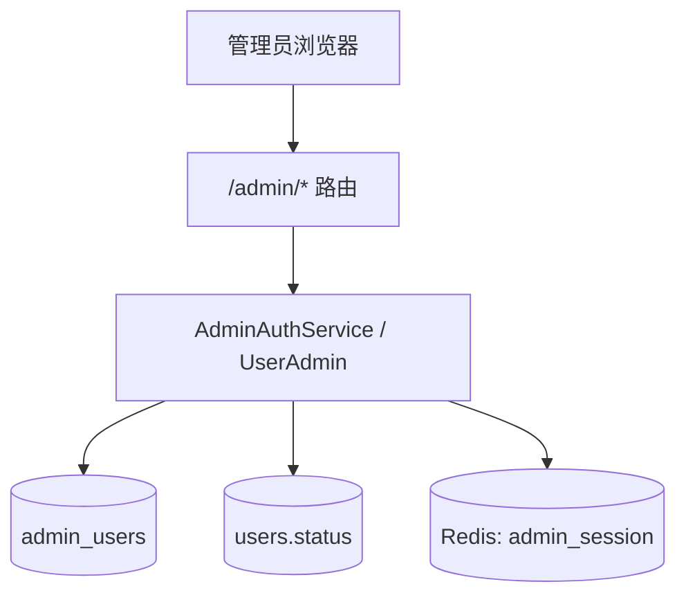
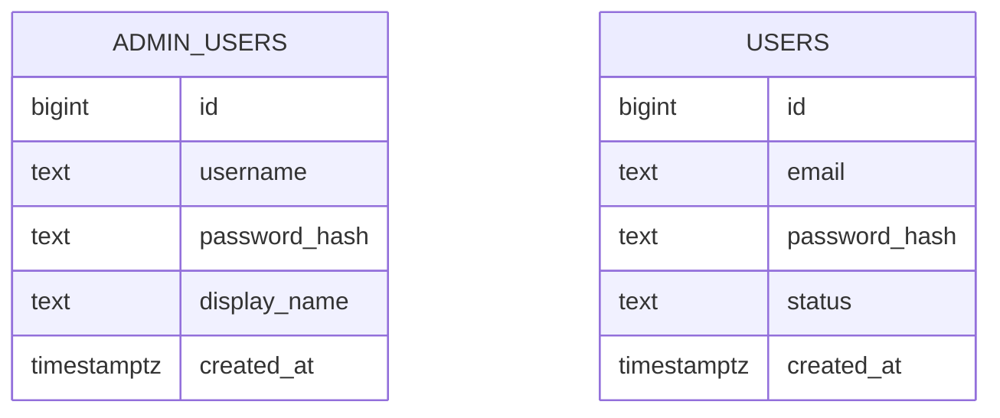

# PRD: 管理员账号与管理后台（admin accounts and console）

> ✅ **交付前置**：无，可立即开工。
> 结构化声明见 §8 Delivery Dependencies，**那里是唯一事实源**。

> 🧍 **验收状态**：待人工验收（Human-Confirmed 仍有空框）。（归档时与 §9 对齐：Human-Confirmed 仍有空框 → 🧍 待人工验收，全部由人确认后 → ✅ 已验收；⬜ 不可归档）
> 本行是 §9 Acceptance Checklist 的投影，**那里是唯一事实源**。

> 本 PRD 分两个 altitude，分别服务不同读者，自上而下阅读：
>
> - **Part A · 人审层 (Review Layer)** — 需求方 / 验收人读这部分，决定"该不该做、做得对不对"，并通过风险地图知道**哪些地方必须亲自确认**。
> - **Part B · 执行器层 (Build Layer)** — 实现者（人或 Agent）读这部分动手。

---

# Part A · 人审层 (Review Layer)

## 1. Introduction & Goals

### Problem Statement

现在系统里只有一种账号：通过网站自助注册的普通用户。运营人员没有办法登录一个独立的后台去查看有哪些用户、停用违规账号；Python 版模板里有的管理后台，在 Rust 版里因为缺少「管理员账号」而一直没法迁移——管理后台调用的登录、用户列表、启用/停用接口，后端一个都没有。

### Interpretation (解读回显)

这是你**前置批准**的对象，也是唯一能拦住"解读错了"的关卡。下面是可以逐格修改的具体样例：

| 验证方式 | 输入 / 操作 | 期望观察到的结果 |
|---|---|---|
| 👀 人审 + 自动验证 | 运营人员在管理后台用管理员账号登录，打开「用户」页 | 看到所有注册用户（邮箱、状态、注册时间），可按状态筛选、按邮箱搜索、翻页 |
| 👀 人审 + 自动验证 | 管理员点「停用」某个正在使用网站的用户 | 该用户**下一次**请求就变成未登录；再登录被拒绝并提示账号已停用；点「启用」后恢复 |
| 🤖 自动验证 | 用普通用户的登录凭据去登录管理后台 | 失败：管理员与普通用户是两套完全独立的账号 |
| 🤖 自动验证 | 带着普通用户的登录 Cookie 访问管理接口，或带着管理员的 Cookie 访问用户接口 | 都被拒绝（401），两套会话互不通用 |
| 🤖 自动验证 | 对同一个管理员账号连续输错密码 | 达到上限后被限流（429），此时即使密码正确也拒绝 |
| 🤖 自动验证 | 启动时没有配置管理员引导账号 | 服务照常启动，管理后台登录返回「功能未启用」，不影响网站 |

`👀 人审 + 自动验证` 表示自动断言之外还需人检查呈递的用户可感知结果；`🤖 自动验证` 表示自动 oracle 和 verifier 证据审查足够。

**我默默定了这些**（没问你、我自己定的歧义点）

- 管理员怎么来 → 只通过启动时的环境变量引导创建第一个管理员；没有注册入口，也没有在页面里创建管理员的功能
- 管理员只有一种角色 → 不做角色与细粒度权限，所有管理员权限相同
- 「停用」对用户意味着什么 → 不能登录、已有登录态立即失效；数据不删除，随时可以启用
- 管理员登录用「用户名」而不是邮箱 → 与原 Python 版的管理后台保持一致
- 管理后台里没有真实后端的演示页面 → 直接删掉，不留假数据

**我理解为不做**（你可能想要、但我读成不在范围内的）

- 在后台里新建、删除管理员，或修改管理员密码
- 找回密码、二次验证、操作审计日志
- 原 Python 版管理后台里的「运行轨迹」页面（它依赖本项目没有的运行轨迹功能）

读成：做一套与普通用户**完全隔离**的管理员账号体系，加上一个只做「看用户、停用/启用用户」的管理后台；不是做一个通用的权限管理系统。

### What The User Gets

运营人员得到一个独立的管理后台：用管理员账号登录后，可以浏览、筛选、搜索全部注册用户，并在需要时立即停用或重新启用某个用户。普通用户的体验不变，除非账号被停用。

### Measurable Objectives

- 管理员账号与普通用户账号互相不能登录对方的入口，登录态 Cookie 互不通用
- 停用一个用户后，其已有登录态在下一次请求时失效，且无法再登录；启用后立即恢复
- 管理员登录有独立的限流，且比普通登录更严格
- 没有配置管理员引导账号时，网站与普通用户功能完全不受影响
- 管理后台只包含有真实后端支撑的页面

---

## 2. Human Review Map (介入与风险地图)

这一节只列需要人判断的决策。

### 决策一：管理员与普通用户必须完全隔离

建议：管理员是独立的一张表、独立的登录入口、独立的登录态 Cookie、独立的限流计数，不与普通用户共用任何一处。这样即使普通用户的账号体系被攻破，也拿不到管理权限；反过来管理员的会话也不能冒充用户。代价是多一套（很薄的）代码。

**请确认：** 是否接受「两套完全独立的账号体系」，而不是「在用户表里加一个管理员标志」？

**验收：** 用一个账号的凭据和 Cookie 去访问另一套入口，全部被拒绝。

### 决策二：停用用户要立即生效

建议：停用后，该用户已经登录的状态在**下一次请求**就失效（而不是等登录过期），并且无法再登录。这是安全相关的行为：停用通常是因为发现了滥用。

**请确认：** 是否接受「停用立即生效」？

**验收：** 一个已登录用户被停用后，刷新页面即变为未登录；再登录收到「账号已停用」。

### 决策三：管理员只能通过启动时的环境变量创建

建议：第一个管理员由部署时设置的环境变量创建；之后没有任何接口或页面能创建管理员。这样不存在「通过网站注册成为管理员」的路径。代价是增删管理员需要运维操作。

**请确认：** 是否接受这种创建方式？

**验收：** 没有任何接口可以创建管理员；只有配置了引导账号的启动才会产生管理员。

### 自动门禁，不需要逐项人工审阅

- 管理后台的类型检查、lint、生产构建
- 用户列表的分页、筛选、搜索行为
- 管理员密码以安全哈希存储、日志与响应里不出现密码

### 本次明确不涉及

计费、数据删除（停用不删除数据）、角色与权限体系、邮件相关功能。数据库有结构变化：新增管理员表，并给用户表增加「状态」列。

---

## 3. Usage And Impact After Implementation

### 运营人员（管理员）

用管理员用户名和密码登录管理后台，在「用户」页浏览、筛选、搜索用户，对需要处理的用户点「停用」或「启用」。登出后会话立即失效。

### 普通用户

登录、注册、使用网站的方式不变。被停用时：已登录的页面刷新后变为未登录，登录时看到「账号已停用」。

### 运维 / 部署

首次部署时设置管理员引导账号的环境变量；不设置则管理后台功能整体关闭，网站不受影响。管理后台是一个独立的静态站点，通过反向代理访问后端的管理接口。

### Impact On Existing Behavior

- 现有用户的登录、注册、会话行为不变；新增的「状态」列默认是「启用」，现有用户全部保持可用
- 新增的环境变量都有安全的默认值（不启用管理后台）
- 数据库迁移是增量的，不修改已有的迁移文件

---

## 4. Requirement Shape

- Actor: 管理员（运营人员）、普通用户、部署运维
- Trigger: 管理员登录后台并操作用户；部署时配置引导账号
- Expected behavior: 隔离的管理员账号体系；用户列表与启用/停用；停用立即生效
- Scope boundary: 不含角色权限、管理员自助管理、找回密码、审计日志、运行轨迹

---

# Part B · 执行器层 (Build Layer)

> 以下供实现者（人或 Agent）使用。

## 5. Repository Context And Architecture Fit

- Existing path: 普通用户认证已完整实现在 `crates/core/src/auth.rs`（用例）、`crates/infrastructure/src/{password,redis_session,redis_attempts}.rs`（适配器）、`crates/api/src/auth.rs`（路由）；管理员认证复用同一批端口与适配器，只是另起一个域
- Reuse candidates: `SessionStore` / `PasswordHasher` / `AttemptCounter` 端口与 argon2、Redis 实现；`ThrottlePolicy` 与限流键构造；`normalize`/`validate_password`；`build_session_cookie` 一类的 Cookie 辅助函数
- Architecture pattern to preserve: 所有外层只依赖 `tpl-core`；`tpl-api` 不得依赖 infrastructure；由 `tpl-app` 装配；`crates/app/tests/architecture.rs` 守卫依赖方向
- Frontend impact: 新增 `frontend-admin/`（Vite + React，来自 Python 模板的 `frontend-admin`），只保留有真实后端的页面：登录、仪表盘、用户、设置、错误页；删除运行轨迹与五个演示页
- Existing PRD relationship: `tasks/pending/` 与 `tasks/archive/` 均无相关 PRD（none found）
- Redundancy risks: 管理员登录流程与普通登录相似，要抽出共用的限流与「诱饵哈希」逻辑，避免复制粘贴

---

## 6. Recommendation

### Recommended Approach

- Approach: 在 core 里新增管理员域（`AdminAuthService`、`AdminRepository` 端口）和用户管理用例（列表、详情、启停），与普通域共用端口与限流辅助；`SessionStore` 的主体 ID 改为中立的 `i64`，每个域用独立的 Redis 键前缀；api 层新增 `/admin/*` 路由与独立 Cookie；用户表增加 `status` 列
- Why this is the best fit: 复用已有的安全部件（哈希、会话、限流），新增代码只有「管理员域」本身；隔离靠独立的表、Cookie、Redis 前缀与限流前缀实现，而不是靠一个角色字段
- Rejected redundancy: 不引入角色/权限框架；不把管理员塞进用户表；不为管理员单独引入新的哈希或会话库

### Proposed Solution Summary (实现机制)

迁移新增 `admin_users`（用户名唯一且小写、密码哈希、显示名）并给 `users` 增加带 `CHECK` 的 `status`。core 的 `AdminAuthService` 提供登录/校验会话/登出，限流键前缀为 `admin`，默认上限比普通登录更低；`UserAdmin` 用例提供分页查询与启停。普通域的 `authenticate` 在查到用户已停用时视同未登录，登录对已停用账号返回专门的错误。启动时若配置了引导用户名和密码且该用户名不存在，则创建管理员（已存在则不覆盖密码）。api 层 `/admin/auth/{login,logout,me}` 与 `/admin/users…`，Cookie 名为 `admin_session`。前端从 Python 模板复制并适配接口契约。

### Alternatives Considered (Only When Useful)

- Alternative: 在 `users` 表加 `is_admin` 标志，复用同一套登录
- Why not chosen: 一旦普通登录或会话被攻破就等于拿到管理权限，隔离被削弱；停用与审计的语义也会混在一起

---

## 7. Implementation Guide

### 7.1 Core Logic

登录：规范化用户名 → 检查限流 → 按用户名取凭据（不存在则对诱饵哈希校验，耗时相近）→ 成功则创建管理员会话 → 失败则计数。校验会话：Redis 取管理员 ID → 数据库取管理员。用户管理：仓储层分页查询，状态用封闭取值（`active` / `disabled`）。

### 7.2 Change Impact Tree

```text
.
├── migrations/
│   └── 新增 admin_users 表；users 增加 status 列
├── crates/core/src/
│   ├── auth.rs                      [修改] SessionStore 主体改为中立 i64；User 带状态；登录拒绝已停用账号
│   ├── auth/throttle.rs             [修改] 限流键带域前缀
│   └── admin.rs                     [新增] AdminAuthService、AdminRepository、UserAdmin 用例
├── crates/infrastructure/src/
│   ├── redis_session.rs             [修改] 会话键带命名空间
│   ├── persistence/user_repository.rs  [修改] 状态、分页、启停
│   └── persistence/admin_repository.rs [新增]
├── crates/api/src/
│   ├── admin.rs                     [新增] /admin/* 路由与独立 Cookie
│   └── lib.rs                       [修改] 状态里挂管理员服务
├── crates/app/src/composition.rs    [修改] 装配与引导管理员
├── config.toml                      [修改] 管理员相关配置
└── Frontend (frontend-admin)
    └── frontend-admin/              [新增] 来自 Python 模板，适配契约，删除无后端的页面
```

### 7.3 Executor Drift Guard

| Check | Command | Expected Result | If It Fails, Inspect First |
|---|---|---|---|
| 依赖方向没被破坏 | `cargo test -p tpl-app --test architecture` | 通过 | 新增代码是否从 api 引用了 infrastructure |
| 没有残留的演示页 | `rg -n "faker\|run-tracing\|runTracing" frontend-admin/src` | 无结果 | 路由、侧边栏、命令菜单、语言文件 |
| 两套会话键互不相交 | `rg -n "session:" crates/infrastructure/src` | 只在带命名空间的构造里出现 | `RedisSessionStore` 的键前缀 |

### 7.4 Flow Or Architecture Diagram



### 7.5 ER Diagram (Only When Data Model Changes)



### 7.6 Realistic Validation Plan (Oracle 块)

```yaml
- id: rv-1
  behavior: 管理员与普通用户的账号、登录态、限流完全隔离，且管理员登录有独立限流
  reviewer: verifier
  real_entry: "真实进程 + 真实 PostgreSQL/Redis：用 HTTP 客户端依次尝试交叉登录、交叉使用 Cookie、连续输错密码"
  expected: "交叉登录与交叉 Cookie 全部 401；连续输错达到上限后 429 且正确密码也被拒"
  mock_boundary: "不 mock 数据库、Redis、哈希；仅用本地回环地址"
  tier: R3
  test_layer: e2e
  required_for_acceptance: true
  critical_value_source: "登录态 Cookie 必须取自各自真实登录响应的 Set-Cookie，不得手工构造"
  must_cross: "HTTP 路由 -> 用例 -> Redis 会话与限流计数 -> PostgreSQL 账号表"
  forbidden_bypasses: "直接调用用例或仓储；在测试里伪造 Redis 键；把两套 Cookie 名写成同一个"
  fresh_state_probe: "动作完成后由全新的 HTTP 客户端携带该 Cookie 独立请求"
  final_tree_evidence: "在最后一次改动认证相关代码之后重新运行 just test real 并保存输出"
  negative_control: "临时让管理员域复用普通域的 Redis 键前缀，交叉 Cookie 用例必须变红"
  expected_fail: "带普通用户 Cookie 访问 /admin/users 返回 200 而不是 401"
- id: rv-2
  behavior: 停用用户后其登录态立即失效且无法登录，启用后恢复
  reviewer: verifier
  real_entry: "真实进程：管理员接口停用用户后，用该用户已有的 Cookie 请求 /auth/me，再尝试登录，再启用后重试"
  expected: "停用后 /auth/me 返回 401、登录返回 403；启用后 /auth/me 与登录恢复"
  mock_boundary: "不 mock 数据库与 Redis"
  tier: R2
  test_layer: e2e
  required_for_acceptance: true
  critical_value_source: "用户 Cookie 取自该用户真实登录响应"
  must_cross: "管理接口 -> 用户表状态 -> 普通域会话校验"
  forbidden_bypasses: "直接改数据库的状态列；在测试里删除 Redis 会话"
  fresh_state_probe: "停用动作之后由全新的 HTTP 客户端独立请求 /auth/me"
  final_tree_evidence: "在最后一次改动状态相关代码之后重新运行 just test real"
- id: rv-3
  behavior: 管理员在真实浏览器里登录管理后台，浏览并筛选用户，停用与启用用户
  reviewer: human
  real_entry: "just web-e2e：真实 Chrome 打开管理后台"
  expected: "登录成功进入后台；用户页列出用户；停用后该用户状态变为已停用；刷新后仍保持"
  mock_boundary: "不 mock 后端；数据库与 Redis 用本地测试实例"
  tier: R2
  test_layer: e2e
  required_for_acceptance: true
  presentation: "浏览器测试保存的截图（登录页、用户列表、停用后的列表）以及 open 命令"
  critical_value_source: "页面上显示的用户邮箱与状态从页面原样读取"
  must_cross: "浏览器 -> 管理后台 -> 反向代理 -> 后端 -> 数据库"
  forbidden_bypasses: "直接调用后端接口代替页面操作；注入页面状态"
  fresh_state_probe: "停用之后刷新页面并由新页面读取状态"
  final_tree_evidence: "在最后一次改动前端或管理接口之后重新运行 just web-e2e"
```

Failure triage:
- `real_entry` 跑挂，先查服务是否拿到了管理员引导账号的环境变量，别急着改实现策略。
- 需要真实 PostgreSQL / Redis 的项用 `just test real` 显式运行；没有这些服务时必须停下来报告，不得用替身顶替真实入口验证。
- **禁止为了让 oracle 能变红去改生产代码**；负控只能通过测试里的打桩或在副本上做破坏性改动实现。

### 7.7 Low-Fidelity Prototype (Only When Required)

- `No low-fidelity prototype required for this PRD.`（管理后台直接复用 Python 模板已有的界面）

### 7.8 Interactive Prototype Change Log (Only When Files Actually Changed)

- `No interactive prototype file changes in this PRD.`

### 7.9 External Validation (Only When Web Research Was Used)

- `No external validation required; repository evidence was sufficient.`

---

## 8. Delivery Dependencies

- Depends on tasks/issues:
  - none
- Gate type: none
- Sequence: via-main
- Notes: 前台站点与认证、限流已经交付，本任务在其上增加管理域。

---

## 9. Acceptance Checklist

### 9.1 人读呈递区（Human Review Surface）

| # | 你要看什么（对应 oracle） | 呈递物（交付时填实际路径） | 想自己复核？ |
|---|---|---|---|
| 1 | 管理员登录后台、浏览并筛选用户、停用与启用用户 | `target/e2e-shots/admin-01-sign-in.png`（登录页）、`admin-02-users.png`（用户列表）、`admin-03-confirm-disable.png`（停用确认）、`admin-03b-after-reload.png`（停用并刷新后仍为 Disabled）、`admin-04-after-enable.png`、`admin-05-throttled.png`；重新生成：`SHOT_DIR=$PWD/target/e2e-shots just web-e2e` | 打开用户页，停用一个用户，刷新后看状态列 |

**以下项不需要你看**（`reviewer: verifier`，agent 自验 + verifier 复核）：隔离与限流、停用立即生效、构建与类型检查。

### 9.2 Acceptance Evidence Package（机器证据 · verifier 入口，人默认跳过）

1. **人审项的 oracle 跑绿证据**：浏览器端到端输出
2. **verifier-only 项结果**：真实服务测试输出
3. **风险地图对账**：是否出现未预测到的高风险面
4. **对抗自检**：隔离与停用立即生效的反方检查
5. **对锁定契约的 diff**：普通域的接口契约未变
6. **低风险门禁结果**：lint / 类型检查 / 构建

### Human-Confirmed (来自 Part A 风险地图)

> 本组条目归**人**回答：在你回复之前它们一直保持 `- [ ]`，执行工具不得代勾。本组**不拦归档**。

- [ ] 决策一：接受「管理员与普通用户两套完全独立的账号体系」
- [ ] 决策二：接受「停用立即生效」
- [ ] 决策三：接受「管理员只能通过启动时的环境变量创建」
- [ ] §9.1 呈递区各项已亲眼看过

### Architecture Acceptance

- [x] 依赖方向守卫测试通过：新增代码没有让 api 依赖 infrastructure  
  证据：`cargo test -p tpl-app --test architecture` 随 `just ci` 通过；`tpl-api` 只新增了对 `tpl-core` 的使用
- [x] 管理员域使用独立的表、Cookie 名、Redis 会话键前缀和限流键前缀  
  证据：表 `admin_users`、Cookie `admin_session`、Redis 命名空间 `admin_session:`、限流前缀 `admin-login`；`config.rs` 默认值测试断言 Cookie 名不同，`redis_session.rs` 的 `namespaces_isolate_user_and_admin_sessions` 对真实 Redis 验证

### Behavior Acceptance

- [x] 交叉登录与交叉使用 Cookie 全部被拒绝  
  证据：`crates/api/tests/admin_routes.rs`（交叉 Cookie、普通凭据登录后台）与 `http_end_to_end.rs::admin_console_flow_against_real_postgres_and_redis`（真实服务）通过；负控：把 `ADMIN_SESSION_NAMESPACE` 临时改成 `"session"`，该真实端到端用例变红，已还原
- [x] 停用用户立即生效且可恢复；已停用账号登录得到专门的错误  
  证据：API 测试、真实端到端、浏览器端到端三层均覆盖：停用后 `/auth/me` 401、登录 403 `account_disabled`，启用后恢复
- [x] 管理员登录有独立限流；数据库或 Redis 未配置时管理接口返回功能未启用（503 `admin_unavailable`），配了但没有引导账号时没有任何管理员能登录（401）  
  证据：`admin_login_throttling_is_stricter_and_separate_from_user_login`（真实服务）、API 与 core 测试、浏览器端到端第 4 次被限流；503 由 `admin_routes_answer_503_when_admin_is_not_configured` 覆盖
- [x] 现有普通用户的登录、注册、会话行为不变  
  证据：`auth_routes.rs` 21 个原有测试与原有真实端到端用例全部未改断言通过（仅补了新增的 AppState 字段）；唯一的契约新增是已停用账号登录返回 403

### Frontend Acceptance

- [x] 管理后台只保留有真实后端的页面，无演示数据残留  
  证据：只剩登录与用户管理；`pnpm knip` 通过（无未使用文件/依赖），演示页面、faker、What's New 均已删除
- [x] 管理后台按后端的接口契约调用，错误信息来自后端的错误码  
  证据：`src/api/client.ts` 解析 `{error:{code,message}}`，`apiErrors.<code>` 翻译；`handle-server-error.test.ts` 验证中英文；浏览器端到端检查了翻译后的错误提示

### Documentation Acceptance

- [x] README、系统架构、迁移状态、配置示例已更新并与实现一致  
  证据：README、`docs/architecture/system-design.md`、`docs/migration-status.md`（阶段 5）、`config.toml`、`.env.example`、`frontend-admin/README.md`、AGENTS 与 ai-standards 已更新

### Validation Acceptance

- [x] `just ci-all` 通过  
  证据：最后一次改动之后重新运行，退出码 0
- [x] `just test real` 通过，且包含管理员相关的端到端用例  
  证据：最后一次改动之后重新运行，退出码 0；含 `admin_console_flow_…`、`admin_login_throttling_…` 与仓储/Redis 真实测试
- [x] `just web-e2e` 通过，且包含管理后台的真实浏览器用例  
  证据：公开站点 20/20、管理后台 33/33 通过

### Delivery Readiness

- [x] 推荐方案完整实现，没有未批准的并行抽象  
  证据：会话端口复用（D-03）；`http.rs` 是把 `auth.rs` 里已有的错误映射/客户端 IP/Cookie 辅助抽出来共用，而不是复制一份
- [x] §9.1 呈递区的呈递物路径已回填  
  证据：已填 `target/e2e-shots/admin-*.png`

---

## 10. Functional Requirements

- FR-1: 提供与普通用户完全隔离的管理员账号体系：独立的表、登录入口、登录态 Cookie、会话命名空间与限流计数
- FR-2: 管理员只能通过启动时配置的引导账号创建，且已存在时不覆盖其密码
- FR-3: 管理员可以分页、按状态筛选、按邮箱搜索地列出用户，并查看单个用户
- FR-4: 管理员可以停用与启用用户；停用后该用户已有登录态在下一次请求失效，且无法登录
- FR-5: 管理员登录有独立限流，默认比普通登录更严格；被限流时返回 429 与等待时间
- FR-6: 提供管理后台站点，只包含有真实后端支撑的页面，并按后端的接口契约调用

---

## 11. Non-Goals

- 角色与细粒度权限
- 在后台里新建、删除管理员或修改管理员密码
- 找回密码、二次验证、操作审计日志
- 运行轨迹页面及其后端

---

## 12. Risks And Follow-Ups

- 管理员只能靠环境变量创建，增删管理员需要运维操作；若将来需要，另开 PRD
- 管理员密码目前没有轮换机制；上生产前应结合部署平台的密钥管理

---

## 13. Decision Log

| # | 决策问题 | 选择 | 放弃的方案 | 理由 |
|---|---|---|---|---|
| D-01 | 管理员如何与普通用户隔离 | 独立的表、Cookie、会话命名空间、限流前缀 | 用户表加管理员标志 | 隔离更强，一套被攻破不影响另一套 |
| D-02 | 停用如何立即生效 | 每次校验会话时读取用户状态 | 停用时批量撤销该用户的全部会话 | 不需要按用户索引会话，且天然覆盖所有会话 |
| D-03 | 会话端口的主体 ID 类型 | 中立的 i64 | 为管理员再定义一套会话端口 | 复用同一个端口与适配器，靠命名空间隔离 |

### Final Reconciliation (Archive Only)

- Interpretation: confirmed — 做成「独立的管理员账号体系 + 只含用户管理的管理后台」，与解读回显一致
- Public behavior and contracts: confirmed — 新增 `/admin/*`；普通域唯一的新增契约是已停用账号登录返回 403 `account_disabled`；会话端口的主体 ID 改为 `i64`（内部契约）
- Related PRD status: confirmed — 无依赖的 PRD，也没有被它影响的 PRD
- Requirements and risks: confirmed — FR-1…FR-6 全部实现；§12 的两条风险（环境变量创建、无密码轮换）已写入 `system-design.md` 与 `migration-status.md`
- Reconciled differences:
  - 「没有配置引导账号时管理接口返回功能未启用」与实现不符：实际是 DB/Redis 未配置才 503，配了但没有引导账号时登录一律 401。已把 §9 的该条改成与实现一致，并写进 `config.toml` 与 `system-design.md`
  - 实现时额外决定：删除模板里与后端无关的页面及其依赖（见 `migration-status.md` 阶段 5），并修掉模板里 `instanceof AxiosError` 永不命中的会话过期处理；这些都在「管理后台只保留有真实后端的页面」范围内
