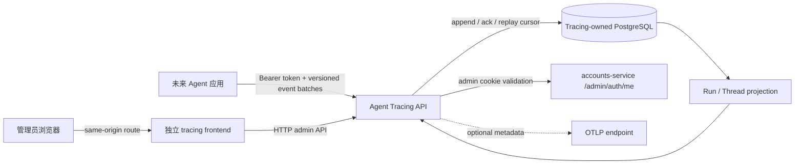

# PRD: 独立 Agent Tracing 服务与通用事件接入

> ✅ **交付前置**：无，可立即开工。
> 结构化声明见 §8 Delivery Dependencies，**那里是唯一事实源**。

> ⬜ **验收状态**：实现进行中；执行侧验证和人工验收仍未完成。
> 本行是 §9 Acceptance Checklist 的投影，**那里是唯一事实源**。

本 PRD 分为两部分：Part A 用行为与已确认决策锁定目标；Part B 记录服务边界、实现方式和验证证据。

## Feature Overview（功能一览）

以下为 §10 功能需求的简要投影；验收以 §1 的行为样例为准。

- **语言无关的 Agent 事件接入**（FR-1、FR-2）：未来 Agent 应用通过版本化 HTTP/JSON 契约持续发送 Run 事件，并能确认接收进度与安全重试。
- **独立的轨迹后端与前端**（FR-3、FR-4）：后端拥有自己的进程、数据、配置和镜像；轨迹 UI 是独立前端服务，只通过 HTTP API 访问后端。
- **从事件恢复一致轨迹**（FR-5）：Run、模型、工具、判定、消息与委派账本从已接收的有序事件投影，刷新后保持一致。
- **受控的诊断和原始导出**（FR-6、FR-7）：管理员可以检索轨迹、查看诊断、导出完整事件；权限、大小限制、缓存和审计约束保持明确。
- **可选 OTLP 导出**（FR-8）：外部导出复用相同 trace/span ID，失败不影响本地事件和轨迹页面。
- **可独立启动和发布**（FR-9）：Compose、CI 和镜像流程可以单独构建、启动及发布两个 tracing 子服务。

# Part A · 人审层 (Review Layer)

## 1. Introduction & Goals

### Problem Statement

未来接入的 Agent 应用需要把运行中的模型调用、工具、决策和消息事件送到独立的 Rust tracing 服务。当前 Rust 仓库只有账号业务服务，没有 Agent Run/Event 数据源或 tracing 接入 API；因此还没有一个可供不同 Agent runtime 调用、可安全重试并能在管理端回看的稳定入口。

相邻的 `ai-assistant` 已有较完整的轨迹行为：以有序 Run/Event 为依据投影轨迹树、会话账本、管理员详情和可选 OTLP 导出。其规范见 [`agent-run-tracing.md`](../../ai-assistant/docs/guides/agent-run-tracing.md)。这次要把这些能力转成 Rust 微服务，并为尚未接入的 Agent 应用定义通用传输契约。

### Interpretation (解读回显)

#### 行为样例

| 验证方式 | 输入 / 操作 | 期望观察到的结果 |
|---|---|---|
| 自动验证 | Agent 应用发送一个包含 Run 开始、模型调用、工具调用和 Run 完成的事件批次 | 服务返回已持久化的序号；独立运行的 tracing 前端随后显示该 Run 的根节点、模型和工具步骤，刷新后内容不变 |
| 🤖 自动验证 | 发送方因响应丢失而重发完全相同的 Run/序号/事件 | 服务返回已接受的检查点，数据库和 UI 投影中不出现重复事件 |
| 🤖 自动验证 | 发送批次缺少下一连续序号，或重复序号携带不同内容 | 服务拒绝该批次并返回可恢复的预期序号；先前已确认的事件保持不变 |
| 🤖 自动验证 | 未授权发送方、无效 JSON 或超出请求上限的批次调用接入 API | 服务拒绝请求，不写入事件，也不泄露内部校验原因或令牌 |
| 自动验证 | OTLP 接收地址未配置或本地接收器不可用时提交新事件 | 本地事件仍被确认并可在 tracing 前端读取；服务记录受控导出失败，Run 的发送方不因 OTLP 状态被阻塞 |

以上行为行会成为 §7.6 的验收 oracle；修改任一行为单元格即同步修改对应验收标准。

#### 我默默定了这些

- 这次迁移的是 Agent Run tracing 子系统；不迁移或实现 Agent runtime，未来 runtime 通过公开契约接入。
- “数据流”先按可持续发送、可确认和可恢复的事件批次理解；不默认引入 gRPC、WebSocket 或消息队列。
- Trace 后端拥有它收到的追加式诊断事件，并维护可重建的查询投影；Agent 应用仍拥有自己的业务 Run 状态。
- Trace UI 独立构建和部署；为沿用现有管理员 Cookie，默认通过同源网关路径访问，而不是另建跨域登录协议。
- 迁移 `ai-assistant` 当前已实现的轨迹、thread 账本、内容级管理员诊断、原始事件导出和可选 OTLP 行为；不把来源 PRD 中未实现的 UI 折叠控件称作已有功能。
- 原始消息和工具载荷仅在受管理员认证的本地诊断界面/导出中可见；OTLP 继续只导出低敏元数据，不导出消息、工具参数、结果或凭据。

#### 我理解为不做

- 不迁移 Agent runtime、模型调用适配器、工具执行器或 Python 业务服务。
- 不把 tracing UI 合并进现有 `frontend-admin` 构建产物；不让浏览器直接访问数据库或事件存储。
- 不建设通用日志搜索、Prometheus/Grafana 栈、Agent 回放、提示词调试器或自动评测系统。

#### 可证伪的范围说明

本次在现有 auth/accounts-service 之后新增第二个后端微服务 `agent-tracing`；`frontend-tracing` 是单独构建和部署的前端子服务。Agent producer 通过语言无关、版本化的 HTTP/JSON 事件接入；服务确认事件持久化后，前端才能读取并投影轨迹。Agent producer 不读取 tracing 数据库，tracing 服务也不直连 producer 的业务数据库。用户已于 2026-10-29 在对话中确认接入协议、管理员可见范围和敏感内容策略。

### What The User Gets

接入者可以用普通 HTTP 客户端把 Agent Run 事件持续发送到一个稳定接口，收到检查点后安全续传。运维人员可以独立部署 tracing 后端与管理 UI，并在 UI 中检索 Run、查看模型/工具/判定步骤、检查异常和下载原始事件。

### Measurable Objectives

- 一个无需依赖特定 Agent 框架的示例 producer 可通过 HTTP 契约发送完整 Run，并在独立进程重启后从确认序号继续发送。
- 相同事件重试不会重复入库；序号冲突、越权、无效载荷和超限请求均可明确拒绝。
- `frontend-tracing` 与 tracing API 是不同构建/镜像；UI 通过 API 展示数据库新读取的轨迹。
- 关闭或故障的 OTLP 接收器不改变本地事件接收、持久化或查询结果。

## 2. Human Review Map (介入与风险地图)

### 决策一：事件流使用可确认续传的 HTTP 批次

建议 Agent 应用按 Run 序号发送有界 JSON 事件批次；每次响应返回已持久化检查点，客户端从未确认的下一条事件重试。它仍可边运行边 flush，且各语言只需 HTTP/JSON 客户端。长连接双向流更接近字面上的 streaming，但会增加代理兼容、断线恢复和客户端库负担。

**请确认：** 可恢复的 HTTP/JSON 批次是否符合你说的“传输数据流”？若要求单一长连接或双向逐事件 ack，需要在此改定协议。

**确认结果（2026-10-29）：** 用户同意推荐项，采用可在 Agent 运行期间持续 flush 的 HTTP/JSON 事件批次、持久化序号确认和幂等重试。

**验收：** producer 可连续提交事件批次、断线后按检查点恢复，重发不会重复建树。

### 决策二：管理员可查看哪些 producer 的数据

来源 `ai-assistant` 按组织成员 owner scope 隔离轨迹；Rust 账号服务目前只有独立管理员账号域，没有组织成员权限模型。建议首版把每个 producer 的写入凭据绑定到固定 source/project，轨迹读取仅允许已认证的平台管理员，并明确首版管理员是否可查看所有 source。若需要保留组织级隔离，需要在 tracing 服务中加入 project/member 授权关系，不能假设账号服务已经提供。

**请确认：** 首版由所有平台管理员查看全部 source 是否可接受，还是要同时迁移组织/project 级读取权限？推荐先限定平台管理员使用，并为每个 producer 隔离写入身份；外部租户接入前再加入成员级 ACL。

**确认结果（2026-10-29）：** 用户同意推荐项；首版平台管理员可查看全部 source，每个 producer 凭据固定绑定 source/project，不接受请求体更换身份。组织/project 成员级读取 ACL 暂不迁移。

**验收：** producer 不能伪造别的 source；未认证用户和普通用户无法读取轨迹；管理员可见范围与确认后的策略一致。

### 决策三：轨迹详情是否保留来源的内容级管理员可见策略

`ai-assistant` 当前页面会显示 canonical 消息、工具 arguments/result 和判定输入摘要；原始导出也包含完整事件。这些数据可能包含客户内容。建议按来源行为迁移，但仅对 tracing 管理员开放，原始导出设置事件数和字节上限、no-store 与下载审计，OTLP 仍只含元数据。

**请确认：** 管理员是否需要在本地 UI/原始导出中看到完整消息和工具内容？推荐保留来源当前行为，并把这些页面、截图和导出文件按敏感数据保管。

**确认结果（2026-10-29）：** 用户同意推荐项；受认证的平台管理员可查看完整 canonical 消息、工具 arguments/result 和判定输入摘要，原始事件导出保留完整事件；hidden chain-of-thought 不属于迁移内容，OTLP 仍只发送低敏元数据。

**验收：** 普通账号不能访问内容；管理员内容可见面与导出边界符合确认策略；OTLP 接收器始终看不到正文和工具原文。

### 自动门禁，不需要逐项人工审阅

事件契约、重放幂等、序号完整性、请求限额、迁移、代理路径、独立构建与 OTLP 属性边界由真实服务入口、真实 PostgreSQL、浏览器流程及本地 OTLP 接收器验证。三项产品/安全决策已由用户确认；最终人审聚焦实现是否符合这些决策，以及独立 UI 的真实呈现。

### 本次明确不涉及

不迁移 Agent runtime、不改 `ai-assistant` Python 仓库、不引入消息队列或外部身份提供方；事件写入始终要求绑定 source 的 producer 凭据，不提供匿名遥测入口。

## 3. Usage And Impact After Implementation

- **未来 Agent 接入开发者：** 获得版本化的事件 envelope、认证方式、批次/检查点/重试语义、错误码和可复制的 HTTP 示例。
- **平台管理员：** 通过独立 tracing 前端查看 Run 摘要、轨迹树、会话账本、诊断信息和受限原始事件导出。
- **运维人员：** 可分别构建和发布 tracing API、tracing UI；为 tracing 服务配置自己的数据库、端点与 producer 凭据。
- **现有账号服务用户：** 认证流程继续由 accounts-service 管理；tracing 服务只调用公开管理员认证契约，不访问账号数据库或 Redis。

## 4. Requirement Shape

- Actor: Agent producer、平台管理员、服务运维人员。
- Trigger: Agent producer 提交 Run 事件；管理员搜索、查看或导出轨迹。
- Expected behavior: 事件按确认检查点持久接收、可幂等续传；本地轨迹可从事件重建；可选 OTLP 旁路失败不影响事件事实；UI 与 API 可独立部署。
- Scope boundary: Agent Tracing 服务、其私有 PostgreSQL/迁移、通用接入契约、独立 tracing 前端、网关/Compose/CI 镜像接线及文档。

# Part B · 执行器层 (Build Layer)

## 5. Repository Context And Architecture Fit

- **Existing Path:** `services/accounts/` 是当前唯一业务服务；其内部 HTTP、配置、PostgreSQL、健康探针及 composition root 提供独立服务样式。仓库没有 AgentRun/Event 源码。前端已有 Vite/React 管理后台和独立 nginx 镜像。
- **Reuse Candidates:** 以 `../ai-assistant/docs/guides/agent-run-tracing.md`、三个已归档 tracing PRD 及 `src/backend/core/agent/harness/trace_use_cases.py` 的行为作为语义来源；复用 Rust 项目的 workspace/service 模式、accounts 管理员会话接口、nginx 同源代理及 Vite/React 管理端组件模式。不得把 Python 实现机械翻译或让新服务依赖账号私有 crate。
- **Architecture Constraints:** 新建 `services/agent-tracing/`，包含 API、core、infrastructure、migration、测试及 composition root；新建独立 `frontends/tracing/`。每服务独立数据和凭据；producer 使用 tracing 接入 API；UI 只调用 tracing API；管理员身份经 accounts-service 公开 `/admin/auth/me` 契约验证。Trace 后端不直连 accounts 数据库，不依赖账号私有 Cargo package。
- **Frontend Impact:** Full-stack。新增 `frontends/tracing/`（Vite + React 19，参考 `frontends/admin/`）；本地开发新增 `just web-tracing-dev`，验证新增 `just web-tracing-check` / browser flow。现有 `frontend-admin` 的参考命令为 `just web-admin-dev`、`just web-admin-check`、`just web-admin-test`，完整真实入口为 `just web-e2e`。
- **Existing PRD Relationship:** `tasks/pending/` 当前为空；`P1-ARCH-20261029-120000-reusable-accounts-service.md` 已归档并确立新业务服务边界；`ai-assistant` 的 canonical tracing、raw event export、thread trajectory 归档 PRD 是语义来源，不是待执行依赖。
- **Potential Redundancy Risks:** 不建第二套 trace/span 表；不同时维护 `events` 投影和 OTLP span 的独立 ID 生成规则；不复制 accounts 管理员认证与账号存储；不为每个 Agent 框架新增专用 API/DTO。

## 6. Recommendation

### Recommended Approach

采用 `services/agent-tracing` + `frontend-tracing` 两个独立部署单元。Agent producer 通过带认证的版本化 HTTP/JSON 批次 API append 事件；tracing 后端拥有接收到的追加式事件记录，以 `(source_id, run_id, seq)` 幂等接受并返回持久化检查点。树和摘要从事件重建，不另存一份会漂移的 span 事实。新前端以 Vite/React 单独构建，经同源 nginx 路径访问 tracing API 与 accounts 管理员验证端点。

接入 API 的默认契约建议为：`POST /api/v1/ingest/runs/{run_id}/events`，使用绑定到固定 source/project 的 producer bearer token。一个有界 JSON 请求包含同一 Run 的连续事件；事件 envelope 有 `schema_version`、`seq`、`event_type`、`occurred_at`、`trace_id`、`span_id`、可空 `parent_span_id` 和受限 JSON `payload`。`run_id` 由 URL 提供，source/project 只由 token 身份决定，不接受请求体覆盖。序号从 1 开始；响应 `accepted_through_seq` 表示数据库事务已提交的连续检查点，调用方从检查点后的第一条事件续传。

最小请求/响应示意：

```json
{
  "schema_version": 1,
  "events": [
    {
      "seq": 1,
      "event_type": "run.started",
      "occurred_at": "2026-10-29T07:00:00Z",
      "trace_id": "0123456789abcdef0123456789abcdef",
      "span_id": "0123456789abcdef",
      "parent_span_id": null,
      "payload": {"thread_id": "thread-example"}
    }
  ]
}
```

成功响应返回 `run_id` 与 `accepted_through_seq`。完全相同的序号和内容视作重试成功；相同序号不同内容或序号缺口返回稳定错误码和 `expected_seq`，整个新批次事务不落库。无效 schema 返回 422，认证失败返回 401，超限返回 413。每个请求都必须有界并可在 Agent 运行期间反复 flush；允许单事件批次，调用方无需等待 Run 结束。配置使用独立 producer bearer token；实际 token 仅通过环境变量注入。

冻结事件目录提供通用 Run/message/model/tool/decision/artifact 类型；JSON Schema 列出每种事件的 payload 必填/可选字段，目录以外的事件类型和 payload 字段均拒绝，必须先通过 schema 版本升级注册。未知父级明确降级并返回稳定诊断 code，不按工具名、时间或完成顺序猜测。默认请求体、批次长度、单事件载荷、运行时长和外部 HTTP 请求均设置上限/超时。契约同时以 OpenAPI 或 JSON Schema、接入指南与 curl 示例发布。

数据库由 tracing 服务独占；独立 migrations 保存已接收事件、Run 查询投影和必要导出审计。根 Compose 组合 tracing API、tracing 前端及 tracing 专属 PostgreSQL；独立部署时可单独运行服务。CI/CD 对两个镜像提供独立构建/发布目标。无需注册中心或消息代理。

### Design Challenge

若把完整 `AgentRunEvent` 无限制 JSON 接受并原样显示，未来 producer 接入容易，但可能把凭据或隐藏推理内容写入长期存储。修正方式是冻结通用 envelope 与标准事件目录、限制扩展载荷，并在消费/导出端执行相同敏感字段策略；消息/工具原文是否在管理员界面可见由 §2 决定。

若把事件投影放到 accounts-service，会把 Agent 数据生命周期和发布节奏绑到账户域，也会让 accounts 继续成为默认共享业务层。新服务边界已由当前架构文档规定，故采用独立 tracing 服务。

### Proposed Solution Summary (实现机制)

1. 增加带序号和 source 身份的 append-only ingest API、schema 校验和 durable ack；存储提交后才确认，重试有幂等规则。
2. 在 tracing core 中将受控事件即时投影为 Run 摘要、span 树、thread 账本和稳定诊断 code；查询从 PostgreSQL 事件重建，不依赖进程内缓存。
3. 增加管理员列表、详情、thread 和 raw export API；通过 accounts `/admin/auth/me` 验证 Cookie，实施 §2 确认的数据范围。
4. 增加独立 Vite/React UI，展示 Run 列表、筛选、账本、时间轴、检查器、受限历史、判定和导出；保留源项目最新交付行为。
5. 增加可选 OTLP/HTTP exporter。默认无端点时不装配；导出失败、队列满和 shutdown flush 失败都不改变本地事件写入。
6. 为服务单独配置 TOML/环境变量、PostgreSQL、Compose、Docker、health/readiness、优雅退出、独立镜像和发布目标。

ROI：单做管理页没有数据源，单做 OTLP exporter也无法满足本地事件回读；完整接入、存储、投影和 UI 是能验证未来 Agent 接入的最小闭环。当前不加入 message broker、通用指标栈或 Agent runtime，控制基础设施成本。

### Alternatives Considered

- **把页面加进现有管理后台并让其直接查 events：** 不符合用户明确要求的独立前端子服务，且会产生跨服务数据库访问。
- **使用共享 PostgreSQL/账号迁移存 trace 表：** 破坏服务数据所有权，账号发布/备份承担无关 Agent 数据。
- **用单个长连接 gRPC/WebSocket：** 双向流更自然，但代理、重连、客户端支持和确认语义显著复杂；待真实 producer 证明批次延迟不可接受后再升级。
- **只接收 OTLP spans：** 语言通用，但不能完整表达来源功能里的顺序事件、message 内容、thread/Run 边界、原始事件导出与稳定业务诊断契约。

## 7. Implementation Guide

以下影响树是当前仓库检查的起点，不是穷尽清单；实现发现的真实引用与入口应先更新本 PRD，再继续。

### 7.1 Core Logic

事件提交只由 tracing repository 分配或裁决连续序号；已确认的批次在一个服务内持久化后才返回 ack。事件 payload checksum 与事件身份用于识别相同重试和冲突重放。Trace projection 将缺失/未知父级明确降级并给稳定诊断 code，不按工具名、时间或完成顺序猜测。终态后才允许 raw export，并设置事件数、文件体积、no-store 和审计约束。

批次确认点、producer token 对 source 的绑定、管理员 source 可见范围、完整内容展示策略在 §2 人工确认后冻结。请求大小、事件条数、单事件体积和 API 超时需在服务配置文档中有上限。默认验证不能向外部 OTLP 发送真实数据。

### 7.2 Change Impact Tree

```text
.
├── Cargo.toml / Cargo.lock [修改] 【总结】登记 tracing 服务 package 与必要 Rust 依赖
├── services/agent-tracing/ [新增] 【总结】独立 composition root、API/core/infrastructure、事件存储与迁移
├── frontends/tracing/ [新增] 【总结】独立 Vite/React 管理 UI 与 API client
├── docker-compose.yml / docker-compose.testing.yml [修改] 【总结】加入 tracing API、独立 UI 及 tracing 专属 PostgreSQL
├── frontends/tracing/nginx.conf [新增] 【总结】为独立 UI、管理员认证与 producer API 提供同源反向代理路由
├── config.toml / .env.example [修改] 【总结】tracing 服务配置段与空值密钥占位
├── justfile [修改] 【总结】加入 tracing 启停、开发、检查和镜像命令
├── .github/workflows/ [修改] 【总结】CI 与发布分别构建两个新镜像
├── scripts/ [修改] 【总结】本地启动、双数据库备份与按服务恢复
├── docs/ [修改] 【总结】事件契约、服务接入、配置、部署、架构、备份与 API 兼容性
└── README.md [修改] 【总结】服务关系与本地集成入口
```

### 7.3 Executor Drift Guard

- `rg -n 'AgentRun|AgentRunEvent|trace_id|span_id|agent-traces|OTEL_EXPORTER_OTLP' ../ai-assistant/src/backend ../ai-assistant/docs/guides/agent-run-tracing.md`：确认来源最新语义，并记录当前 export audit 及折叠控件已知偏差；不得把历史未实现需求当成来源现状。
- `rg -n 'tpl-api|tpl-core|tpl-infrastructure|services/accounts|accounts-service' services/agent-tracing frontends/tracing docker-compose.yml deploy .github/workflows justfile`：新 tracing 服务不得直接依赖账号私有 package/数据库；集成只经过公开 HTTP 契约。
- `rg -n 'postgres|DATABASE_URL|migrations|sqlx::migrate|trace_events|event_export' services/agent-tracing docker-compose.yml Dockerfile .github/workflows justfile docs`：迁移、运行期参数化 SQL、容器和服务配置归属一致。
- `rg -n 'agent-tracing|frontend-tracing|trace-ingest|/api/tracing' . --glob '!target/**' --glob '!node_modules/**'`：独立构建、代理、文档和运行入口无遗漏。

失败分诊顺序：先核对 batch 序号/ack 与唯一键，再核对 SQL migration 和服务 Docker build context，随后确认前端真实请求的同源路径、accounts Cookie 路由与管理员范围。

### Risk Classification Register

| 变更 | 等级及决定性因素 | 干预与 oracle |
|---|---|---|
| 事件 API、序号、幂等及 producer 授权 | R3：外部契约、跨进程并发与持久化 | 人工确认协议；`rv-2` 冲突/越权负控与持久状态探测 |
| Trace 数据可见范围及敏感内容 | R3：管理员授权、业务内容泄露 | 人工确认 §2；`rv-2` 未授权读取负控 |
| API/UI/事件数据库真实闭环 | R2：跨服务行为与新 schema | `rv-1` producer HTTP -> commit -> 新请求 -> 独立 UI 浏览器 |
| OTLP 可选 exporter 与属性边界 | R2：外部网络和敏感数据边界 | `rv-3` 本地协议接收器与禁止属性断言 |
| 独立镜像/构建与文档 | R1：可回滚运行接线 | 构建/结构检查与 service-only Compose 启动 |

### 7.4 Flow Or Architecture Diagram



### 7.5 ER Diagram

概念结构：

```text
producer_sources 1 ─── * agent_runs 1 ─── * agent_run_events
                                      └──── * agent_run_export_audit
```

`producer_sources` 仅在服务内部保存 source 身份与 token hash/配置映射，不保存 token 明文。事件由 `(source_id, run_id, seq)` 唯一定位；Run/Thread 查询数据是可重建 projection。每张表和每列均需 `COMMENT ON`。字段、索引、保留策略和 schema 最终按 §2 人工确认收敛；不得复用 accounts 数据库权限或迁移目录。

### 7.6 Realistic Validation Plan

```yaml
- id: rv-1
  behavior: Agent 应用发送一个包含 Run 开始、模型调用、工具调用和 Run 完成的事件批次
  reviewer: human
  real_entry: "service-only Compose 启动 tracing API、专属 PostgreSQL 与 tracing frontend；使用文档中的独立 HTTP producer 示例提交事件，再通过真实浏览器打开列表/详情"
  expected: "API ack 的最终 seq 已持久化；新的 HTTP 查询和 tracing UI 都展示同一稳定 Run 树；刷新后轨迹不变"
  mock_boundary: "不模拟 HTTP 入口、代理、数据库、提交、projection 查询或浏览器 API wiring；producer 可以是确定性示例客户端"
  tier: R2
  test_layer: e2e
  required_for_acceptance: true
  presentation: "真实 tracing UI 的 Run 列表和 detail 截图，连同可运行的 service-only Compose 命令"
  critical_value_source: "从接入指南的 JSON 示例生成带唯一 run_id/source_id 的真实请求，记录响应 ack 序号"
  must_cross: "producer HTTP -> tracing router/auth -> payload policy -> PostgreSQL transaction commit -> 新 HTTP 查询 -> Vite UI client -> 浏览器渲染"
  forbidden_bypasses: "不直接调用投影函数、不预置 trace DTO、不从数据库种子替代 ingest、不让前端读取数据库、不把 stub response 当作 UI 数据"
  fresh_state_probe: "关闭写请求后由新 HTTP 连接读取 Run/event counts，再启动新浏览器页面确认完整轨迹和 reload 稳定性"
  final_tree_evidence: "记录最终树标识、请求/ack 摘要、数据库新读结果和浏览器截图；相关路由/事务/查询/前端改动后重采"
- id: rv-2
  behavior: 相同事件重试不会重复入库；序号缺口、冲突序号和未授权 producer/admin 会被拒绝
  reviewer: verifier
  real_entry: "向真实 tracing HTTP 入口发送有效 batch、精确重放、同 seq 不同 payload、跳号 batch、错误 token、普通用户 Cookie 与无 Cookie 查询"
  expected: "精确重放返回既有 checkpoint 且 event 行数不变；冲突/跳号返回稳定错误码；错误 producer 无写入，普通/匿名用户无读取权限"
  mock_boundary: "真实 HTTP、认证中间件、PostgreSQL 唯一约束与事务；身份 claims 可使用项目真实 accounts-service 管理员/普通用户账户"
  tier: R3
  test_layer: real-entry
  required_for_acceptance: true
  critical_value_source: "由 producer bearer token 配置和请求 JSON 中原样发送的 source/run/seq/event 字段产生"
  must_cross: "proxy canonical path -> auth -> envelope validation -> sequence decision -> database commit -> fresh query -> admin cookie validation -> read authorization"
  forbidden_bypasses: "不直接调用 repository/use-case、不通过管理员 Cookie 写入事件、不接受 body source_id 覆盖 bearer token 绑定、不跳过数据库提交检查"
  fresh_state_probe: "新的数据库 session 与新的 API 请求分别检查 event count/ack；对错误主体发起真正读取请求"
  final_tree_evidence: "记录最终树标识、数据库行数和响应码；认证/唯一约束/事务/代理任一改变后重采"
  negative_control: "复用 seq 并改变 payload checksum、删掉 producer token、用普通用户会话请求 detail/export；均必须失败并且数据库行数/审计记录不增长"
  expected_fail: "重复内容不得双写；冲突和越权不能被错误标为成功"
- id: rv-3
  behavior: OTLP endpoint 未配置或接收失败时本地事件照常可查；OTLP 不得包含用户消息、工具参数/结果或凭据
  reviewer: verifier
  real_entry: "使用仅绑定本机回环的 OTLP/HTTP 接收器运行 tracing service；依次启用、关闭及停止接收器后提交真实事件 batch"
  expected: "启用时收到与本地树一致的 trace/span ID 和允许的 metadata；关闭时不发生请求；失败不影响 event ack/查询；敏感 canary 在全部 OTLP attributes 中零命中"
  mock_boundary: "允许本地协议接收器代替公网 OTLP 厂商；真实配置解析、composition、HTTP exporter、事件持久化和 projection 不得 mock"
  tier: R2
  test_layer: integration-real-entry
  required_for_acceptance: true
  critical_value_source: "由 service config 的实际最终 Trace URL 与真实 ingest batch 产生的已提交事件"
  must_cross: "config resolution -> composition -> persisted canonical event -> exporter -> local OTLP wire receiver；同时由 fresh API read 检查本地事件"
  forbidden_bypasses: "不直接调用 exporter 的私有投影函数、不手写等价 span DTO、不依赖公网或真实凭据、不把 prompt/tool payload 映射进 attributes"
  fresh_state_probe: "接收完成后从本地 receiver 解析 wire payload，并由新 API request 读取同一 Run"
  final_tree_evidence: "记录最终树标识、receiver 捕获的脱敏属性清单和本地 API fresh read；配置/exporter/schema 改动后重采"
  negative_control: "本地 receiver 返回连接失败时 ingest 仍成功；放宽敏感属性过滤的负控必须使 allowlist 断言失败"
  expected_fail: "导出故障不得改变本地事件；原文不得出现在 OTLP"
```

缺真实 PostgreSQL、容器或浏览器环境时必须记为未验证并说明阻塞；不得用内存投影结果替代 `rv-1` 的真实存储闭环。

### 7.7 Prototype Waiver

本次迁移复用相邻仓库已交付的 Agent Trace Viewer 信息结构和原型 [`agent-run-tracing.html`](../../ai-assistant/docs/prototypes/agent-run-tracing.html)，不新增另一套交互设计。交付时仍需用真实 Rust API 的 tracing UI 截图核对同一列表、详情/账本、空态和失败节点；人审呈递成对标注来源原型与 Rust 实现，不把原型截图当作产品验证。

### 7.8 Interactive Prototype Change Log

No new prototype file changes in this PRD; the adjacent `ai-assistant` prototype is the design reference.

### 7.9 External Validation

无需公网 OTLP endpoint 或真实 Agent 服务。验收由本地协议接收器和独立 HTTP producer 示例完成；若部署方提供真实 collector，可单独 opt-in 验证，不作为默认门槛。

## 8. Delivery Dependencies

- Depends on tasks/issues:
  - none
- Gate type: none
- Sequence: via-main
- Notes: 无现存 pending PRD 或服务依赖。用户已于 2026-10-29 确认 §1 解读及 §2 三项决策；开始实现前须由 kc 建 issue 并认领（`kc issue create tasks/pending/P1-FEAT-20261029-150130-agent-tracing-services.md`），不需要 `just prd start` 的执行锁。

## 9. Acceptance Checklist

### 9.1 人读呈递区（Human Review Surface）

| # | 你要看什么 | 呈递物 | 想自己复核？ |
|---|---|---|---|
| 1 | 独立 UI 显示由通用 producer 接口提交的真实 Run/Thread 轨迹，刷新后保持稳定 | rv-1 的 tracing UI 列表与详情截图；`just web-tracing-dev`/service-only Compose 本地入口 | 看所选 Run 的模型、工具、诊断和账本记录是否符合期望 |
| 2 | 实现遵循已确认的三项 §2 决策 | rv-2/rv-3 摘要与最终访问控制/内容边界 | 核对 producer 身份隔离、管理员可见范围、内容策略和 OTLP 属性 |

### 9.2 Acceptance Evidence Package

#### Human-Confirmed

- [ ] **H1 接入契约：**验收最终接口支持运行中 flush、有界 JSON batches、持久化 sequence checkpoint 和 idempotent retry，行为与 2026-10-29 用户确认一致。
- [ ] **H2 数据范围：**验收所有 tracing 平台管理员可查看全部 source，且 producer 凭据固定绑定 source/project、请求体不能伪造身份。
- [ ] **H3 内容策略：**验收管理员 UI/原始导出保留完整消息与工具 arguments/result 和判定输入摘要，同时 hidden chain-of-thought 不展示、OTLP 不含正文/工具原文。
- [ ] **H4 真实 UI 呈递：**查看 rv-1 对应的真实浏览器页面，确认它是可独立部署的 tracing 前端，且读取的是 tracing API 的实际轨迹。

#### R3 Security Acceptance

- [ ] producer 凭据、source 绑定、管理员认证、读/写拒绝、payload 上限和 OTLP 原文隔离均按 rv-2/rv-3 验证；错误响应/日志不含密钥、Cookie 或内部连接信息。

#### R2 Behavior And Architecture Acceptance

- [ ] 事件流按序接受、checkpoint/重复/冲突语义、重启后 fresh read 和 Run/Thread 投影按 rv-1/rv-2 验证。
- [ ] trace API、frontend-tracing、tracing 数据库、Docker 镜像和发布目标各自独立；跨服务只走 HTTP，不共享账号数据库、迁移或私有 crate。
- [ ] 数据库 schema 每表每列有注释；tracing 查询保持参数化运行期 SQL；全新库和已迁移库都可启动。
- [ ] OTLP endpoint 默认关闭/缺省不外发；本地接收器验证失败隔离和允许属性。

#### R1/R0 Frontend, Documentation And Contract Gates

- [ ] 新建的 OpenAPI/JSON Schema、producer 接入指南、错误码与 frontend API types 相互一致；配置、README、架构和部署文档同步。
- [ ] tracing 前端通过其独立 Docker 镜像提供页面，gateway 只路由 API/静态 UI，不绕过 tracing API。

#### Validation Acceptance

- [ ] `just prd check --structure-only` 通过；最终 `just ci-all`、tracing 服务真实 PostgreSQL 入口、`just web-tracing-check`、真实浏览器路径及两个镜像构建均如实记录。
- [ ] 至少 rv-1 的真实入口链路和 rv-2/rv-3 的失败路径从最终实现树重新采集；缺少外部服务时按 §7.9 使用本地接收器，不以模拟替代真实持久化/API。

#### Delivery Readiness

- [ ] executor 完成 AI 编码自检、文档/配置同步、Final Reconciliation；若 PRD 进入实现，先由 kc 建 issue 认领（`kc issue create tasks/pending/P1-FEAT-20261029-150130-agent-tracing-services.md`），无需领取 `just prd start` 执行锁。
- [ ] Human-Confirmed 空框保持未勾并配 `🧍 待人工验收` 横幅；只有人工确认后才能勾选。

## 10. Functional Requirements

- **FR-1:** Rust tracing API 暴露带版本的、语言无关 HTTP/JSON Agent Run 事件接入契约；包含 source 身份、Run ID、顺序、事件种类、时间、span/parent、payload、schema version 和稳定错误响应。
- **FR-2:** producer 可以持续提交有界事件批次并收到已持久化检查点；精确重复幂等成功，缺序号/相同序号不同内容返回可恢复的错误；所有请求有认证、超时、体积和集合上限。
- **FR-3:** 新建独立 `services/agent-tracing` Rust 服务、数据库、迁移和配置；只拥有 tracing 数据，不访问 Agent producer 或 accounts 的内部数据库。
- **FR-4:** 新建独立 `frontend-tracing` 项目/镜像，通过 HTTP API 调用 tracing service；管理员 Cookie 仅在同源代理路径中验证，不使用宽泛 CORS 或信任浏览器自报 ID。
- **FR-5:** Run/tree/thread projection 从追加式事件重建；支持模型、工具、artifact、decision 与 Run 终态；父级来源不可靠时显式降级，不推断因果关系；历史/空轨迹明确显示受限状态。
- **FR-6:** Admin API 支持 Run 摘要筛选/分页、单 Run detail、thread 列表/账本和诊断；访问范围遵循 §2 确认策略，普通用户/匿名用户不可读。
- **FR-7:** Admin 可以导出完整 UTF-8 原始事件；只允许终态和完整连续事件，限制 10,000 条/10 MiB，设置 no-store 并写入低敏导出审计记录。审计读取与保留策略按 §12 明确披露为后续能力。
- **FR-8:** 配置 OTLP 地址时 best-effort 导出与本地一致的 trace/span ID 和低敏 attributes；配置缺失时不装配 exporter；故障不回滚事件、不改变 ack、不阻塞服务退出。
- **FR-9:** 新 tracing 服务和前端分别可在本地开发栈、Docker、CI/CD 中独立构建/运行/发布；后端具备 `/live`、`/ready`、优雅退出、结构化日志和独立数据库迁移，查询使用参数化 SQL。

## 11. Non-Goals

- Agent runtime、模型/工具 adapter、工具风险 gate、Run 创建/取消/lease、用户会话与 SSE 实现。
- 直接访问 `ai-assistant` 的 Python 数据库，或修改 `../ai-assistant` 生产代码。
- gRPC/WebSocket 双向长连接、Kafka/NATS/RabbitMQ 或独立消息集群；只有批次契约不能满足真实生产需求时另行评估。
- 组织服务/通用 IAM 重写、跨服务 SSO、公开用户侧 trace viewer。
- 通用 OpenTelemetry Collector、Prometheus/Grafana、HTTP/SQL/Redis APM、日志搜索、Trace replay 或评测平台。
- 导出/展示 hidden chain-of-thought、凭据或通过 OTLP 发送消息正文/工具原文。
- 为当前未实现的“折叠节点”承诺增加新交互。

## 12. Risks And Follow-Ups

- **长连接需求未证实：**批次 flush 的延迟取决于 producer 何时提交。默认不引入流 RPC；若实际 Agent 测得批次延迟无法满足需求，再以独立 PRD 设计 gRPC/HTTP duplex。
- **数据授权模型差异：**来源使用组织 owner scope，目标账号服务目前只有平台管理员域；用户已选择首版由 tracing 平台管理员全局查看，producer 写入凭据按 source/project 隔离。未来有外部租户时必须先增加成员级读取 ACL，不能沿用全局可见模式。
- **外部数据敏感：**未来 Agent payload 的字段分布未知；事件目录和 payload policy 必须在接入时 fail-closed，保持原文仅对明确授权的本地诊断/导出可见，OTLP metadata-only。
- **来源审计能力不完整：**当前 `ai-assistant` 只写导出审计、不提供查询入口或保留任务。本次按实际行为写审计；不宣称已提供可查询的问责能力。后续若需要审计管理，单独增加读取权限和 retention 需求。
- **来源 PRD 与代码差异：**原始 UI PRD 中声明过折叠控件，但最新前端目录没有该实现；本次以当前交付行为为基线，不暗中增加或宣称迁移该控件。
- **当前目标配置面：**账号服务使用 Nacos 与独立 Compose 配置 Data ID。tracing 应使用独立配置/secret names，不继承账号数据库连接串；生产部署 Data ID 与镜像发布权限需在实现前对照部署流程补齐。
- **验证限制：**没有真实未来 Agent producer；用 OpenAPI/JSON Schema 示例客户端证明接入契约，但该示例不能替代未来 Runtime 的真实 adapter 验证。

## 13. Decision Log

| ID | Decision | Chosen | Rejected | Rationale |
|---|---|---|---|---|
| D-01 | 服务边界 | `services/agent-tracing` 后端 + 独立 `frontends/tracing` 前端 | 塞进 accounts 私有 crate 或 `frontends/admin` bundle | 用户明确要求后端和前端都是子服务；账号服务保持身份/认证所有权 |
| D-02 | Agent runtime 范围 | 这次不迁移 runtime，只定义 generic ingest | 顺带把全部 Python Agent runtime 翻译成 Rust | 用户确认先要通用接口，未来 Agent 应用按契约接入；把 runtime 搬入会扩大为另一项产品迁移 |
| D-03 | 事件可靠性 | 有界 JSON batch、连续序号、持久化 ack、相同内容幂等重试 | 无 ack 的 fire-and-forget；单个长连接全量 stream | 允许语言无关 HTTP 接入和断线恢复，避免引入 broker/RPC 复杂度 |
| D-04 | Trace 数据源 | tracing 自己接收并持久化 append-only event，projection 可重建 | 直连 Agent 数据库、平行维护人工 span 真源 | 保持服务数据边界，并使 UI 可在后端重启后稳定读取 |
| D-05 | 原始事件审计 | 按来源当前行为记低敏下载审计，但披露只写不查/无保留策略 | 声称已完成可查询问责系统 | 不把来源已知缺口伪装成完整功能；审计管理需要另行确定权限与保留期 |
| D-06 | 管理员读取范围 | 首版平台管理员查看全部 source；producer 凭据固定绑定 source/project | 首版迁移组织成员级 ACL | 用户于 2026-10-29 确认首版服务面向平台内部管理员，外部租户接入前再独立增加成员授权 |
| D-07 | 内容可见策略 | 管理员 UI/导出包含完整 canonical 消息、工具参数/结果和判定输入摘要；OTLP metadata-only | 仅保留元数据，或向 OTLP 发送正文 | 用户于 2026-10-29 确认迁移来源的管理员诊断能力，同时不引入 hidden chain-of-thought 导出 |

### Final Reconciliation

用户已于 2026-10-29 确认 §1 解读和 §2 H1-H3 推荐选项。实现、部署文件与文档已落入工作区；最终审查已将 producer 输入收紧为 30 个冻结事件类型，未知事件与 payload 字段均拒绝，JSON Schema 的事件类型及必填/可选字段与 Rust 目录逐项一致。已完成 fmt/clippy、Rust 文档、前端类型与构建、两张 tracing 镜像构建、Compose/Nginx 配置解析和 PRD 结构检查。单元/集成/浏览器测试、真实 PostgreSQL ingest 闭环与真实 UI 截图未运行；因此 §9 行为、安全和 Human-Confirmed 项仍待最终验证/人工验收，不由执行方预先勾选。

## 14. Change Log

### 将独立前端应用归入 frontends/
- Type: doc
- Before: 独立前端分别位于仓库根目录 `frontend-public/`、`frontend-admin/`、`frontend-tracing/`。
- After: 独立前端应用统一位于 `frontends/public/`、`frontends/admin/`、`frontends/tracing/`，继续分别构建和部署。
- Reason: 用户确认将前端应用像后端服务一样集中归类，便于识别仓库边界。
- Impact: 同步更新实现路径、运行入口和架构文档；不改变应用、API 或部署边界。
- Review: 用户已在 2026-10-29 对目录调整方案明确授权。
