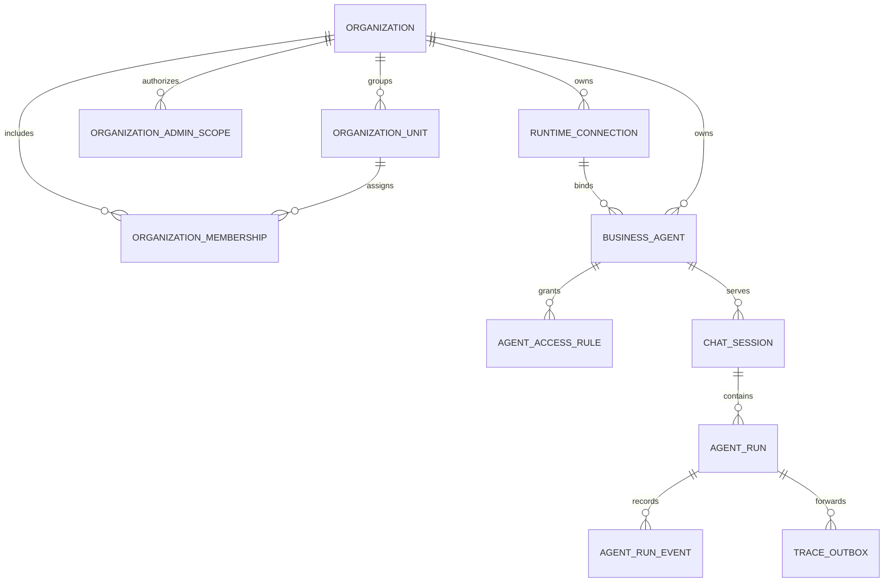
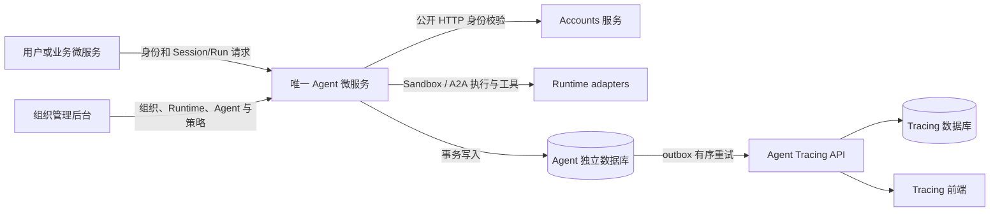

# PRD: 独立 Agent 微服务与 Runtime 能力迁移

- GitHub Issue: https://github.com/ZataZhang/zata-code-template-rust/issues/1

> ✅ **交付前置**：无，可立即开工。
> 结构化声明见 §8 Delivery Dependencies，**那里是唯一事实源**。

> ⬜ **验收状态**：未开工。
> 本行是 §9 Acceptance Checklist 的投影，**那里是唯一事实源**。

本 PRD 分为两部分：Part A 用行为样例和待确认决策锁定目标；Part B 记录代码库边界、实现建议和验收证据。

## Feature Overview（功能一览）

以下为 §10 功能需求的简要投影；验收以 §1 的行为样例为准。

- **集中式 Agent 服务**（FR-1、FR-2）：新增一个独立 Rust 微服务，迁移 Organization、Runtime 目录和 Business Agent 目录；其他业务微服务通过 HTTP 调用它，不在各业务服务中复制 Agent。
- **Runtime 与 Run 生命周期**（FR-3、FR-4）：Runtime 与 Agent 分开建模；迁移内置 Sandbox 与外部 A2A Runtime、组织授权、Session/Canonical Run、快照、幂等运行、SSE 进度流和取消能力。
- **统一轨迹**（FR-5）：Agent 服务持有 Run 执行状态，并把脱敏后的 Run 事件通过现有 HTTP 契约送到 agent-tracing，便于集中检索和诊断。
- **端到端使用**（FR-6）：提供组织管理员的 Runtime/Agent/授权配置入口和用户侧 Session 对话入口；服务、前端、数据库与 tracing 通过 Compose 和健康检查一起启动。
- **安全和韧性**（FR-7、FR-8）：分别验证服务、public 用户与 admin 组织 scope，执行组织 membership/Agent ACL/Run owner 策略；tracing 暂时不可用时 Agent Run 仍可完成，待投事件会在恢复后有序送达。

# Part A · 人审层 (Review Layer)

## 1. Introduction & Goals

### Problem Statement

Rust 仓库已有独立的 agent-tracing 微服务和事件接入契约，但没有 Agent 定义管理、模型调用、工具执行或 Run Runtime。其他业务服务现在不能通过统一入口使用 Agent 能力，也没有完整的 Agent 创建、执行、取消和观测闭环。

相邻仓库 ../ai-assistant 已包含 Organization、Runtime、Business Agent、授权、Session、Canonical Run、Sandbox、A2A、Skill、资源/产物和管理/使用界面的实现与行为说明。本需求把这些与 Agent 执行直接相关的通用能力迁移到 Rust 仓库里的**一个独立 Agent 微服务**。业务微服务调用该服务；不为每个业务微服务各自部署一份 Agent，也不让 tracing 服务承担模型调用或工具执行。

### Interpretation (解读回显)

#### 行为样例

| 验证方式 | 输入 / 操作 | 期望观察到的结果 |
|---|---|---|
| 👀 人审 + 自动验证 | 组织管理员只读查看部署声明的内置 Sandbox Runtime，新增一个 A2A 连接并从 Runtime 创建 Agent；配置组织/部门授权后，成员创建 Session、发送消息并取消一次 Run | Agent 始终绑定创建时选定的 Runtime；同一幂等键重放同一 Run；旧 Run 的 Runtime、提示词与执行来源快照不被后续配置改写；访问规则变更影响后续新 Run，历史仍受 owner ACL 保护；取消停止后续工作；Session 历史和成功结果可见 |
| 🤖 自动验证 | 组织 A 的成员、组织 B 的成员、未入组用户分别尝试发现和运行 Agent，并以合法/非法服务凭据调用服务 API | 同组织显式授权成员可运行；跨组织、未授权部门成员、个人 deny 和无效机器身份被拒绝；Session/Run 所有者隔离有效 |
| 🤖 自动验证 | agent-tracing 暂不可用时执行一个有效 Run，之后恢复 tracing | Run 仍能完成并从 Agent 服务读取；Agent 服务保留待投递事件，恢复后 tracing 收到一次有序、可重试的事件流 |

以上行为行会成为 §7.6 的验收 oracle；如修改行为单元格，应同步更新对应验收标准。

#### 我默默定了这些

- 系统中只有一个 Agent 微服务边界；它可以托管多个组织、Runtime connection、Business Agent、Session 和 Run。组织目录、Agent 授权与 Run 事实由该服务持有；登录身份仍由 accounts 公共边界验证。
- 业务微服务通过 Agent 服务统一入口发起调用。Agent 服务不依赖业务服务私有 crate，也不连接业务服务数据库。
- Runtime 是执行载体，Agent 是业务定义。`origin` 表示 builtin/external，`adapter_kind` 表示协议类型；二者独立。内置 Runtime 由部署配置声明并在管理面只读；外部 Runtime 由组织管理员配置 A2A Agent Card URL 和凭据别名。
- Agent 创建时绑定一个 Runtime；普通 Agent 更新不允许改绑。换 Runtime 时创建新 Agent。Agent 不直接选择模型 Provider；模型、工具和执行配置属于装配的 Runtime。
- 不新增 Agent 发布版本表。Run 创建时冻结 Agent descriptor checksum、Runtime binding、有效提示词、输入/资源清单和选择的 Skill 等执行快照；Agent/Runtime 后续配置变化只影响新 Run。
- Organization、部门、显式 public 用户/部门成员关系和 Agent allow/deny 规则由 Agent 服务拥有；accounts 只负责验证身份。admin 组织 scope 与 public 用户身份继续分离，平台管理员身份不自动获得任意组织的 Agent 目录权限。部门授权不沿父部门自动继承，个人 deny 覆盖 allow。
- Agent 服务是 Run 状态和运行事件的事实来源；agent-tracing 是集中诊断和数据流查看服务，通过现有接入能力接收事件副本。
- tracing 的写入失败不能回滚已成功的模型/工具运行；Agent 服务会本地保存待投递事件并进行有界重试。
- 迁移范围包含来源项目仍在使用的通用 Runtime 与 Agent 能力：Sandbox/A2A 运行、Skill 选择、Session/Run、SSE、资源和通用产物；当前真实执行适配范围以来源仓库代码为准（Freight Runtime 与历史 `third-party` 占位不作为可运行能力）。
- 用户界面放在现有 public/admin 前端中；组织管理、Runtime/Agent/授权管理进入 admin，Session 与 Run 进入 public；frontends/tracing 保持独立，只承担轨迹查看与诊断。
- Auto 路由与组织/部门入口策略、受治理的 Sandbox 子 Agent 委派，作为来源中现存的通用能力纳入迁移；具体策略、预算、授权和快照须逐项对照来源实现，不重造来源仓库已退役的旧路径。
- Outlook 宿主、Outlook 专用代理/资源流程和来源仓库的业务 Skill 内容不随本期迁移；Skill Runtime/授权/资产装配机制属于通用能力，具体业务 Skill 由后续业务需求单独接入。
- 默认不导入 ai-assistant 的用户、Agent、会话或历史 Run 数据；本 PRD 迁移可运行能力和接口，不做跨项目历史数据搬运。

#### 我理解为不做

- 不在 accounts、其他业务微服务或每个子模块中嵌入 Agent Runtime。
- 不改造 agent-tracing 来执行模型或工具，不让 Agent 服务直接写 tracing 数据库。
- 不迁移与 Agent/Runtime 无关的账号实现、Outlook 宿主、用户 CLI、业务 Skill 内容和专属业务工作流。
- 不建设新的通用消息队列平台、模型训练平台、Agent 回放平台或自动评测平台。
- 不承诺未经仓库确认的第三方 Provider、工具或 Runtime 模式；未在 ai-assistant 中真实实现的能力不列作迁移完成。

#### 可证伪的范围说明

完成后，Rust 仓库存在一个独立 Agent 服务。组织管理员能配置组织目录、外部 A2A Runtime、Business Agent 和授权规则；部署声明的内置 Runtime 只读显示。成员能从 public 创建 Session、使用显式 Agent 或已配置的 Auto 入口、提交文本/资源、读取 SSE 和历史并取消 Run；受信业务服务能经统一 HTTP 契约调用同一能力。Run 执行快照不依赖 Agent 版本表，所有可观测事件通过现有 tracing 契约送达。其他业务服务只持有调用契约和服务凭据，不持有 Agent Runtime 实现。所有必需服务启动后，能够通过公开入口完成一次真实 Runtime 执行并在 tracing 中看到对应 Run 事件。

- [ ] 我确认这段解读与行为样例准确表达了我的需求。

> **第一触点确认（2026-10-30，用户在对话中逐项给出）：** 确认 §1 解读与行为样例；确认决策一至六的推荐选项——一：Agent 服务持有组织目录/部门/成员与 Agent 授权，accounts 只认证身份；二：创建时绑定、无 AgentVersion 表、首发只跑现存 Sandbox 与 A2A adapter；三：迁移通用能力，Outlook 宿主与业务 Skill 内容不迁；四：独立服务凭据 + accounts 公共 HTTP 校验用户 + Agent 服务执行组织授权；五：交付 public/admin 入口，tracing 只收脱敏副本；六：Session/Canonical Run、幂等重试、持久序号事件、协作式取消。下列勾选框仍留给人自行勾选，执行方未代勾。

### What The User Gets

组织管理员能管理组织成员、内置/外部 Runtime、Business Agent 及访问规则；用户能在授权范围内与 Agent 对话、查看 Session 历史和 Run 进度、取消运行并获取获准产物。业务服务统一复用同一个 Agent 入口。运维人员可以独立部署 Agent 服务；Run 可在 Agent 服务中读取，在 tracing 界面集中检查事件流。

### Measurable Objectives

- 内置 Sandbox 与外部 A2A Agent 均可按部署可用性被正确列出/拒绝；至少一个真实配置的 Runtime 能完成 Run 并返回用户可见结果。
- 有权限的调用者可以创建 Session/Run、查询状态/事件、用幂等方式重试并取消；Agent descriptor 或 Runtime 配置更新不会改变已创建 Run 的执行快照。
- 一次有效 Run 在 Agent 服务和 agent-tracing 中都可检索；同一事件重试不在 tracing 中重复创建。
- tracing 中断期间 Agent Run 仍可完成；待投事件在恢复后有序送达且可核对。
- 全部必需微服务和前端通过仓库部署流程启动后，用户侧和管理员侧的主路径均可使用。

## 2. Human Review Map (介入与风险地图)

以下是实施前需要确认的产品边界。推荐项是本 PRD 的默认方案，空框由用户在审阅时选择；执行者不得代为勾选。

### 决策一：Organization、成员关系与 Agent 授权由谁持有

来源项目以 Organization 为租户边界，保存部门和显式用户/部门成员关系；Agent 的授权由组织、部门、用户 allow 与个人 deny 规则决定。当前 Rust accounts 提供登录身份，但没有同等的组织目录。推荐 Agent 服务自己持有 Organization、部门、public 用户成员关系及授权规则，并通过 accounts 公共 HTTP 边界验证 user ID。组织管理员 scope 使用 admin 域已验证身份单独映射；不把 admin 与 public 用户合并，不复制 accounts 私有数据，也不依赖账号私有 crate。

**请确认：** 是否接受 Agent 服务持有业务组织/部门/成员关系？如果组织成员真源应由其他服务拥有，需要开工前确定它的公开 HTTP 契约和同步语义。

**验收：** 组织之间隔离；组织管理员只能管理其 scope，平台管理员不会自动获得组织目录权限；public 部门授权只使用显式 membership；用户 deny 覆盖 allow；成员移除阻止新 Agent 使用；Session/Run 仍按 owner 隔离。

- [ ] 推荐：由 Agent 服务持有组织目录、部门、成员映射和 Agent 授权；accounts 只认证身份。
- [ ] 备选：成员真源属于其他现有服务，开工前定义可调用的公开接口。

**数据结构供审阅：** 本模型刻意没有 `AGENT_VERSION`。Agent 更新直接更新 Business Agent descriptor；每个 Run 冻结运行所需的 Agent/Runtime/提示词/资源等快照。Tracing 事件仍由 tracing 服务持有，不跨库外键或共享事务。



### 决策二：Runtime 与 Agent 的迁移边界

建议照来源模型分开迁移 Runtime connection 和 Business Agent：`origin` 只回答 Runtime 是部署内置还是组织外部接入；`adapter_kind` 只回答执行协议。部署声明的内置 Sandbox Runtime 在管理面只读，不做 endpoint、发现或删除；组织管理员可创建 A2A Runtime，填 Agent Card URL 与可选凭据别名。Agent 创建时绑定 Runtime，普通更新不改绑；Agent 只持有业务描述、提示词、负责人、启停和授权规则，不直接选 Provider。Run 快照替代虚构的 Agent 版本表。来源历史 Freight Runtime 与 `third-party` 占位不可运行，不迁移为可执行适配器。

**请确认：** 是否以“当前可运行的 Sandbox + A2A 1.0 JSON-RPC”为 Runtime 首发范围？来源仓库中当前真实 adapter、能力和限制以源码为准；任何新增协议需单独决策。

**验收：** 内置 Runtime 只读；A2A 连接可校验/发现并按 Card 执行；Agent binding 创建后不变；已创建 Run 保留完整 descriptor checksum、Runtime binding 与有效提示词快照。

- [ ] 确认 Runtime/Agent 分层、创建时绑定、无 Agent 发布版本表，并将首发可运行来源限定为现存 Sandbox 与 A2A adapter。

### 决策三：通用能力迁移到什么深度

建议把来源中仍在使用的通用 Agent 能力一起迁入服务：组织目录与显式 ACL、Runtime/Agent 管理、Session/Canonical Run、Auto/入口策略、幂等、事件/SSE、取消、Skills 运行时与授权、用户资源和通用产物、受治理的 Sandbox 子 Agent 委派。迁移机制和稳定语义，不搬 Outlook 宿主、业务 Skill 内容或来源仓库的其他产品流程。管理后台承载组织/Runtime/Agent/策略管理，public 承载 Session 与 Run；tracing 保持独立。

**请确认：** 是否接受该通用能力范围？若要分期，请指出需从本 PRD 移出的功能组，避免首期范围过宽。

**验收：** 每个纳入的功能组有映射到来源现存实现的能力清单、Rust API/UI 路径和独立验收；排除项列明源码位置和排除理由。

- [ ] 推荐：迁移上述通用能力；Outlook 宿主、业务 Skill 内容及非 Agent 产品流程不在本期。
- [ ] 备选：仅迁移组织/Runtime/Agent 目录与 Canonical Run/Sessions，其余功能另开 PRD。

### 决策四：业务服务身份与最终用户身份

业务微服务需要机器身份，最终用户身份不能只由调用方在 JSON 中自报。建议每个调用服务用独立部署凭据；Agent 服务通过 accounts 公开 HTTP 验证用户 token，并在 Run 审计中分别记录 service principal 与最终用户。Agent 自己按组织 membership 和 Agent Access Rule 做业务授权。

**请确认：** 是否采用“每服务独立凭据 + accounts 公共用户身份校验 + Agent 服务组织授权”的组合？若 accounts API 不支持用户 token 校验，应扩展公开 HTTP 契约，而不是依赖内部账号 crate 或共享数据库。

**验收：** 未知服务、伪造身份、跨组织访问和越权 Run 被拒绝；有效 Run 可区分服务身份、最终用户及组织授权依据。

- [ ] 确认采用独立服务凭据，用户身份由 accounts 公共 HTTP 校验，组织授权由 Agent 服务执行。

### 决策五：前端入口与 tracing 事件范围

建议交付 public Session/Run 工作台与 admin 组织/Runtime/Agent/策略管理；frontends/tracing 独立诊断 Run 事件。Agent 服务数据库保存完整执行事实，tracing 只收诊断投影，包含 Run、模型/工具/路由/委派步骤、状态、时间、低敏错误类别和非敏感关联 ID。API 密钥、访问 token、A2A endpoint/credential alias、完整提示词、用户资源正文和未批准工具参数/结果默认不发送。

**请确认：** 是否采用脱敏事件投影？若为诊断允许更多内容进入 tracing，应逐字段指定授权范围、可见角色和保留周期。

**验收：** public/admin 可完成已选能力路径；tracing 能按 Run 检查脱敏事件；tracing 中断不阻塞 Run，恢复后按序幂等续传。

- [ ] 推荐：交付 public/admin 入口，tracing 收脱敏事件副本，Agent 服务保留完整 Run 事实。
- [ ] 备选：本期只交付 Agent API；界面另行规划。
- [ ] 备选：批准指定 tracing 字段可承载提示词/工具内容，并补齐访问和保留策略。

### 决策六：Canonical Run、Session 与取消语义

建议按来源实现采用产品 Session 一对一映射 Thread、每条消息创建一个 Canonical Run；Run 创建用 `Idempotency-Key`，相同用户/key/canonical request 重放原 Run，不同请求返回冲突。持久事件序号支持 SSE 重放；Run 冻结 Agent、Runtime、有效提示词、输入/资源和可选 Skill 快照。取消幂等、进入终态并停止后续工作，但不承诺撤销已发出的 Shell/MCP/A2A 副作用。

**请确认：** 是否按此迁移核心 Run 语义？Auto 路由和 child Run 也必须沿用同一 Canonical Run 内核、事件和授权规则。

**验收：** 幂等重试不创建重复 Run；配置更新不改写历史快照；SSE 可断线续读；取消后不再开始新工作并准确反映无法回滚的外部副作用。

- [ ] 确认采用 Session/Canonical Run、幂等重试、持久序号事件和协作式取消语义。

### 自动门禁，不需要逐项人工审阅

接口契约、权限拒绝路径、Run 生命周期、待发送事件重试、服务健康状态和前端真实入口都由执行侧提供可复核验证；上面列出的组织数据所有者、Runtime/Agent 模型、通用能力迁移深度、调用身份、界面/tracing 范围和 Run 语义需要人工确认。

### 本次明确不涉及

本期不为各业务微服务复制 Agent，不迁移 ai-assistant 中与 Agent/Runtime 无关的功能或历史数据，也不让 tracing 执行 Agent。

## 3. Usage And Impact After Implementation

- **组织管理员**：维护 Organization、部门、显式成员关系、Runtime connection、Business Agent、访问规则和 Auto/入口策略；内置 Runtime 只读。
- **普通用户**：在 public 工作台创建/恢复 Session、使用授权 Agent 或 Auto 入口，发送文本与资源，查看历史消息、Run 状态/SSE 和产物；需要时取消 Run。
- **业务微服务调用方**：使用版本化 HTTP API 和自己的服务身份创建或查询 Session/Run；提供幂等键，不访问 Agent 数据库；API 调用也遵守最终用户授权。
- **运维人员**：按 Compose 健康状态启动 accounts、agent-service、agent-tracing 以及前端；Agent 服务读取 Nacos 配置的独立数据库、内置 Runtime 声明与密钥映射；tracing 通过 producer API 收事件。
- **影响边界**：新增独立 Agent 服务及 Organization/Runtime/Agent/Session/Run 数据、配置和镜像；public/admin 增加工作台和管理页/API 客户端；Compose、部署说明和配置示例增加 Agent 服务项。accounts 继续保持独立服务边界。
- **开发者/集成者**：其他业务服务开发者使用统一版本化 HTTP 契约和独立服务凭据，按 Session/Run ID 获取历史和进度；不引入 Agent 私有 crate 或数据库访问。
- **兼容与数据影响**：现有 accounts 登录和 agent-tracing producer/query 接口继续可用；新增 Agent 配置不覆盖既有用户数据；首版不导入 ai-assistant 历史 Agent、用户、会话或 Run。

## 4. Requirement Shape

**Actor：** 组织管理员、已登录用户、受信任的业务微服务调用方、Agent/Runtime 实施者和部署运维人员。

**Trigger：** 组织管理员维护组织授权、Runtime 与 Agent；用户创建 Session 并发送消息，或受信业务服务提交带身份上下文的 Run 请求；运维人员启动完整站点。

**Expected behavior：** Agent 服务验证机器/用户身份与组织权限，按 Agent 的不可变 Runtime binding 执行，并从当前定义生成 Run-owned 快照；保存 Session/Run 状态并持续提供 SSE 进度；同一执行事件可在 tracing 服务中检索。

**Explicit scope boundary：** 一个共享 Agent 微服务承载多个 Agent；不把 Runtime 放进每个业务服务，不共享 accounts/tracing 数据库，不迁移 ai-assistant 其他业务或历史数据。

**Scope cohesion assessment：** Organization/Agent 授权、Runtime binding、Session/Run、调用身份、前后台入口与 tracing 数据策略共同组成一次可用的 Agent 执行链路。Auto/Skills/资源/委派建立在同一 Run 内核和授权上；如执行时发现规模需拆分，应先更新 PRD 的依赖与阶段，不得无记录地省略来源能力。历史数据搬运明确排除，不作为隐藏阶段。

# Part B · 执行器层 (Build Layer)

## 5. Repository Context And Architecture Fit

- **现有后端边界：** services/accounts/ 是账号组合根，services/agent-tracing/ 是事件写入/查询服务；两者都有各自私有 crate。新 Agent 服务按 services/<service>/ 模板和 core/api/engines/infrastructure 依赖方向搭建，业务服务间只经 HTTP 通信。
- **Tracing 现状：** services/agent-tracing/ 已有版本化 producer HTTP/JSON 契约、持久化确认和幂等续传。相关待办 PRD 是 tasks/pending/P1-FEAT-20261029-150130-agent-tracing-services.md；本需求不重复实现 tracing，且其服务契约代码已经存在，因此可独立执行，不依赖该待办 PRD。
- **Accounts 现状：** 账号边界由 tasks/archive/P1-ARCH-20261029-120000-reusable-accounts-service.md 定义。新服务不依赖账号私有 crate，不共享账号数据库；身份校验若需新增能力，只能扩展公开 HTTP 契约。
- **来源实现：** ../ai-assistant/docs/guides/business-agent-catalog.md、canonical-agent-runs.md、sandbox-runtime.md、a2a-runtime.md、agent-delegation.md、mcp-connection-management.md、agent-run-tracing.md，以及 docs/prototypes/runtime-and-agent-management.html、agent-run-tracing.html。实施时继续核对源码和迁移状态，只迁移仍真实支持的行为。
- **前端落点：** public 最近入口是 frontends/public/app/(app)/app/dashboard/page.tsx 和同组 layout；admin 最近入口是 frontends/admin/src/routes/_authenticated/users/index.tsx 及认证 layout；tracing 保持 frontends/tracing/src/App.tsx。public/admin 只经 HTTP API 通信，管理员域与用户域保持分离。
- **部署与验证约束：** docker-compose.yml 已编排 accounts 和 agent-tracing；justfile 有 web-check、web-admin-check、web-e2e、web-tracing-check 和 tracing 启动入口。新服务应补独立镜像、配置、健康检查与真实入口验证；必须遵循 Nacos 默认配置和秘密注入约定。
- 仓库没有 ROADMAP.md，也没有其他 Agent Runtime PRD；本 PRD 不假设未声明的 Agent 工作已经存在。

### Existing PRD Relationship

| Related PRD | Current relationship | Decision |
|---|---|---|
| tasks/pending/P1-FEAT-20261029-150130-agent-tracing-services.md | Related pending work; producer API and service contract code are already present | No duplicate implementation, no dependency/blocking relationship; this PRD can run independently and must recheck the live schema |
| tasks/archive/P1-ARCH-20261029-120000-reusable-accounts-service.md | Completed service-boundary decision | Reuse its public HTTP identity boundary; do not depend on or modify accounts private crates |

## 6. Recommendation

### Recommended Approach

新增 services/agent/，作为唯一 Agent 微服务，按现有服务模板登记 workspace 成员、组合根、私有 crate、配置和独立数据库。建议私有包使用 tpl-agent-core、tpl-agent-api、tpl-agent-engines、tpl-agent-infrastructure 命名；只有组合根装配各层。core 持有 Organization/Runtime/Agent/授权/Session/Run 规则与端口；api 提供用户、组织管理、目录、Session、Run、资源与 Skill HTTP 契约；engines 适配 Sandbox、A2A、模型/工具与 Skill 执行；infrastructure 实现独立持久化、Blob、配置、服务身份和 tracing outbox。

选择新服务是因为组织 Agent 目录、运行状态、Provider/Runtime 凭据和工具执行需要由一个独立边界拥有及部署；现有 tracing 只收集/查询轨迹，accounts 提供登录身份，二者都不适合承载 Runtime。新建一个服务引入独立容器和数据库迁移成本，但比把 Runtime 塞入 tracing 或在每个业务服务复制 Runtime 更少责任重叠，也能让所有调用方共享同一接口。

### Proposed Solution Summary (实现机制)

- **输入由谁提供：** Ops 提供内置 Runtime 声明、基础提示词和密钥环境映射；组织管理员提供组织、成员关系、外部 Runtime、Agent descriptor、访问规则与入口/委派策略；用户或业务服务提供身份凭据、Session/Run 输入、资源 ID 和幂等键。Agent 不接受调用方覆盖 Runtime、endpoint、模型或快照。
- **插入现有流程：** public/admin 通过 Agent HTTP API 调用；业务服务调用同一版本化契约；Agent 服务通过 accounts 公开身份接口校验登录主体，通过 agent-tracing producer API 投递事件，不依赖任一服务私有 crate。
- **状态与输出：** Agent 独立 DB 保存组织目录、显式 membership、Runtime connection、Agent descriptor/ACL、Session、Run、快照、事件、资源元数据、产物元数据和 tracing 待投记录。无需 AgentVersion 表；Run 保存其执行时的 descriptor checksum 和有效配置快照。Agent 服务返回会话/运行结果与进度，tracing 接收脱敏诊断事件。
- **避免的复杂度：** 不共享数据库、不写分布式事务、不增加通用消息队列，也不在各业务微服务放一份 Runtime。通过 Agent DB 本地事务与待发送事件记录实现故障后恢复。

### Alternatives Considered

- **把 Runtime 加到 agent-tracing：** 拒绝。它会让诊断服务同时拥有业务执行、模型凭据和运行状态，破坏现有“事件生产者与追踪存储分离”的边界。
- **每个业务服务各自嵌入 Agent crate：** 拒绝。会产生多个运行状态源、凭据副本和版本差异，违反用户已确认的单一 Agent 服务边界。
- **把 Agent 能力塞入 accounts：** 拒绝。Agent 不是账号业务，且会破坏业务服务私有层隔离。

## 7. Implementation Guide

This section is a living implementation guide based on current repository analysis. If implementation discovers additional affected files, hidden dependencies, edge cases, or a better path, update this PRD before proceeding.

### 7.1 Core Logic

服务启动时把已装配且通过声明校验的 builtin Runtime 幂等对齐到只读目录；外部 connection 由组织管理员维护，A2A Card 发现/健康检查只对外部连接开放。创建 Agent 时校验 Runtime 属于当前组织或可供其使用的 builtin，冻结 binding 身份；Agent 更新只改业务 descriptor、提示词、启停和授权，不改 Runtime binding。public Agent 目录与 Run 创建共用一个授权判定：组织 membership 是前提，组织/部门/user allow 合并，user deny 再收窄；部门不做父子递归。

用户先创建 owner-safe Session；每条 Session message 生成一个 canonical Run，明确 agent_id 或按会话/入口策略/Auto 规则裁决。Run 创建先 canonicalize 请求并按 user + idempotency key + request digest 查重，再在一个事务写 Run、AgentExecutionSnapshot、ContextPackSnapshot、首批事件和幂等记录。快照保存 Runtime binding、Agent descriptor checksum、生效提示词、输入/资源摘要、Skill 与路由/委派治理信息；后续 Agent/Runtime/授权配置变化不改写历史 Run。持久单调事件序号为 polling/SSE 断线续读提供事实源。

执行端按快照选择 Sandbox 或 A2A adapter。Sandbox 使用受限会话、平台工具、获授权 MCP、Skill 资产和资源/产物交换；A2A 按来源已支持的 A2A 1.0 JSON-RPC Card/Task 子集执行。未注册 Runtime 在 Run 创建时 fail closed。Auto/入口策略仅从授权且 runnable 的候选中选择；受治理的 `delegate_task` 创建同内核的 child Run 并受组织/用户授权、策略、并发和用量上限约束。取消先进入 cancelling，传递到当前 Runtime/模型流；外部已完成 Shell/MCP/A2A 操作不保证回滚。

Run 事件和 tracing 投影在 Agent DB 本地事务落盘；有界 outbox worker 使用 tracing producer API 确认点顺序投递。Tracing 失败不改变 Run 真相；同一事件重试必须幂等。API 至少涵盖组织与成员管理、Runtime/Agent/访问规则/入口策略/委派策略管理、可用 Agent/Skill/用户资源目录、Session 与消息、Run 状态/SSE/取消、产物下载。精确路径以 OpenAPI 定稿，需同步 public/admin 手写类型及错误码映射。

Runtime adapter 和外部输入都需超时、请求/响应大小上限、并发/速率上限和低敏错误类型；资源与产物需 owner ACL、摘要/大小校验和非路径式 ID。不得通过 Run 参数推断权限、Provider secret、endpoint 或工具授权。

### 7.2 Change Impact Tree

以下文件级路径是当前仓库分析形成的预计清单；仍可能发现生成文件或现有注册点，实施者必须使用 7.5 Executor Drift Guard 重新搜索，并在新增受影响文件时更新本 PRD。

```text
Cargo.toml [修改] 【总结】登记唯一 Agent 服务及私有 crate 为 workspace 成员。
services/agent/Cargo.toml [新增] 【总结】声明 Agent composition root 的本地依赖和二进制入口。
services/agent/src/main.rs [新增] 【总结】读取配置并启动 Agent 服务进程。
services/agent/src/composition.rs [新增] 【总结】装配目录、Session/Run、Runtime、Blob 和 tracing 端口。
services/agent/src/server.rs [新增] 【总结】提供健康检查、服务启动与优雅关闭。
services/agent/Dockerfile [新增] 【总结】独立构建 Agent 服务镜像。
services/agent/openapi.yaml [新增] 【总结】定义组织管理、Runtime/Agent、Session/Run、Skill/资源契约。
services/agent/crates/core/src/organization.rs [新增] 【总结】实现 Organization、部门和显式 membership 规则。
services/agent/crates/core/src/runtime_catalog.rs [新增] 【总结】实现 builtin/external connection 与不可变 Agent binding。
services/agent/crates/core/src/agent_catalog.rs [新增] 【总结】实现 Business Agent descriptor、访问规则与 runnable 判定。
services/agent/crates/core/src/session.rs [新增] 【总结】实现 owner-safe Session、Thread 映射和消息行为。
services/agent/crates/core/src/run.rs [新增] 【总结】实现 Canonical Run、幂等、快照、状态机与持久事件规则。
services/agent/crates/core/src/routing.rs [新增] 【总结】实现入口策略、Auto 候选裁决和路由快照。
services/agent/crates/core/src/delegation.rs [新增] 【总结】实现受治理 child Run、权限求交和预算策略。
services/agent/crates/core/src/skill_access.rs [新增] 【总结】实现 Skill 可见性、授权和 Run 选择规则。
services/agent/crates/core/src/resources.rs [新增] 【总结】实现 owner-safe 资源、ContextPack 和产物元数据规则。
services/agent/crates/api/src/admin/ [新增] 【总结】提供组织、Runtime、Agent、ACL、入口及委派策略路由。
services/agent/crates/api/src/sessions.rs [新增] 【总结】转换 Session、消息、历史与发送请求。
services/agent/crates/api/src/runs.rs [新增] 【总结】转换 Run 创建、状态、SSE 和取消请求。
services/agent/crates/api/src/resources.rs [新增] 【总结】提供用户资源上传/读取/删除和产物下载入口。
services/agent/crates/engines/src/sandbox.rs [新增] 【总结】适配受限 Sandbox、平台/MCP 工具与运行资产。
services/agent/crates/engines/src/a2a.rs [新增] 【总结】适配来源已支持的 A2A 1.0 JSON-RPC Card/Task 子集。
services/agent/crates/engines/src/skills.rs [新增] 【总结】装配 Runtime Skill 指令与资源资产。
services/agent/crates/infrastructure/src/persistence.rs [新增] 【总结】实现组织目录、connection、Agent、Session/Run 与事件持久化。
services/agent/crates/infrastructure/src/blob_store.rs [新增] 【总结】实现受控资源/产物 Blob 读写和 checksum 校验。
services/agent/crates/infrastructure/src/tracing_outbox.rs [新增] 【总结】按确认点顺序幂等投递脱敏事件到 agent-tracing。
services/agent/migrations/ [新增] 【总结】创建组织、成员、Runtime、Agent ACL、Session/Run、资源和 outbox schema。
services/accounts/tests/architecture.rs [修改] 【总结】登记并约束 Agent 私有 crate 的服务内依赖方向。
services/agent/tests/http_end_to_end.rs [新增] 【总结】验证真实 Session/Run、授权、Runtime adapter 与 tracing 入口。
services/agent/tests/architecture.rs [新增] 【总结】阻止 Agent 层依赖倒置和跨服务私有 crate 引用。
frontends/public/app/(app)/app/agents/ [新增] 【总结】提供 Session 工作台、Agent/Auto 入口、Run 流和产物展示。
frontends/public/lib/api/agent.ts [新增] 【总结】实现前台组织可用目录、Session/Run/资源 HTTP 客户端和手写类型。
frontends/admin/src/routes/_authenticated/organizations/ [新增] 【总结】注册组织、部门与成员管理路由。
frontends/admin/src/routes/_authenticated/agent-runtimes/ [新增] 【总结】注册外部 Runtime 管理页并展示只读内置 Runtime。
frontends/admin/src/routes/_authenticated/agents/ [新增] 【总结】注册 Business Agent、授权、Auto 入口和委派策略页面。
frontends/admin/src/api/agents.ts [新增] 【总结】提供管理端组织/Runtime/Agent HTTP 客户端与契约类型。
frontends/admin/src/locales/en.json [修改] 【总结】增加 Agent 服务管理界面英文文案。
frontends/admin/src/locales/zh.json [修改] 【总结】增加 Agent 服务管理界面中文文案。
docker-compose.yml [修改] 【总结】编排 Agent 服务、独立数据库/依赖和健康检查。
justfile [修改] 【总结】增加 Agent 构建、启动、真实入口验证和全栈命令。
.github/workflows/ci.yml [修改] 【总结】验证 Agent crate、前端、契约和镜像构建。
.github/workflows/cd.yml [修改] 【总结】将 Agent 服务镜像加入独立发布矩阵。
config.toml [修改] 【总结】记录 Agent 默认配置、builtin Runtime 声明及密钥环境变量映射。
.env.example [修改] 【总结】列出 Agent 服务配置入口并保持密钥值为空。
deploy/nacos/rust-study-compose.properties.example [修改] 【总结】同步 Agent 服务非秘密配置入口。
README.md [修改] 【总结】补充 Agent 服务边界、启动入口和服务清单。
docs/architecture/system-design.md [修改] 【总结】记录 Organization/Runtime/Agent 服务边界与数据库所有权。
docs/ai-standards/architecture.md [修改] 【总结】更新新服务依赖方向及服务清单。
docs/guides/agent-service.md [新增] 【总结】说明目录、身份、Session/Run、Runtime、Skill、资源与排障。
docs/guides/configuration.md [修改] 【总结】说明 Agent 的 Nacos、数据库和 Runtime secret 配置。
docs/guides/deployment.md [修改] 【总结】记录 Agent 健康依赖、Compose 启动与发布方式。
docs/migration-status.md [修改] 【总结】记录 Agent/Runtime 能力迁移清单与业务专属排除项。
frontends/public/README.md [修改] 【总结】同步前台 Agent API 类型、错误码和登录边界。
```

若实际 frontend 目录、CI workflow 或配置加载器与预计不同，按搜索结果调整文件树；不要为了匹配清单新造重复路由或配置抽象。

### 7.3 Risk Classification Register

| Change point | Tier | Decisive dimension / override | Intervention | Oracle / gate |
|---|---|---|---|---|
| Organization membership, Runtime binding, Agent ACL, Session/Run and event/outbox schema | R2 | Persistent data and idempotent transaction; database schema is a human-confirm fixed zone | 用户确认组织数据所有者及 ER 图；迁移往返与授权/状态机由执行侧验证 | rv-1、rv-2、rv-3 |
| Auto routing, Skill/resource snapshot, delegation and cancellation semantics | R2 | Core business orchestration and idempotent side effects are fixed-zone behavior | 用户确认通用能力迁移范围；真实 Run lifecycle gate | rv-1 |
| Service identity, user authorization, sensitive event projection | R3 | Authentication trust boundary and possible credential/data exposure | 用户确认信任与数据可见范围；真实入口负控验证拒绝/脱敏 | rv-2 |
| Public Session workspace, admin organization/runtime/agent workflow and configured Runtime execution | R2 | Cross-component user behavior and external runtime | 用户查看真实入口证据；端到端执行与 fresh read | rv-1 |
| Tracing outage recovery and event order | R2 | Persistent retry/checkpoint behavior across services | 真实停启 tracing 并从独立查询端核对 | rv-3 |
| Agent composition root, configuration, and Compose startup | R2 | Startup/health order affects all Agent consumers and live execution | Compose config/healthy startup gate plus full Run entry | rv-1 |
| Generated route/client/type registration | R1 | Contained interface plumbing with clear compiler/e2e failure | 执行者按现有 frontend checks 和 browser e2e 验证 | web check/e2e + contract checks |

### 7.4 Data, Identity, and Deployment Boundaries

§2 决策一的 ER 图是数据归属的审阅图：Agent 数据库保存 Organization/admin scope/public Unit/Membership、Runtime connection、Business Agent descriptor/Access Rule、Session/Run/快照/事件、资源元数据及 tracing outbox；不创建 Agent 版本表。用户和管理员身份分别由 accounts public/admin 边界验证，组织授权状态由 Agent 服务读取。Tracing 数据库仍独立；不添加跨服务外键或共享事务。实施者如需调整组织成员真源、加入额外业务实体或改变 Run 快照，先更新 ER 图与决策记录。


跨服务凭据按调用服务隔离，由部署秘密注入；public 用户与 admin 组织管理员身份分别从 accounts 的对应公开 HTTP 边界验证，Agent 服务执行 public membership 与 admin scope 授权。若公开契约不足，先新增明确的 accounts HTTP 契约，不依赖 tpl-accounts 等私有包。不要把 Provider 密钥放入 Run 输入、日志或 tracing 事件。

Agent 服务从 Nacos 应用 TOML 读取独立数据库配置和 builtin Runtime 声明；.env.local 只提供 Nacos 地址与认证信息。A2A credential alias 映射的真实密钥由环境/秘密管理注入，.env.example 留空。Compose 使用健康依赖；缺少外部 Runtime 凭据不妨碍服务启动，但对应 Runtime 明确不可用，真实 Sandbox/A2A Run 按各自部署凭据和环境记录验证结果。

### 7.5 Executor Drift Guard

实施前后运行以下搜索确认入口、契约和实际落点；若结果与 PRD 路径不同，先更新 Change Impact Tree。

```sh
rg --files services/agent services/agent-tracing frontends/public/app frontends/admin/src/routes
rg -n "producer|event|schema|checkpoint|idempot" services/agent-tracing
rg -n "Agent|Runtime|sandbox|A2A" ../ai-assistant/docs/guides ../ai-assistant
rg -n "agent-tracing|accounts:" docker-compose.yml justfile
rg -n "tpl-agent-|agent-service" Cargo.toml services/accounts/tests/architecture.rs services/agent
```

架构验收还应搜索 Agent 私有 crate 不在 accounts/tracing 之外被引用，业务微服务不含 Agent 私有数据库地址；以 services/accounts/tests/architecture.rs 守卫和实际配置搜索作为 gate。生产代码不得增加仅供测试的故障开关或观测钩子。

### Flow / Architecture Diagram



### 7.6 Realistic Validation Plan

真实 Runtime 验证使用部署配置中的 Sandbox 或 A2A 凭据，并单独记录环境与 adapter。可用本地 A2A protocol fixture 验证外部协议映射，但不能用它替代至少一种实际配置 Runtime 的运行验收；fixture 不得替换 Agent 编排、持久化、accounts 身份校验或 tracing producer。真实模型/Runtime 响应记录实际结果、尝试和事件，不要求固定回答文本、成功次数或成功率。

```yaml
- id: rv-1
  behavior: 组织管理员查看 builtin Runtime 并接入 A2A Runtime、创建绑定该 Runtime 的 Agent 并配置访问规则；用户从 public 创建 Session、发送消息后以同一幂等键重试、更新 Agent 后再发一条消息并取消一个 Run；成功结果和 tracing 脱敏事件可见
  reviewer: human
  presentation: 组织/Runtime/Agent 管理页、用户 Session/Run 进度与结果、tracing Run 详情截图；证据路径见 §9.1
  real_entry: 新增 just agent-e2e --scenario organization-runtime-session-lifecycle；真实部署 Runtime 的 smoke 需显式配置并记录类型/版本
  expected: builtin Runtime 只读、Agent 绑定创建时选定 connection；同一幂等键得到同一 Run；Agent descriptor/Runtime 配置更新不改写历史 snapshot；更新后的请求使用当前 Agent snapshot；SSE 可从最近持久序号续读；取消后不再启动新工作；来源纳入范围的 Sandbox/A2A、Skill、资源/产物、Auto 和受治理 child Run 均按 adapter/API 契约验证；成功 Run ID、状态和 tracing 事件序号经独立查询一致
  mock_boundary: 浏览器、Agent API/DB、accounts 身份边界、tracing API/DB 均真实；允许本地 A2A protocol fixture 只模拟外部 A2A endpoint，必须执行真实 adapter 和整个 Run 栈；至少一种目标部署 Runtime 使用其真实配置实跑并单独标记
  tier: R2
  test_layer: e2e
  required_for_acceptance: true
  critical_value_source: organization_id、Agent ID、Session ID、Run ID 和 snapshot provenance 来自 Agent 服务写入后的独立查询；事件序号来自 tracing 查询 API；截图值从真实页面读取后原样记录
  must_cross: 浏览器 → public API → Agent HTTP API → accounts identity boundary → organization/ACL → Session/Run/Runtime adapter → Agent DB/outbox → tracing producer API → tracing DB/query API
  forbidden_bypasses: 前端静态假数据、直连数据库、测试专用 tracing 内存替身、伪造成功响应
  fresh_state_probe: 每轮生成新组织/成员、Agent descriptor 状态、Session 和幂等键；测试前确认 Run ID 不存在，更新前后两个 Run 的 snapshot 与取消终态均从独立 Agent/tracing 查询入口读取
  final_tree_evidence: 保存截图、完整 Run ID、结构化测试报告、最终请求路径和 commit/tree 证明；改动任一链路边界后重跑
  negative_control: 在本地 A2A protocol fixture 返回受控错误并断言真实 adapter 将 Run 写为 Failed 终态；不改生产逻辑或加入故障开关
  expected_fail: 若 Run 被报告为 Succeeded、错误终态缺失或 tracing 伪报成功完成事件，验收必须失败

- id: rv-2
  behavior: 无效服务凭据、伪造用户身份、跨组织成员、未获部门显式授权的成员、个人 deny 用户或越权读取他人 Session/Run 时无副作用；有效 Run 的 tracing 事件不会携带密钥、完整提示词或未批准的工具内容
  reviewer: verifier
  real_entry: 新增 just agent-e2e --scenario authorization-and-redaction；完整 Compose 栈、无效/有效身份与标记敏感输入
  expected: 未授权请求返回约定错误码且无 Run/事件副作用；admin scope 与 public identity 隔离，跨组织管理被拒；组织/unit/user allow/deny 规则符合来源语义，部门父级不继承；Session/Run owner ACL 有效；有效 Run 的 tracing 字段白名单通过，标记秘密不出现在事件、响应或日志
  mock_boundary: Agent API、Agent DB、accounts 身份验证边界、tracing 查询真实；Provider 可在本地 fixture，但测试不得绕过认证 middleware 或 tracing 投影
  tier: R3
  test_layer: integration
  required_for_acceptance: true
  critical_value_source: 请求返回码、Agent DB Run 记录、tracing 查询响应和由该 Run 产生的脱敏日志样本
  must_cross: 外部 HTTP API、服务凭据校验、accounts public/admin 身份验证、Organization admin scope 和 public membership、AgentAccessPolicy、Session/Run owner 授权、持久化边界
  forbidden_bypasses: 伪造请求上下文、跳过 middleware、信任调用方自报 user_id、测试专用身份开关、tracing 直写
  fresh_state_probe: 使用随机 user/service 身份和标记输入，在请求前后从独立 Agent/tracing 查询端分别确认记录和敏感字段
  final_tree_evidence: 保存请求/状态码、数据库差异、tracing 响应和日志断言并关联最终代码树
  negative_control: not needed — 新 Agent API 路径在实现前不存在；新真实入口测试会比较身份拒绝状态和持久化副作用，不依赖生产故障注入
  expected_fail: 任何未授权 Run 被创建、被执行或投递事件，或标记秘密出现在禁止字段中，验收都必须失败

- id: rv-3
  behavior: tracing 暂不可用期间 Agent Run 仍按已选 Runtime 完成并可从 Agent 服务读取；tracing 恢复后事件通过 outbox 有序送达，且重复投递不产生重复事件
  reviewer: verifier
  real_entry: 新增 just agent-e2e --scenario tracing-outage-recovery；完整 Compose 栈，按场景停止并恢复 tracing API
  expected: Run 不因 tracing 故障失败；Agent 数据库保留 pending outbox；恢复后 tracing 查询到完整有序事件且唯一键无重复
  mock_boundary: Agent 服务、两个数据库和 tracing HTTP API 真实；通过真实停启 tracing 容器制造故障，不替换 producer 客户端
  tier: R2
  test_layer: integration
  required_for_acceptance: true
  critical_value_source: Agent Run 状态与 outbox 记录来自 Agent 数据库，事件序号和唯一数来自 tracing API 独立查询
  must_cross: Agent Run 事务、outbox worker、HTTP 重试、tracing 持久化/幂等查询
  forbidden_bypasses: 直接插入 tracing 表、只验证 mock HTTP 请求次数、不真实重启 tracing 服务
  fresh_state_probe: 使用新 Run ID，在 tracing 停止前确认该 ID 无记录，恢复后轮询独立 tracing API
  final_tree_evidence: 保存故障注入时间线、Run 状态、outbox 前后状态和 tracing 事件序号清单
```

Human-decision oracle map: D-01 → rv-1 and rv-2; D-02 → rv-1; D-03 → rv-1; D-04 → rv-2; D-05 → rv-1, rv-2 and rv-3; D-06 → rv-1. D-07 is already confirmed in §13. These IDs stay in Part B and do not appear in the human-facing behavior table.

失败排查先核对 Agent 数据库/outbox 游标，再检查 tracing producer 确认点和 Nacos Runtime/数据库配置；本地 A2A fixture 结果不得标作真实外部 Runtime 验收。

### 7.8 Low-Fidelity Prototype

目标原型文件定为 docs/prototypes/agent-service-runtime.html，必须在开始修改 public/admin 页面前生成，提供“组织管理员查看内置/创建外部 Runtime 并配置 Agent 授权”“用户在 Session 中查看 Run 进度/取消”“管理员查看 tracing Run 详情”三种可点击状态。它的目标图与真实实现截图在任务证据目录中配对。来源参考为 ../ai-assistant/docs/prototypes/runtime-and-agent-management.html 和 ../ai-assistant/docs/prototypes/agent-run-tracing.html；原型需适配当前仓库真实路由、组件和视觉系统，不能直接将来源页面作为 Rust 前端截图。

本 PRD 没有修改交互原型文件：No interactive prototype file changes in this PRD. 实施原型时按 interactive-ui-prototype skill 工作流进行并记录原型变更。

### 7.9 External Validation

No external validation required; repository evidence was sufficient.

## 8. Delivery Dependencies

### Delivery Dependencies

- Depends on tasks/issues:
  - none
- Gate type: none
- Sequence: via-main
- Notes: 可与 agent-tracing pending PRD 独立执行，因为其 producer API 和契约代码已存在；实施前核对实际 schema，如契约已变化则同步调整 producer 映射。本 PRD 不启动或代替 tracing PRD。

## 9. Acceptance Checklist

本节是唯一完成与验收记录。9.1 给人一次性查看可见结果；9.2 给执行者和验证者记录机器证据。所有勾选框在 PRD 初稿中保持未勾选。

### 9.1 人读呈递区（Human Review Surface）

| 人需要看到的结果 | 呈递物 | 约 10 秒自检 |
|---|---|---|
| 组织管理员查看内置 Runtime 并接入 A2A、创建授权 Agent；用户创建 Session 并完成 Run，tracing 页面显示同一 Run 的脱敏事件。 | 目标原型 docs/prototypes/agent-service-runtime.html；交付截图 tasks/evidence/P1-FEAT-20261030-092543-agent-service-runtime/rv-1/organization-runtime-agent.png、user-session-run.png、tracing-run.png；交付时同步写入 tasks/evidence/P1-FEAT-20261030-092543-agent-service-runtime/P1-FEAT-20261030-092543-agent-service-runtime.evidence-report.md 的 Human Review Navigation。 | 执行 open "docs/prototypes/agent-service-runtime.html"；执行 open "tasks/evidence/P1-FEAT-20261030-092543-agent-service-runtime/rv-1/"；在真实 Session/Run 页面核对 Run ID、snapshot provenance 与 tracing 详情一致且状态为完成。 |

Verifier-only 结果故意不放在人读区：rv-2 的授权/脱敏负控、rv-3 的 tracing 故障恢复，以及契约、迁移、架构、构建和普通浏览器门禁只在下方证据包呈现，失败时再向人说明。

交付消息必须带有本表内容，并将每张真实截图以内嵌 Markdown 图片展示；仅把截图存入 evidence 目录或只给出 open 命令都不算完成。图片使用相对路径；若截图只保存在本机，标注“本机验证截图”，不要把绝对个人目录写入提交或 PR。

### 9.2 Acceptance Evidence Package

#### Human-Confirmed (来自 Part A 决策地图)

- [ ] D-01：签署 Organization/Unit/Membership 与 Agent ACL 的数据所有者及 §2 ER 图；核对显式部门授权、用户 deny 和 owner 隔离。
- [ ] D-02：签署 Runtime/Agent 分层、builtin/external 来源语义、不可变 Agent binding 和“Run 快照而非 AgentVersion”数据模型。
- [ ] D-03：签署来源通用能力的迁移范围；逐项核对 Auto/入口策略、Skills、资源/产物和 child delegation 是否纳入。
- [ ] D-04：签署服务身份、用户身份和组织授权链；确认无效身份在真实 Agent HTTP 入口被拒绝。
- [ ] D-05：签署 public/admin 入口范围及 tracing 字段投影；对照 §9.1 原型和真实页面/事件字段。
- [ ] D-06：签署 Session/Canonical Run、幂等、快照、SSE 和取消语义；核对配置更新与重试后的可见状态。
- [ ] 完成 §9.1 人读呈递区审阅；最终回答记录组织/Runtime/Agent 管理、用户 Session/Run 和 tracing 是否符合预期。

#### R3 Security Acceptance

- [ ] rv-2 的 just agent-e2e --scenario authorization-and-redaction 报告证明无效服务/用户身份、越权 Run 和标记敏感值均按预期处理；报告包含状态码、Agent DB 前后记录、tracing fresh query 与日志断言。
- [ ] 生产配置与日志审阅证明 Provider 密钥、服务凭据、Cookie、连接串不会出现在 API 响应、Agent 日志或 tracing 事件；证据链接到配置键和脱敏报告。
- [ ] 对请求体、集合长度、Provider/工具等待时间及并发设置的边界验证通过；每项证据记录真实入口、阈值及超限观察。

#### R2 Behavior Acceptance

- [ ] rv-1 的真实浏览器/API 报告记录从 UI 返回的 Run ID、写入后的 Agent 独立查询、tracing 查询的事件序号，并将三处原值核对一致；新增或改动入口后重跑并关联最终代码树。
- [ ] rv-1 的生命周期报告证明相同幂等键返回同一 Run、Agent/Runtime 配置更新不改写旧快照，取消后不再启动新工作；每项状态从 Agent 服务独立读取。
- [ ] 至少一个目标部署 Runtime 有真实运行记录：运行 AGENT_E2E_REAL_RUNTIME=1 just agent-e2e --scenario organization-runtime-session-lifecycle 并保存实际 Runtime 类型、配置来源和结果；若当前无可用 Runtime 凭据，明确记录 not run，不能用 A2A fixture 代替生产可用性验收。
- [ ] rv-3 的 just agent-e2e --scenario tracing-outage-recovery 报告记录 tracing 容器停机前 fresh query、Agent Run 状态/outbox 游标、恢复后的 tracing 事件序号与唯一性；证据关联本次最终代码树。
- [ ] 新业务微服务示例只调用 Agent HTTP 契约；其 Run 创建、查询、取消响应和错误码与 OpenAPI/手写客户端类型一致，且没有 Agent 数据库配置。
- [ ] 更新前后的 Agent Run 均能从持久化数据重读；幂等重试不重复工具副作用、取消能停止后续执行，事件序号顺序可复核。

#### R1 Contract And Frontend Acceptance

- [ ] frontends/public 的 /app/agents 与 admin 的 Agent 管理路由分别通过 just web-check、just web-admin-check 和适用的 just web-e2e；报告包含真实页面/API 路径与权限状态。
- [ ] Agent producer 样例通过 agent-tracing 当前冻结事件 schema；契约差异同步 OpenAPI、public/admin 手写类型和前端错误码映射。
- [ ] Cargo 依赖检查证明 tpl-agent-* crate 只依赖本服务允许层级；services/accounts/tests/architecture.rs 守卫覆盖新增 crate，且无跨服务私有 crate 依赖。

#### Documentation Acceptance

- [ ] docs/architecture/system-design.md、docs/guides/agent-service.md、docs/guides/configuration.md、docs/guides/deployment.md、config.toml 和 .env.example 描述一致的服务端口、配置来源、身份边界、健康检查与回滚方式。
- [ ] migrations、SQLx/schema snapshot（若使用）及迁移说明体现 §2/§7 ER 图；无 accounts/tracing 外键、共享数据库或未经确认的旧数据导入。
- [ ] public/admin 路由、API 错误码、builtin/external Runtime、Sandbox/A2A 限制、Skill/资源/产物、tracing 字段范围和未迁移业务能力均有可发现的中文说明。

#### Validation Acceptance

- [ ] 运行 just agent-e2e --scenario organization-runtime-session-lifecycle，实际经过浏览器、public API、Agent HTTP API、Agent 数据库/待发送事件、tracing producer 和 tracing 查询；Runtime 边界与其他真实组件按 §7.6 标注清楚。
- [ ] 对照 ai-assistant 中实际存在的 Sandbox backend、A2A、工具、Skills、资源/产物、Auto/入口策略和 delegation，逐项运行 Run API adapter/真实入口验证；不支持的来源模式写明真实代码证据与排除理由。
- [ ] 完成 docs/ai-standards/testing.md 所选的 fmt/lint/Rust service/web/Compose 验证；未运行命令明确写 not run，不用低层测试代替真实入口。
- [ ] 运行 just prd check --structure-only tasks/pending/P1-FEAT-20261030-092543-agent-service-runtime.md；归档前运行 just prd check --archive-ready tasks/pending/P1-FEAT-20261030-092543-agent-service-runtime.md，Final Reconciliation 与横幅同步。

#### Delivery Readiness

- [ ] 生产可用路径已按决议实现；必需微服务健康后可从 public 完成一次 Run 并从 admin/tracing 查到对应状态，无开放的安全或数据回滚阻塞项。
- [ ] 所有验收证据含真实输出来源、跨越的边界、fresh-state 观察和最终代码树标识；实现改动或矛盾观察出现后重跑受影响证据。
- [ ] 如使用 PR，PR 证据必须内嵌呈递 §9.1 的真实截图与结果；无 PR 时，完成消息逐项呈递 §9.1 的内容和截图。
- [ ] 交付时将真实渲染截图以内嵌图片写入 §9.1 和 evidence report，并在完成消息/PR 中同步呈现；目标原型与实现截图使用相同状态、视口和数据。

## 10. Functional Requirements

- **FR-1：单一 Agent 服务边界。** 新增一个独立 Rust Agent 微服务作为唯一 Organization/Runtime/Agent/Session/Run 服务入口。任何业务微服务通过 HTTP 使用它，不复制 Agent 实现。
- **FR-2：Organization 与目录。** 服务管理组织、组织管理员 scope、public 用户/部门 membership、Runtime connection、Business Agent 和 Agent Access Rule；admin 身份与 public 用户身份保持隔离；builtin Runtime 由 ops 声明且只读，external A2A connection 按来源能力管理。Agent 创建时绑定 Runtime，更新不得改绑；不新增 Agent 发布版本表。
- **FR-3：执行能力迁移。** 服务迁移来源仍在使用的 Sandbox、A2A 1.0 JSON-RPC、工具/Skill 运行机制、Auto/入口策略、受治理 delegation、资源与通用产物能力；只实现来源源码真实具备的协议/行为与资源限制。
- **FR-4：Canonical Session/Run。** 用户与受信业务服务可创建 owner-safe Session/Run、读取历史/状态、按持久事件序号续读 SSE 并取消；幂等键避免重复执行；Run 保存执行时 Agent/Runtime/输入及路由/授权相关快照。
- **FR-5：Tracing 事件。** Agent 服务事务写入 Run 事件和 outbox，并按 agent-tracing 当前 producer schema 有序发送脱敏事件；保存确认点并安全重试，禁止直接写 tracing 数据库。
- **FR-6：完整使用入口。** 按 §2 决议交付 public Session/Run 工作台和 admin 组织/Runtime/Agent/访问策略入口；管理员可管理 Agent，用户可在授权范围内对话、查看进度/历史和产物、取消运行。
- **FR-7：身份和权限。** 机器调用方、public 最终用户与 admin 组织管理员分别认证/授权；Agent 服务基于组织 admin scope、public membership、Agent allow/deny 规则及 Session/Run owner ACL 授权。不得合并 public/admin 身份、信任调用方自报身份或依赖 accounts 私有 crate。
- **FR-8：运行与韧性。** Agent 服务具有独立配置、数据库、迁移、镜像、健康检查和运维文档；tracing 失败通过 outbox 延迟恢复，不阻塞 Run；外部输入和调用具有大小、并发与超时边界。

## 11. Non-Goals

- 为每个业务微服务增加 Agent Runtime、SDK 私有分叉或独立 Agent 服务副本。
- 通过跨服务 crate、共享数据库或数据库外键复用 accounts/tracing 内部实现。
- 迁移 ai-assistant 的 accounts 实现、Outlook 宿主、用户 CLI、业务 Skill 内容、无关产品工作流或历史数据；Agent 服务自己的组织/部门与授权目录属于本期范围。
- 允许普通用户执行任意 shell、任意网络请求或越过沙箱边界。
- 将 agent-tracing 变为 Agent Run 的唯一事实库或同步执行依赖。
- 本期无决策地导入历史数据库或把原始 Prompt/工具内容全部写进 tracing。

## 12. Risks And Follow-Ups

| 风险 | 影响 | 应对 |
|---|---|---|
| 组织成员数据由谁维护尚未对齐 | Agent ACL 可能与组织成员真实状态漂移 | D-01 明确由 Agent 服务持有成员映射，或在实施前定义另一所有者公开 API 和同步语义 |
| 服务调用身份协议缺失 | 业务微服务可能伪造调用者或用户 | 为每个调用服务配置独立凭据；用户上下文经 accounts 公共接口校验并绑定审计记录 |
| Sandbox/A2A、Skill、资源/产物或 delegation 迁移过宽 | 交付延期或部分能力语义偏离来源 | D-03 逐组确认；按来源源码建立能力映射和真实入口 oracle，不得用静态页面或 mock Runtime 宣称完成 |
| Agent 与 tracing 跨库无分布式事务 | tracing 可能暂时缺事件 | Agent 本地 outbox、单调事件序号、检查点和 tracing 幂等接收 |
| 事件含敏感 prompt/工具内容 | 诊断界面扩大数据暴露 | 默认脱敏投影；字段白名单、保留期限、管理员授权与审计明确后才增加内容 |
| UI 同时改动 public/admin 且增加组织工作台 | 契约漂移或工作量扩张 | 先交付目标原型和 OpenAPI；按 §2 决定界面范围并同步手写类型 |
| 历史数据没有可信身份映射 | 数据归属错误，泄漏旧数据 | 首版默认不迁移；后续迁移独立评估并有映射预览与回滚方案 |

## 13. Decision Log

| ID | Decision | Chosen | Rejected | Rationale | Status |
|---|---|---|---|---|---|
| D-01 | Organization/membership 与 Agent ACL 所有权 | Agent 服务持有组织目录和 membership；accounts 只认证身份 | 将账号私有表或私有 crate 当组织授权 API | 迁移来源授权语义，同时维持服务隔离；如已有其他成员真源需由公开 API 对接 | 待用户确认 |
| D-02 | Runtime 与 Agent 数据模型 | origin/adapter_kind 分离；Agent 创建时绑定 Runtime；Run 冻结 descriptor/runtime 快照；没有 AgentVersion 表 | 把 provider/model 放 Agent，或为 Agent 引入发布版本实体 | 忠实保留来源概念，避免把普通 Agent 更新误建成来源没有的发布流程 | 待用户确认 |
| D-03 | 通用 Agent 能力迁移深度 | 组织目录、Runtime、Agent ACL、Session/Run、Auto/策略、Skill、资源/产物与受治理 delegation 一并迁移 | 只做一个最小聊天入口或搬入 Outlook/业务专属流程 | 用户要求将 ai-assistant 能力放进单一服务；业务专属部分另规划 | 待用户确认 |
| D-04 | 调用身份与授权链 | 每服务独立凭据；用户身份经 accounts 公共 HTTP 验证；组织授权由 Agent 执行 | 信任请求体自报 user_id 或共享账号数据库 | 分开验证机器与用户身份，并保持服务边界 | 待用户确认 |
| D-05 | 前端范围和 tracing 投影 | public Session/Run + admin 组织/Runtime/Agent；tracing 接收脱敏副本 | API-only 或默认发送完整 prompt/tool payload | 同时交付可用闭环并控制诊断数据暴露 | 待用户确认 |
| D-06 | Session/Run 生命周期 | 幂等创建、配置快照、持久事件/SSE、协作式取消但不回滚已完成副作用 | 每次重试新建 Run 或把取消描述为事务回滚 | 调用方可判断同一 Run；通用工具副作用无法撤销 | 待用户确认 |
| D-07 | Agent 服务边界 | 一个独立 Agent 微服务承载多个组织/Runtime/Agent，业务服务统一通过 HTTP 调用 | 在 tracing/accounts 服务运行或每个业务服务复制 Runtime | 用户已明确要求单一服务；独立部署可拥有 Agent 状态而不侵入现有服务 | 用户已确认 |

## 14. Change Log

### 2026-10-30 · Initial draft

- 类型：新增
- 原文：无
- 变更后：创建独立 Agent 微服务与 Runtime 能力迁移 PRD。
- 原因：用户明确要求将 ../ai-assistant 的 Runtime 和 Agent 能力迁移到一个独立微服务，并用已有 tracing 服务记录数据流。
- 影响：定义 Agent 服务边界、接口使用方式、运行/观测语义及待确认范围。
- 审核：初稿待用户审阅 Part A §1–2；所有人工确认项保持未勾选。
